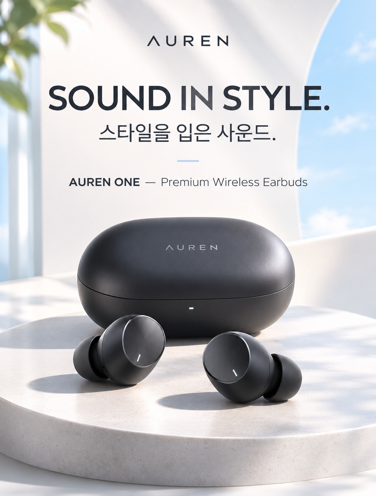
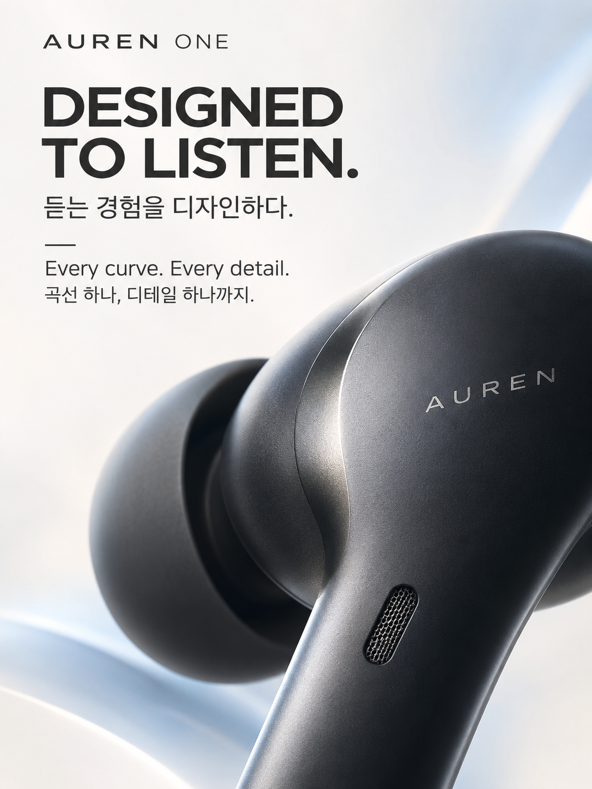
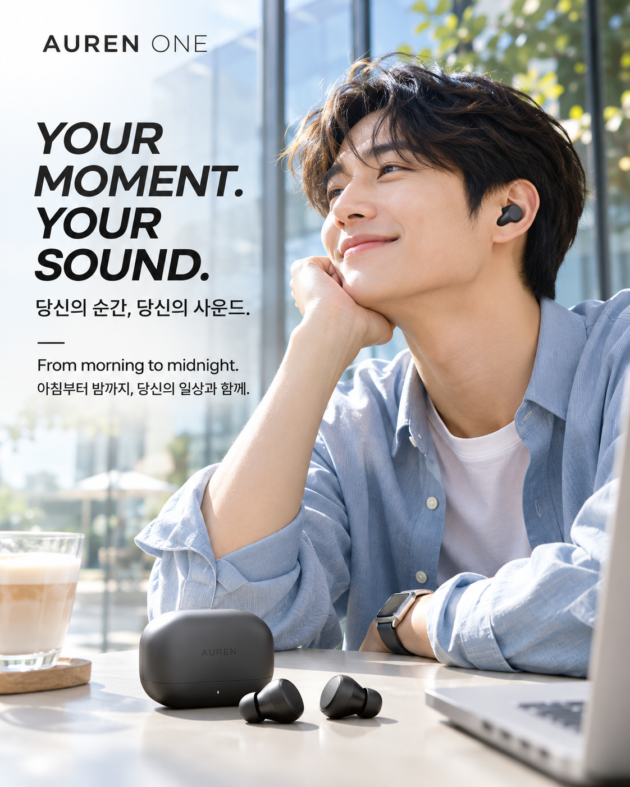
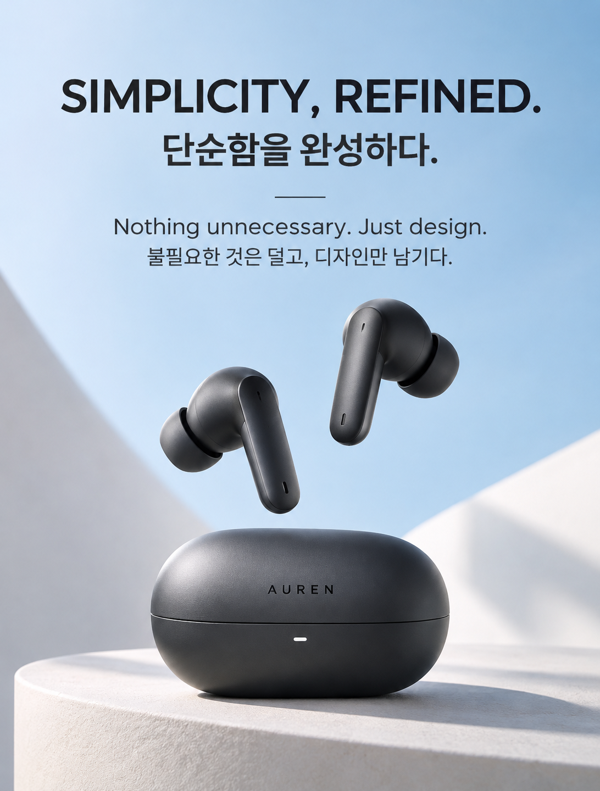
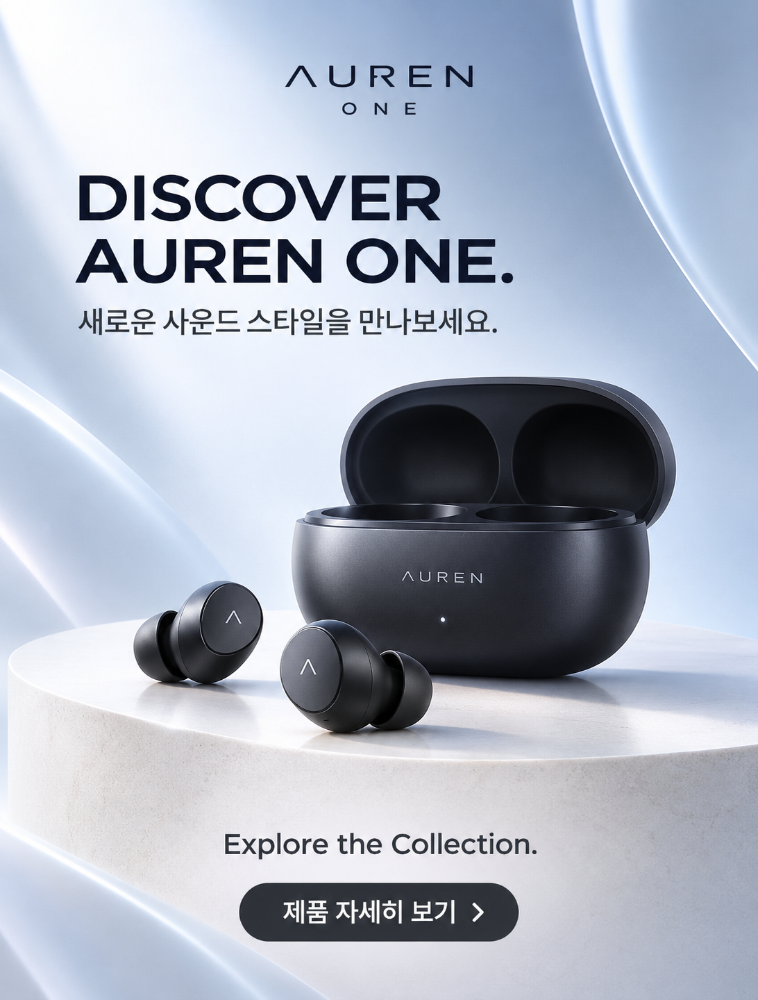
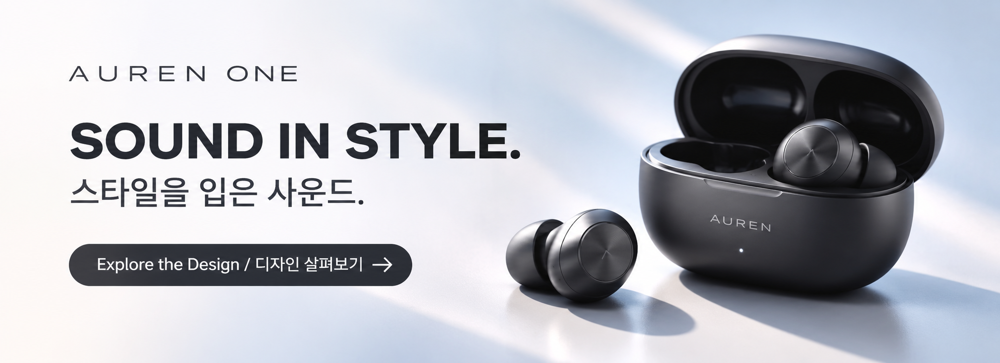

# 07. AUREN ONE — 광고 캠페인 상세 기획

## 프로젝트 개요
- 브랜드: **AUREN** (가상, 상표 사용 가능 여부 미검증)
- 제품: **AUREN ONE** 프리미엄 무선 이어버드
- 목적: 브랜드 인지도·제품 관심 유도
- 최종 타깃: **20대 중심** (초기 기획 25~45세에서 변경)
- 최종 스타일: **밝고 경쾌한 프리미엄 광고 화보**. 아이보리·스카이블루·부드러운 자연광, 그래파이트 블랙 제품 대비.
- 한국어 + 영어 병기
- 사업 포트폴리오 게시 채널: **@standon.agency**

## 브랜드 방향 변경
초기 슬로건 `BEYOND SOUND. / 소리, 그 이상의 경험.`은 폐기. 개인 취미 채널과 무관한 독립 브랜드 카피로 교체.

**현재 메인 슬로건: `SOUND IN STYLE. / 스타일을 입은 사운드.`**

## 제품 디자인 가이드
무광 그래파이트 블랙 이어버드 2개 + 둥근 타원형 충전 케이스, AUREN 워드마크, 절제된 금속 질감. **주의:** 기존 생성 시안에서 스템형/버튼형이 혼재한다. 최종 제품 형태 하나를 먼저 고정하고 모든 컷에 같은 레퍼런스를 적용해야 한다.

## 광고 이미지 6종 — 최신 밝은 톤 카피

### 01. 메인 히어로 (1080×1350)
- `SOUND IN STYLE.`
- `스타일을 입은 사운드.`
- `AUREN ONE — Premium Wireless Earbuds`
- 밝은 스카이블루·아이보리 배경, 제품 중심, 햇살과 곡선형 구조물.
- 

### 02. 디테일 (1080×1350)
- `DESIGNED TO LISTEN.`
- `듣는 경험을 디자인하다.`
- `Every curve. Every detail.` / `곡선 하나, 디테일 하나까지.`
- 매크로 제품컷, 밝은 배경과 제품 소재 대비.
- 

### 03. 라이프스타일 (1080×1350)
- `YOUR MOMENT. YOUR SOUND.`
- `당신의 순간, 당신의 사운드.`
- `From morning to midnight.` / `아침부터 밤까지, 당신의 일상과 함께.`
- 20대 모델, 햇살 드는 카페/도시 공간.
- 

### 04. 디자인 스토리 (1080×1350)
- `SIMPLICITY, REFINED.`
- `단순함을 완성하다.`
- `Nothing unnecessary. Just design.` / `불필요한 것은 덜고, 디자인만 남기다.`
- 이어버드 2개·케이스 조형적 구성.
- 

### 05. 관심 유도 (1080×1350)
- `DISCOVER AUREN ONE.`
- `새로운 사운드 스타일을 만나보세요.`
- `Explore the Collection.` / `제품 자세히 보기`
- 밝은 톤의 제품 전시·CTA. 실제 구매 링크는 없는 가상 광고.
- 

### 06. 쇼핑몰 메인 배너 (1920×700 기획 규격)
- `AUREN ONE`
- `SOUND IN STYLE.` / `스타일을 입은 사운드.`
- `Explore the Design / 디자인 살펴보기`
- 좌측 카피·우측 제품, 밝은 하늘색 배경.
- 

> **이미지 주의:** 포함된 시안의 실제 픽셀 크기는 파일별로 다를 수 있고, 일부 제품 형태가 서로 다르다. 최종 납품 규격으로 리사이즈/재구성하고 제품 디자인을 통일해야 한다.

## 색상·타이포
- 기존 기본색: Charcoal `#111318`, Graphite `#303640`, Titanium `#8B949E`, Silver `#D7D9DC`, Ivory `#F5F3EF`
- 최신 밝은 캠페인: 아이보리·연한 스카이블루·햇살, 검정 제품·문구로 명도 대비
- 영문: Inter/Montserrat, 한글: Pretendard 등 가독성 높은 산세리프
- 4:5 주요 요소는 가장자리에서 충분히 여백 확보

## 영업용 프로젝트 설명
AUREN ONE은 가상의 프리미엄 무선 이어버드를 대상으로 브랜드 콘셉트, 한영 카피, AI 제품 연출, SNS 광고 이미지 및 쇼핑몰 배너를 통합 기획한 포트폴리오 프로젝트입니다. 실제 고객 의뢰·광고 집행·성과 측정은 진행하지 않았습니다.
