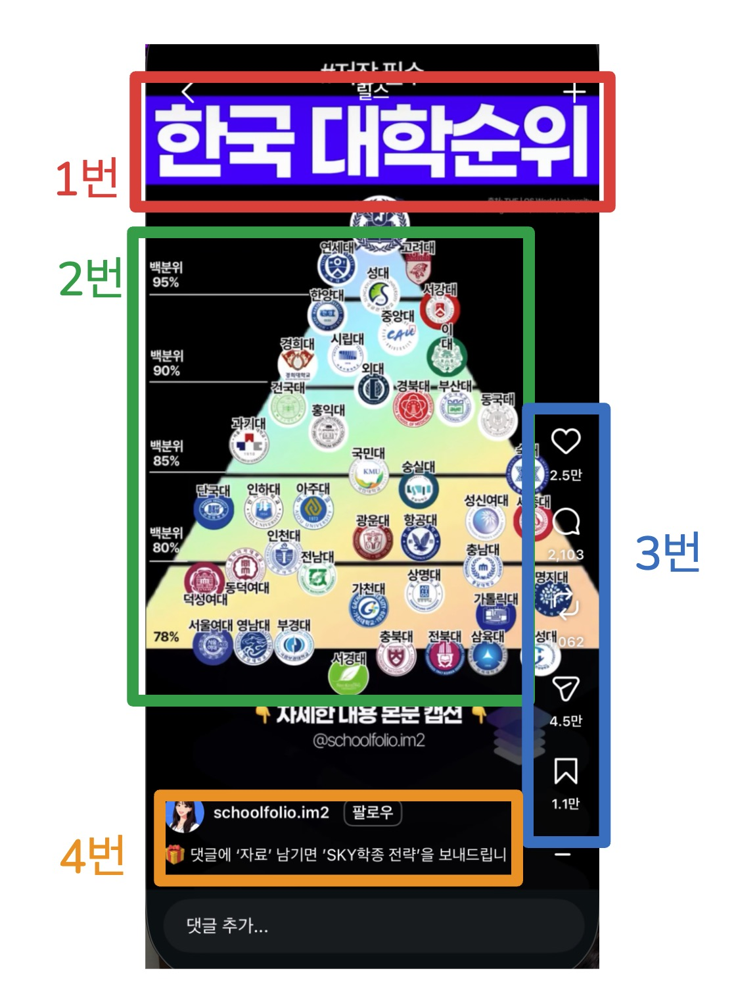

# 오파독 강의

[오파독 AI 서비스 이용 안내]

1. 오파독 AI 로그인: https://opadog.site/
🚨반드시 Gmail 계정으로 로그인해 주세요.

2. OT 설문조사 제출: https://opadog.site/ot/2026-4

3. 오파독 ai 승인 및 서비스 이용
- 설문 제출 후 가입 승인까지 약 1주일 소요됩니다.
- 승인 완료 후 오파독 AI의 서비스를 이용하실 수 있습니다.

원활한 진행을 위해 로그인 및 설문 제출을 미리 완료해 주세요. 감사합니다!

---
## 강의다시보기

1주차특강 | 숏폼제작 | 유튜브링크
:---:|---------|:---:
1주차특강 | 숏폼제작 | [[다시보기]][1주차특강] 


1주차특강: https://www.youtube.com/watch?v=RjUa2WqnvZg

---
## 1차 강의
> 오늘하는 것
> - 인스타 보면서 레퍼런스 수집
> - 계정 웜업 (좋아요, 저장, 관심있음)
> - 오파독 AI 가입, 로그인

### 1. 4주 로드램봐 운영안내
> - 1주차 : 계정세팅, 웜업, 레퍼런스 수집
> - 2주차 : 콘텐츠 자동화 제작 + 오파독 AI 오픈
> - 3주차 : 발행운영‧수익화

- 인스타그램 계정 : 
  - 디지털 크리에이터
  - 프로페셔널 프로필로 전환
  - 비즈니스
- 비즈니스 계정 id
  - @aicampaign.lab
  - @adpilot.ai
  - @nextad.ai
  - @ai2xpert.jace


### 2. 바이럴을 만드는 3가지 
> 썸네일, 정보의 질, 저장‧공유
- 썸네일이 전부
  - 돋보기 탭에서 한눈에 들어오게, 멀리서봐도 읽히면 된다.
- 조회수보다 저장‧공유 : 알고리즘은 저장을 더 세게 본다
  - 기획할 때 딱 하나만 물어본다. 이거 저장하고 싶은가?
- 캡션 첫 줄이 승부처 : 첫 줄에 행동유도(CTA, Call To Action)
  - 댓글에 '자료'남기면 'OOO전략'을 보내드립니다.
  - 저장해두고 하나씩 해보세요, 지금 바로 실철해 보세요, 친구에게 공유해보세요.
  - 첫줄만 보입니다. 나머지는 안봅니다.
- 무료 자료로 문의를 만든다.
  - 무료 자료 ⇒ 링크 유도 ⇒ 자동화 응대
  - 계정을 수익 통로로 바꾸는 지점이다. 
- 올리는 시간대
  - 오전 7~9시
  - 오후 5~8시
  - 이시간에 올리면 숙성이 되서 새벽시간에도 많이 보게 된다.


제목, 내용, 좋아요댓글수...


### Tip. 유용한 도구
- 매니챗, Manychat : 댓글 대응
- 소셜비즈, 자동화 메시지 솔루션
- Edits + 트렌드 음악 : 간편한 동영상 제작 및 편집
  - 인스타그램이 만듬
  - Edits.제작 -> 라벨을 달아준다. 노출에 도움
  - 영상안에 음악을 넣는게 아니라(무음이나 효과음만), 배경음악은 무조건 여기서 넣는다. 
  - Trending, 유행 카테고리의 음악을 고른다


- 인사이트 읽는 법
  - 영상별 유입 비율을 본다
  - 유입경로 등

### 3. 레퍼런스 찾는법
- 무엇을 볼지 
  - 검색: 관심주제와 키워드 
  - 판별: 콘텐츠의 가치와 신뢰도
  - 수집: 유용한 콘텐츠를 체계적으로 저장
- 레퍼런스 리서치
  - 돋보기탭 → 주제검색 → 스크롤하며 소리내어판별 → 좋아요 → 관심있음 → 계정진입 → 팔로우 → 추천계정 재수집
  - 관심있음, 좋아요, 저장, 팔로우 
  - 1주일간 10개와 20~30명의 팔로우
  - 5분만에 다하는 게 아니라, 사람이 보는것처럼 천천히 하라!
  - 모범영상기준 : 계정팔로워 1만명 이상, 영상 조회수 30만~100만 이상
- 카테고리는 넓게
  - 돈‧재테크 : 재테크‧투자기초, 부업‧N잡, 정부지원금‧정책, 부동산 
  - 정보‧트랜드 : AI도구 활용법, IT‧앱 꿀팁, 연예‧이슈 정리
  - 라이프 : 여행정보, 맛집‧식당 소개, 요리‧레시피 등

프로페셔날 계정
인스타내에서 저작권 이슈는 없다
들어보고 꽂히면 그냥 쓰면 된다

인사이트
영상에서 발생한 정보
왜 잘됐을까?
원인분석


### 3. 레퍼런스 찾는 법

원페이지 릴스
카드뉴스


좋아요, 저장
팔로우 만명이상
영상조회수 30만 이상


계정최적화
관심있음 100
좋아요 100
저장 100
팔로우 20~30


절대금지 3가지
  - 1. 자동 DM
  - 2. 만들자마자 자동 어볼
  - 3. 대량 팔로우


---
📌 [원페이지 릴스 · 카드뉴스 레퍼런스 계정] @all 

잘 되는 포맷을 먼저 보고, 웜업하세요!

✅ 원페이지 릴스 · 카드뉴스
https://www.instagram.com/numbers_talk_0/reels/
https://www.instagram.com/money_life_bal/reels/
https://www.instagram.com/helloheidi.trip/reels/
https://www.instagram.com/moni.toon..v/reels/
https://www.instagram.com/dasonibook/reels/
https://www.instagram.com/grow.day/reels/
https://www.instagram.com/trend_elf2/reels/
https://www.instagram.com/h0ney_news/reels/
https://www.instagram.com/workhack_daily/reels/
https://www.instagram.com/hot___click/reels/
https://www.instagram.com/jinro.n.lab/reels/
https://www.instagram.com/6a___best/reels/
https://www.instagram.com/apt_lap/reels/
https://www.instagram.com/careet.official/reels/
https://www.instagram.com/mylife_happy_elf/reels/
https://www.instagram.com/6a.war/
https://www.instagram.com/going_tothe_moon/
https://www.instagram.com/home_ford88/reels/
https://www.instagram.com/269_grand_pcxpcx/reels/
https://www.instagram.com/kangi.toon/reels/
https://www.instagram.com/flow.itself/reels/
https://www.instagram.com/successnote/
https://www.instagram.com/namui.sajeong_ssultoon/reels/

✅ 카드뉴스 전문 참고용
https://www.instagram.com/ai_margin_/
https://www.instagram.com/platformtree_/
https://www.instagram.com/sliq_ai/

---
- 챗GPT 월3만원 권장

### AI 에이전트 사용시
- 컴퓨터 유저: AI가 내 컴퓨터 화면을 보고 직접 조작
- 브라우저 컨트롤: AI가 내 브라우저를 열고 직접 클릭‧입력

---
### PART2

### 트랙3가지
트랙  | 내용
:---:|-----------
본업강화 | 내계정 키우기 + 수익화
에이전시 | 큰 수익규모, 장기고객, 마케팅
프리랜스 | 사업자 없이 가능, 수익화가 빠름
보너스‧오플 | 에이전시 매칭 플랫폼


### 실습 콘텐츠 3종
> 카드뉴스, 숏폼 릴스 영상, 광고 크리에이티브

### 실습1. 광고소재 제작봇(GPTs)
> 광고화면 이미지 

- [ChatGPT - 오파독 광고소재 제작봇][광고소재제작봇]

올리브영에서 링크하나 복사 붙힌후, 
```첨부한 링크로 광고소재 하나 만들어줘```
```모델을 추가해줘```
```남자모델로 바꿔줘```


메디큐브 -> 장원영
이미지를 올린후, 지금 이 모델처럼 아이돌스럽게 


일본풍 귀염상 

제품은 이거야 수정해줘

### 실습2. 카드뉴스 제작봇(GPTs 이미지)
> 하나의 주제를 여러장의 카드로 풀어내는 카드뉴스 제작 도구
- 기획을 먼저 보여주고 → 승인 후 → 장표별 이미지 프롬프트(JSON)를 주는 방식
- 디자인 일관성이 핵심

- 카드뉴스 제작에서 손이 많이 가는 4가지를 자동으로 처리합니다.
단계   | 내용
-------|---------------------------------------------------
기획   | 주제에 맞는 후킹, 장표별 핵심 메시지, 전체 흐름을 구성합니다.
카피   | 스크롤을 멈추게 하는 마케팅 전략 후킹(커버) + 장표별 핵심 문구를 씁니다.
디자인 | 5가지 디자인 스타일 중 주제에 맞는 1개를 제안하고, 장표마다 내용과 어울리는 그래픽까지 프롬프트에 담아 일관된 톤으로 설계합니다.
수정   | 추가 프롬프트만 입력하면 문구·정보량·디자인 톤·컬러·장수·후킹 등을 다시 조정합니다.


- [ChatGPT - 오파독 카드뉴스 제작봇][카드뉴스제작봇]


### 💡 광고소재를 더 잘 뽑는 5가지 팁

TIP | Descriptions
----|---------------------------------------
1. **제품 사진은 꼭 첨부** 하세요 | 키워드만 입력하면 비슷한 ’일반 제품’이 그려질 수 있습니다. <br/> 실제 제품 사진을 첨부하면 용기·색상·라벨을 그대로 살려 합성하기 때문에 결과물이 훨씬 정확합니다 (가장 추천하는 사용법)
2. **'제공할 정보'와 '목적'** 을 함께 주세요 | 할인율·기간·가격·타깃·톤을 같이 주면 카피가 정확해집니다 <br/> 예: “첫구매 10% 할인, 6/25~7/5, 20대 여성 타깃, 깔끔한 톤”  (봇은 주지 않은 수치·효능은 임의로 지어내지 않습니다 → 유의사항 참고)
3. **모델 유무** 를 정하세요 | 감성·브랜딩 소재는 “모델이 제품을 들고”, 세일·스펙 강조 소재는 “모델 없이 제품만, 큰 할인 숫자로”가 잘 어울립니다. <br/> 원하는 쪽을 명시하면 구도가 안정됩니다
4. **메인 카피는 짧고 강하게** | 광고는 ’한 줄’에서 승부가 납니다 <br/> “메인 카피 13자 이내로, 핵심 단어 하나만 강조해줘” 라고 요청하면 휴대폰에서도 한눈에 읽히는 소재가 나옵니다
5. **한 번에 한 가지씩 수정** 하세요 | “카피, 컬러, 모델, 배경 다 바꿔줘” 처럼 한꺼번에 요청하면 의도와 다르게 나올 수 있습니다. <br/> “이번엔 배경 컬러만”, “다음은 메인 카피만” 처럼 한 요소씩 고치면 원하는 방향으로 빠르게 수렴합니다


[광고소재제작봇]: https://chatgpt.com/g/g-6a3e590dd1b081918745fa9913b99e1e-opadog-gwanggosojae-jejagbos
[카드뉴스제작봇]: https://chatgpt.com/g/g-6a3e858d58088191be854b487e44f6d9-opadog-kadeunyuseu-jejagbos


코드로 넣는 이유
- 일관적인 이미지를 만드는데 중요
- 편집이 가능: 크레딧을 아낄수 있다
- 고퀄

MCP
- AI와 다른 프로그램 사이를 이어주는 통로
- MCP는 배관이자 통로


캡컷 : 영상편집에서 가장 많이 사용하는 툴


클로드나 챗GPT처럼

모션갤러리
오파독 멀티룸
오파독 웹빌더 

거인의어깨
자이언트숄드


Q.
오파독AI 안에 MCP기능이 들어있나요?
아니면 챗GPT처럼 별도 서비스로 등록해야 사용할 수 있나요?

Q.
자동화하려면 오파독 AI안에서만 가능한가요?

브랜딩 사업 : 1500만원~3000만원/월, 최소 6개월 -> 프로젝트 규모 최소 2~3억
예전엔 6개월 이상 걸렸지만, 지금은 하루만에 끝낸다!

마케팅 & AI


거인의 어깨
거인의 비서, Giant Agent
GTAT


강의중에 챗GPT와 클로드 언급하셨는데
두개다 서비스 구독해야 하나요?


1.웜업
2.조회수 만들기

레퍼런스 찾는게 중요하다. 결과물의 8할이 레퍼런스에서 갈립니다.
- 팔로원 1만이상 계정
- 조회수 30만~100만 이상 게시물
- 최근 것 위주
- 인스타 탐색탭 : 좋아요, 저장, 관심있음

끝까지가면 무조건 이기는 싸움!

거인의어깨에 올라타라!
거인의비서를 활용하라!


플로우는 꼭 학습하라!
- 영상편집
- 요금제가 싸다
- 제미나이 계정

채팅이 안되고, 영상이랑 이미지 2개만 생성이 된다.
[이미지]
크레딧이 안들고, 대량으로 빠르게 만든다
저장시 화질개선이 된다. 
이모지 같은 이미지는 좋으나, 실사는 어렵다.
나만의 부케이미지 모델 생성도 가능하다.


수익화 전에 - 크몽 세팅 - 
숨고: 
크몽: 전문가로 가입, 처음에는 개인으로 한다 (개인계좌로 받는다)
검색에서 "카드뉴스"
건당 4만원

그냥 캡쳐해서 개선해줘만 해도 더 잘나온다.

AI드라마 제작
원시시대, 살아남기, 영웅되기, 복수하기, 권선징악


바이럴
제작

챗GPT는 월3만원 요금제 추천해주셨는데, 
그외 클로드, MCP, FLOW, 제미나이 등 이것도 모두 유료버전으로 등록해야 할까요?
오파독AI 안에서 되는거와 별도로 가입 혹은 구독해야 되는게 뭔지 정리좀 ^^

AI가 다 알아서 하는데 직원은 있으신지?


Q. 구독해야할 서비스들이 많은데, 정리좀 부탁드려도 될까요?
챗GPT : 월3만원


도파민
거인의어깨 < 거인의비서
올마이즈
교육 > 수강생 > 수수료
영업수수료 10~15%
프리랜스 양성
단계별 서비스매출
아부다비? 미국에도 똑같이 광고

멘토...


브랜드 : standon.agency / 스탠던.에이전시
G-메일 : standon.agencyk@gmail.com
철학 : 거인의 어깨, 보다 멀리 보다 빠르게


