🏠 > [ai_agent](../../) > [opadog](../) > **오파독AI | Summary Notes 1**

<table>
  <tr>
    <td><a href="./">[오파독]</a></td>
    <td><b href="S01_notes.md">노트1</b></td>
    <td><a href="S02_notes.md">노트2</a></td>
    <td><a href="S03_notes.md">노트3</a></td>
    <td><a href="S04_notes.md">노트4</a></td>
    <td><a href="S05_notes.md">노트5</a></td>
    <td><a href="S06_notes.md">노트6</a></td>
    <td><a href="S07_notes.md">노트7</a></td>
  </tr>
</table>

---
# 오파독 1주차 정규강의 — GitHub 강의 요약 노트

> **오늘은 인스타를 보는 게 전부입니다.**  
> 원본: `오파독 1주차 정규강의.pdf` (43페이지)  
> 목표: 인스타그램 콘텐츠를 제작하기 전에 **계정 준비·주제 선정·레퍼런스 수집·안전한 워밍업·발행 관리**를 익힌다.

> [!IMPORTANT]
> 이 문서는 첨부 강의 슬라이드에 근거한 학습용 요약입니다. 플랫폼 규칙, 노출 시간, 팔로우 수량, 계정 정지 위험에 관한 설명은 **강의 당시의 권고·예시**이지 인스타그램의 공식 보장 기준은 아닙니다. 특히 인위적 참여 유도·대량 활동은 플랫폼 정책을 준수해야 합니다.

## 목차

1. [강의 개요와 4주 로드맵](#1-강의-개요와-4주-로드맵)
2. [바이럴을 만드는 3가지](#2-바이럴을-만드는-3가지)
3. [레퍼런스 찾는 법](#3-레퍼런스-찾는-법)
4. [계정 지키는 법](#4-계정-지키는-법)
5. [콘텐츠 발행 관리](#5-콘텐츠-발행-관리)
6. [이번 주 과제](#6-이번-주-과제)
7. [실습용 프롬프트](#7-실습용-프롬프트)
8. [실행 체크리스트](#8-실행-체크리스트)

---

## 1. 강의 개요와 4주 로드맵

**오늘 하는 일:** 인스타그램 레퍼런스 수집, 계정 워밍업(좋아요·저장·관심 있음), 오파독 AI 가입 및 로그인. **오늘 하지 않는 일:** 콘텐츠 제작, 영상 업로드, 오파독 AI 기능 사용. (3쪽)

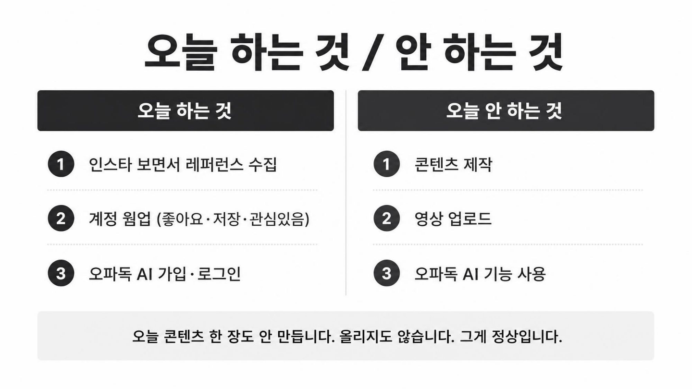

### 4주 로드맵 (6쪽)

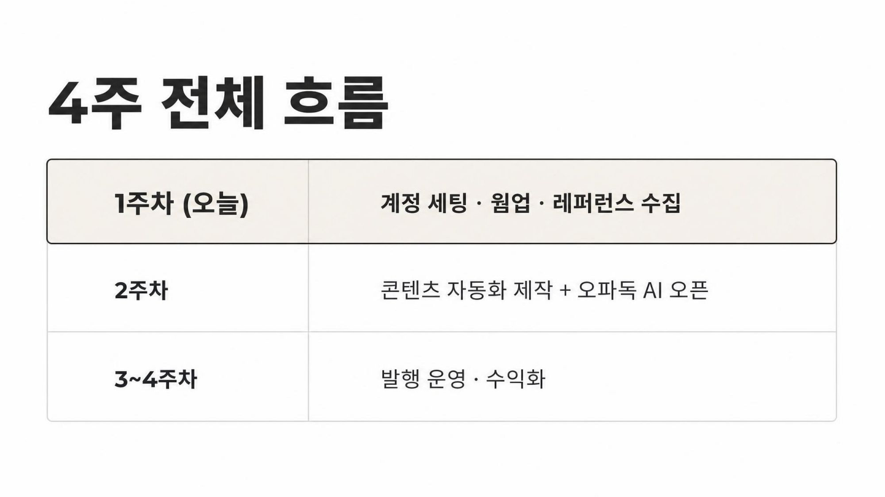

| 주차 | 강의상 목표 |
|---|---|
| 1주차 | 계정 세팅·워밍업·레퍼런스 수집 |
| 2주차 | 콘텐츠 자동화 제작 + 오파독 AI 오픈 |
| 3~4주차 | 발행 운영·수익화 |

### 과제 진행 구조 (7~10쪽)

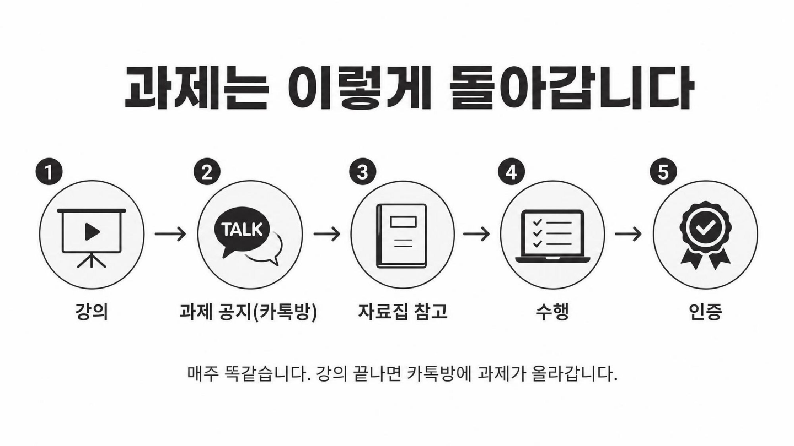

`강의 → 과제 공지(카톡방) → 자료집 참고 → 수행 → 인증`

- **1주차:** 실습만 수행하며 제출·인증은 없음. **2주차부터 인증 시작.** (8쪽)
- 소통방은 서로 존중하고 스팸·홍보·불필요한 링크를 피한다. (9쪽)
- 오파독 AI는 **1주차 가입만**, 기능 사용은 2주차부터로 안내한다. (10쪽)

## 2. 바이럴을 만드는 3가지

**원본 11~19쪽**

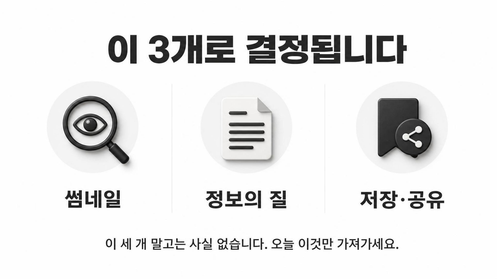

1. **썸네일:** 첫 화면에서 주제와 가치를 바로 알아볼 수 있는가? (13쪽)
2. **정보의 질:** 조회수뿐 아니라 **저장·공유**할 만한 실용성이 있는가? (14쪽)
3. **저장·공유 유도:** 캡션 첫 줄에 자연스러운 행동 유도(CTA)를 넣는가? (15쪽)

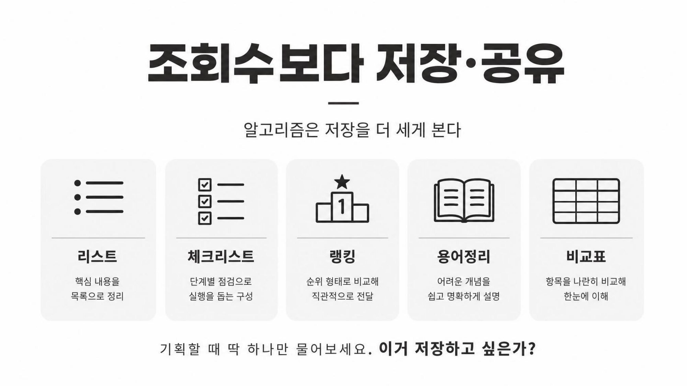

강의의 CTA 예: “저장해두고 하나씩 해보세요”, “지금 바로 실천해보세요”, “친구에게 공유해보세요”. 과도한 참여 유도 대신 실제 콘텐츠 가치와 연결한다.

### 콘텐츠와 계정의 연결

- 무료 자료 → 링크 유도 → 후속 안내의 퍼널을 소개한다. (16쪽)
- 강의가 소개한 게시 시간은 **오전 7~9시 / 오후 5~8시**. 실제 최적 시간은 **내 계정 인사이트**로 확인한다. (17쪽)
- Edits 및 트렌드 음악 사용 사례를 소개한다. 플랫폼에서 제공되는 기능·음원 사용 가능 범위는 계정 유형에 따라 다를 수 있다. (18쪽)
- 인사이트에서 **탐색 탭 유입과 팔로워 유입 비율**을 비교한다. (19쪽)

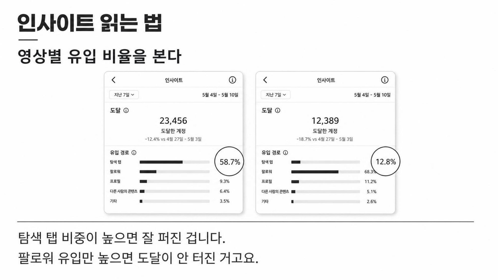

## 3. 레퍼런스 찾는 법

**원본 20~28쪽**

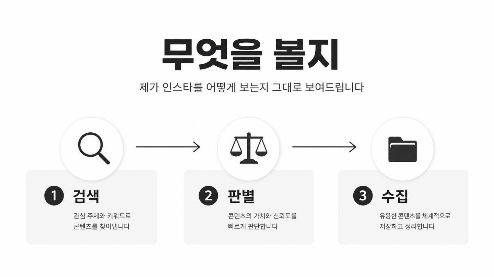

**검색 → 판별 → 수집** 순서로 진행한다.

### ① 검색

- 돋보기에서 관심 주제 키워드 검색 → 스크롤하면서 패턴 관찰. (22쪽)
- 움직이는 영상·원페이지 텍스트·카드뉴스를 각각 구분한다.
- 강의는 움직이는 영상·원페이지 텍스트를 수작업 제작할 영역, 카드뉴스·배경 정지를 자동화 가능한 영역으로 나누어 설명한다.

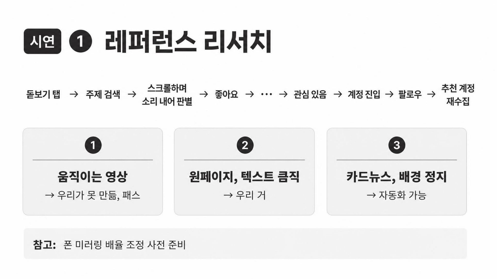

### ② 판별

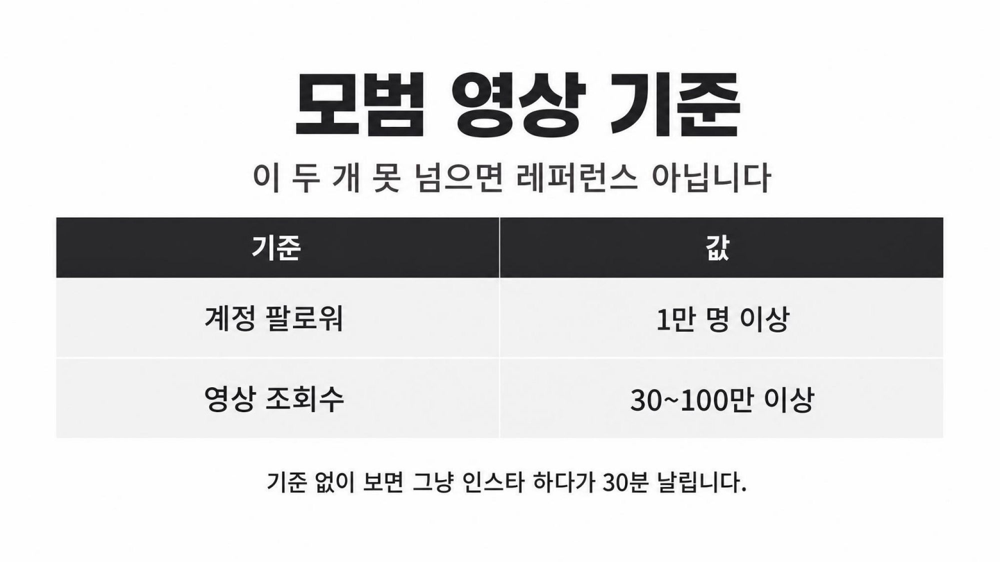

강의의 모범 영상 참고 기준: **계정 팔로워 1만 명 이상, 영상 조회수 30만~100만 이상**. 이는 **강의의 선별 기준**이지 성공을 보장하는 플랫폼 공식 기준은 아니다.

- 주제는 좁은 분야보다 잠재 시청자가 넓은 카테고리에서 시작. 예: ‘야구’보다 ‘스포츠’. (24쪽)
- 강의 추천 주제 30선은 **뷰티·건강, 돈·재테크, 자기계발·마인드, 정보·트렌드, 라이프**로 나뉜다. (25~26쪽)
- 관심 있는 주제 하나를 고르고, 유사 계정·게시물을 비교한다.

### ③ 수집과 워밍업

강의는 5일간 관심 있음 100회, 좋아요 100회, 저장 100회, 레퍼런스 계정 팔로우 20~30개를 제시한다. **이는 강의의 실습 목표**이며 대량·반복 활동을 권장하는 공식 정책이 아니다. (27쪽)

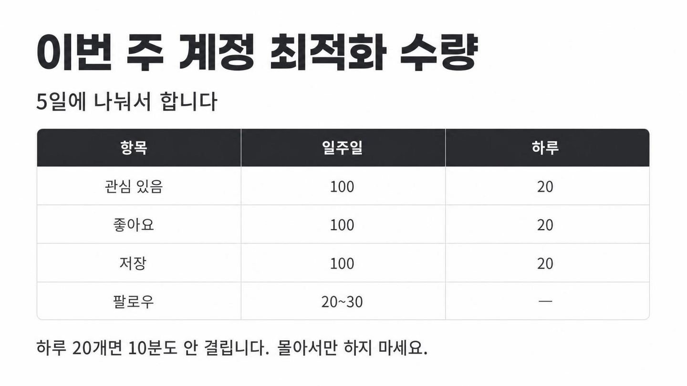

‘관심 있음’은 게시물 메뉴에서 선택하여 추천 피드에 관심 주제를 반영하는 기능으로 설명한다. (28쪽)

## 4. 계정 지키는 법

**원본 29~35쪽**

- 강의는 신규 계정에 과도한 자동화나 대량 활동을 하면 정지 위험이 있다고 경고한다. (30쪽)
- 위험 패턴으로 **만들자마자 자동 업로드·봇 판정**, 좋아요/관심 있음 몰아하기, 무분별한 대량 팔로우, 동일 콘텐츠 반복 업로드를 제시한다. (31쪽)

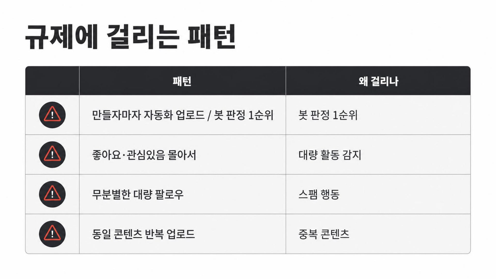

### 강의에서 금지한 3가지 (32쪽)

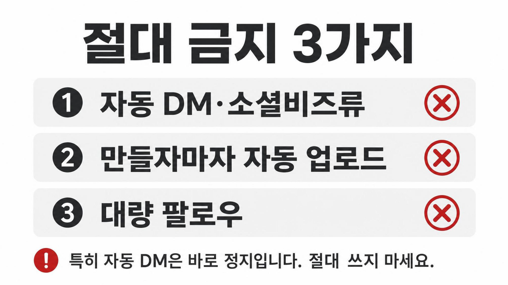

1. 자동 DM·소셜비즈류 사용
2. 만들자마자 자동 업로드
3. 대량 팔로우

### 첫 달 운영 원칙 (33~35쪽)

- **첫 한 달 수기 운영** 후 필요 시 자동화를 점진적으로 검토한다.
- 인스타 계정은 다시 만들 수 있지만 추천 시스템 학습은 처음부터 다시 시작될 수 있다고 설명한다.
- 휴대폰 한 대에서 **2~3개 계정까지**를 강의상 허용 예시로 제시하지만, 이는 인스타그램 공식 계정 제한을 뜻하지 않는다.
- **실무 적용:** 공식 정책을 우선하고, 동일 행동의 반복·비정상적 빈도·스팸성 자동화를 피한다.

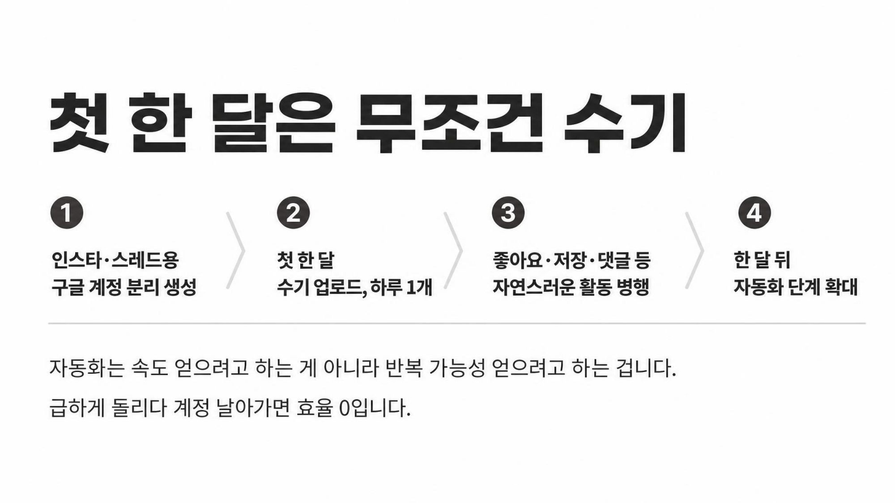

## 5. 콘텐츠 발행 관리

**원본 36~38쪽**

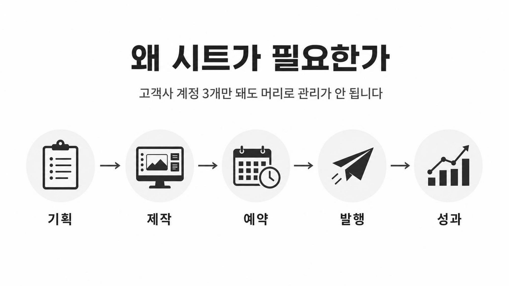

강의의 관리 흐름: **기획 → 제작 → 예약 → 발행 → 성과**. 여러 고객사나 계정의 게시물을 머리로만 기억하지 말고 시트에 기록한다. (37쪽)

### 마스터 시트 시연 (38쪽)

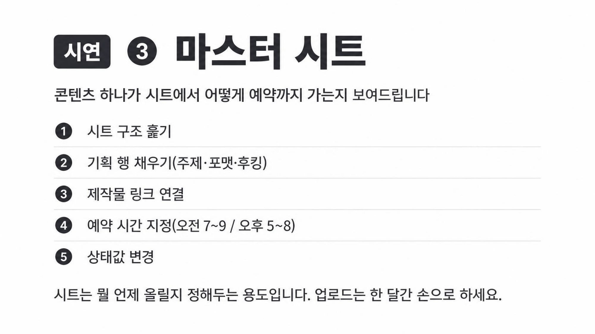

1. 시트 구조 열기
2. 기획 행 채우기: **주제·포맷·후킹**
3. 제작물 링크 연결
4. 예약 시간 지정: 강의 예시 **오전 7~9시 / 오후 5~8시**
5. 상태값 변경

**운영용 표 예시 (노트 작성용 제안):**

| 날짜 | 계정 | 주제 | 포맷 | 후킹 | 파일 링크 | 예약 | 상태 | 성과 |
|---|---|---|---|---|---|---|---|---|
| YYYY-MM-DD | 계정A | 주제 | 카드뉴스 | 첫 문장 | URL | 08:00 | 기획 | - |

## 6. 이번 주 과제

**원본 39~43쪽**

- 프로필 이름: **한글 2~3글자**, 소개글 **2~3줄**, 이미지 **AI 활용** 예시. (40쪽)
- 리틀리 설정은 별도 영상 자료로 따라 하기. (40쪽)

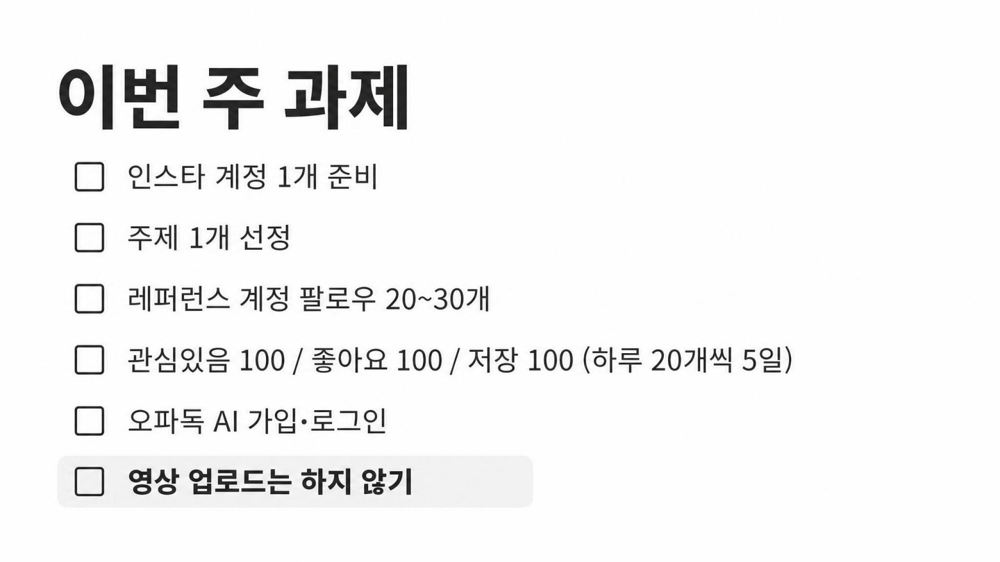

- [ ] 인스타그램 계정 1개 준비
- [ ] 주제 1개 선정
- [ ] 레퍼런스 계정 20~30개 팔로우 *(강의 제시 수량, 정책·안전 우선)*
- [ ] 관심 있음 100 / 좋아요 100 / 저장 100 *(하루 20개씩 5일이라는 강의 실습안; 인위적 반복 행동 주의)*
- [ ] 오파독 AI 가입·로그인
- [ ] **영상 업로드는 하지 않기**

강의는 **2주차에 콘텐츠 자동화**를 본격적으로 시작한다고 예고한다. (42쪽)

## 7. 실습용 프롬프트

> **아래 문구는 원본에 직접 실린 프롬프트가 아니라, 강의 내용을 복습하기 위해 새로 작성한 보조 프롬프트**입니다. 1주차 정규강의는 주로 인스타 앱 안에서 직접 실습합니다.

### 주제 선택

```text
인스타그램 정보형 계정을 새로 시작하려고 합니다.
관심 분야는 [관심 분야]입니다.
강의의 5개 카테고리(뷰티·건강, 돈·재테크, 자기계발·마인드,
정보·트렌드, 라이프)에 맞춰 주제 5개를 제안하고
각 주제의 타깃·저장할 만한 정보·차별화 포인트를 표로 정리해줘.
```

### 레퍼런스 분석

```text
다음 인스타그램 게시물의 공개 정보와 내가 제공한 화면을 바탕으로
썸네일, 정보의 질, 저장·공유 가치, 후킹, 포맷을 분석해줘.
확인할 수 없는 조회수·참여율은 추정하지 말고 표시해줘.
게시물: [링크 또는 캡처]
```

### 프로필 문구

```text
인스타그램 계정의 주제는 [주제]이고 타깃은 [대상]이야.
프로필 이름 후보 5개와 소개글 2~3줄 버전 5개를 작성해줘.
과장된 수익·성과 약속은 피하고 계정의 제공 가치를 분명히 해줘.
```

### 마스터 시트

```text
인스타그램 콘텐츠 관리용 시트 컬럼을 설계해줘.
기획 → 제작 → 예약 → 발행 → 성과 단계를 추적하고,
주제·포맷·후킹·파일 링크·예약 시간·상태를 포함해줘.
```

## 8. 실행 체크리스트

- [ ] 4주 로드맵과 이번 주 범위 이해
- [ ] 인스타그램 계정 준비·프로필 기본 설정
- [ ] 관심 주제 1개 결정
- [ ] 레퍼런스 조사: 검색 → 판별 → 수집
- [ ] 썸네일·정보의 질·저장/공유 관점으로 분석
- [ ] 인사이트에서 유입 경로 보는 법 익히기
- [ ] 계정 안전 수칙 숙지 (자동 DM·대량 활동·반복 업로드 금지)
- [ ] 콘텐츠 발행 마스터 시트 구조 이해
- [ ] 오파독 AI 가입·로그인
- [ ] 이번 주는 콘텐츠 제작·업로드하지 않기

---

**핵심 한 줄:** 1주차 정규강의는 **콘텐츠를 만들기 전에 좋은 레퍼런스를 보는 눈과 안전한 계정 운영 습관을 갖추는 시간**이다.

**출처:** `오파독 1주차 정규강의.pdf` (43쪽). 원본 슬라이드 이미지는 강의 복습용으로 발췌했으며, 공개 GitHub에 게시할 때는 재배포 권한을 확인하세요.
