🏠 > [ai_agent](../../) > [opadog](../) > **오파독AI | Summary Notes 2**

<table>
  <tr>
    <td><a href="./">[오파독]</a></td>
    <td><a href="S01_notes.md">노트1</a></td>
    <td><b href="S02_notes.md">노트2</b></td>
    <td><a href="S03_notes.md">노트3</a></td>
    <td><a href="S04_notes.md">노트4</a></td>
    <td><a href="S05_notes.md">노트5</a></td>
    <td><a href="S06_notes.md">노트6</a></td>
    <td><a href="S07_notes.md">노트7</a></td>
  </tr>
</table>

---
# 오파독 1주차 특별강의 — GitHub 학습 노트

> **오늘 바로 만들어 봅니다** · 원본: `오파독 1주차 특별강의.pdf` (38페이지)  
> 핵심: **운영 규칙 → 나에게 맞는 트랙 → 카드뉴스·원페이지 릴스·광고 소재 제작 → 수익화 연결**

> [!NOTE]
> 이 노트는 강의의 슬라이드 내용을 학습용으로 재구성했습니다. 수익 사례, 도구 지원, 링크 및 정책은 강의 당시 설명이며 최신 상태나 수익을 보장하지 않습니다. 실습에 쓰는 프롬프트는 원본의 취지를 살린 **학습용 재작성 예시**입니다.

## 목차

- [강의 전체 지도](#강의-전체-지도)
- [PART 1 · 필수 준수 수칙](#part-1--필수-준수-수칙)
- [PART 2 · 나에게 맞는 트랙](#part-2--나에게-맞는-트랙)
- [PART 3 · 지금부터 실습](#part-3--지금부터-실습)
- [PART 4 · 콘텐츠 3종 제작](#part-4--콘텐츠-3종-제작)
- [수익화 연결 · 크몽과 숨고](#수익화-연결--크몽과-숨고)
- [PART 5 · 무료 도구와 다음 단계](#part-5--무료-도구와-다음-단계)
- [실습 프롬프트](#실습-프롬프트)
- [체크리스트](#체크리스트)

## 강의 전체 지도

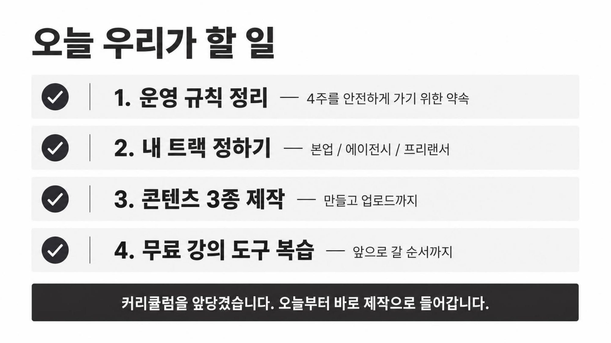

강의는 **운영 규칙 정리 → 트랙 정하기 → 콘텐츠 3종 제작 → 무료 강의 도구 복습** 순서입니다(2쪽). 실습 결과물은 **카드뉴스, 원페이지 릴스, 광고 소재**이며 GPT 또는 Gemini 로그인 계정을 준비합니다(3쪽).

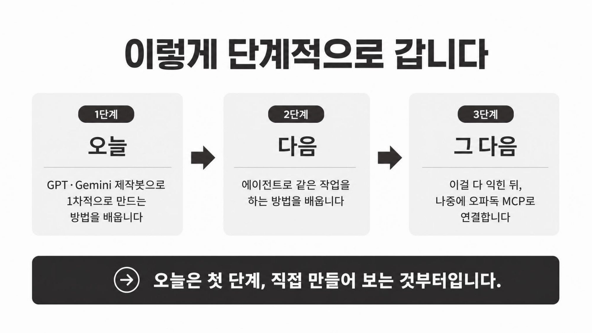

1. **오늘:** GPT·Gemini 채팅창으로 직접 결과물 1개 제작.
2. **다음:** 에이전트에 같은 작업을 시키는 방법 학습.
3. **그다음:** 오파독 MCP 연결.

강의는 직접 제작 순서를 알아야 이후 에이전트에게 정확히 지시할 수 있다고 강조합니다(5쪽). 새로운 AI 도구를 전부 배울 필요 없이 강의에서 지정한 흐름부터 익히라고 권합니다(6쪽).

### 선배 사례의 의미 (9~10쪽)

강의에는 **2달 만에 1,300만 원+, 850만 원+, 650만 원+** 등의 선배 사례가 소개됩니다. 원본에도 **사례 개별 인증 캡처 예시 참조**라고 표시되어 있습니다. 이는 개별 사례이지 평균 수익이나 달성 보장이 아닙니다. 공통 조언은 **카드뉴스 한 장부터 만들고, 고객을 기다리기보다 제안하며, 꾸준히 시도하라**는 것입니다.

## PART 1 · 필수 준수 수칙

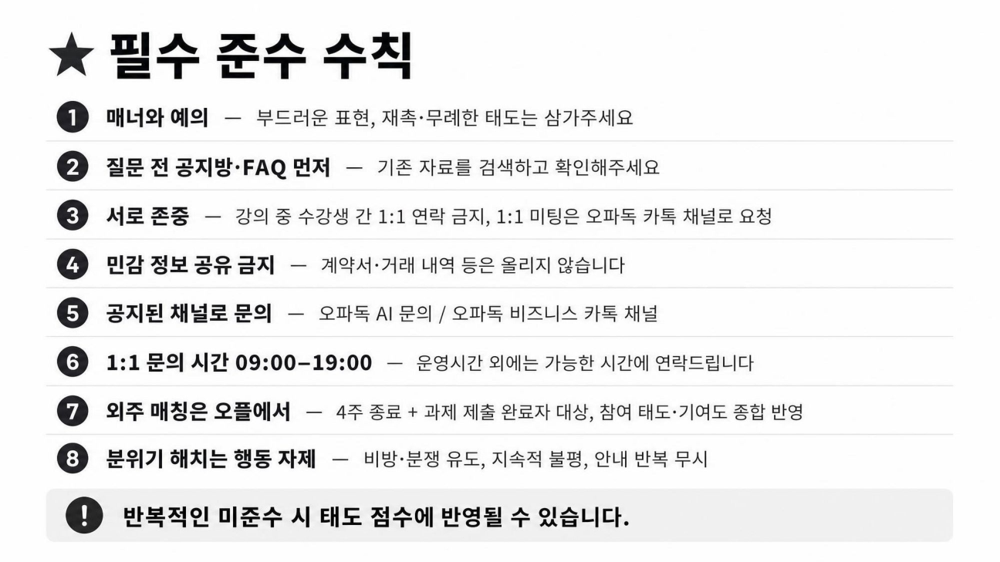

**원본 11~16쪽**

| 구분 | 강의 규칙 |
|---|---|
| 매너와 예의 | 부드러운 표현, 재촉·무례한 태도 지양 |
| 질문 전 검색 | FAQ → 공지방 → 강의자료 → 그래도 모르면 질문 |
| 서로 존중 | 강의 중 수강생 간 1:1 연락 금지, 1:1 미팅은 오파독 카톡 채널 요청 |
| 정보 보호 | 계약서·거래 내역 등 민감 정보 외부 공유 금지 |
| 공식 문의 | 오파독 AI 문의 / 오파독 비즈니스 카톡 채널 |
| 1:1 문의 | 강의 안내 시간 **09:00~19:00** |
| 외주 매칭 | 4주 종료 + 과제 제출 완료자 대상, 참여 태도·기여도 반영 |
| 행동 자제 | 비방·분쟁 유도·지속적 불평·안내 반복 무시 금지 |

반복적인 미준수 시 태도 점수에 반영될 수 있다고 안내합니다. **가점·감점 범위 -100~+100**을 제시하며 질문 답변, 과제 제출, 커뮤니티 기여를 가점 사례로 소개합니다(15쪽). 소통방 활동은 기록되며 초기에는 참여를 연습하는 것이 목적이라고 설명합니다(16쪽).

### 사칭·결제 사기 주의 (13쪽)

- 오파독을 사칭하는 사례가 있었다고 경고합니다.
- 개인에게 별도로 돈을 요구하지 않는다고 안내합니다.
- 공지된 공식 채널이 아닌 곳에서 결제를 요구하면 운영진에게 확인합니다.

### 질문 양식 (14쪽)

```text
[기수] / [실명] / [연락처 뒤 4자리]
질문: [문제 상황]
이미 확인한 자료: [FAQ / 공지 / 강의자료]
시도한 방법: [단계와 결과]
```

**주의:** 이 양식은 강의의 공식 질문 채널용입니다. 공개 GitHub 이슈나 README에 실명·연락처를 적지 마세요.

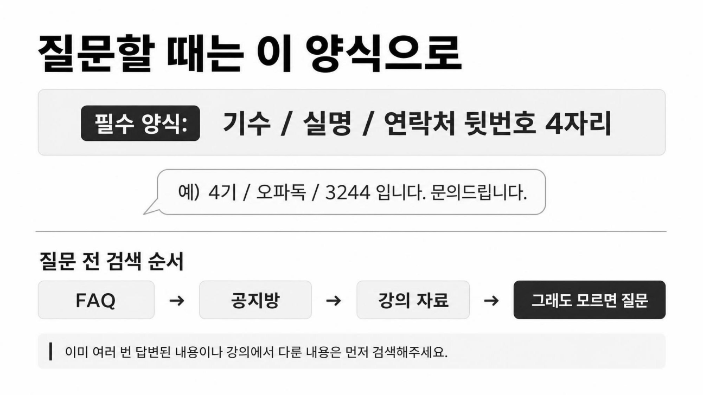

## PART 2 · 나에게 맞는 트랙

**원본 17~23쪽**

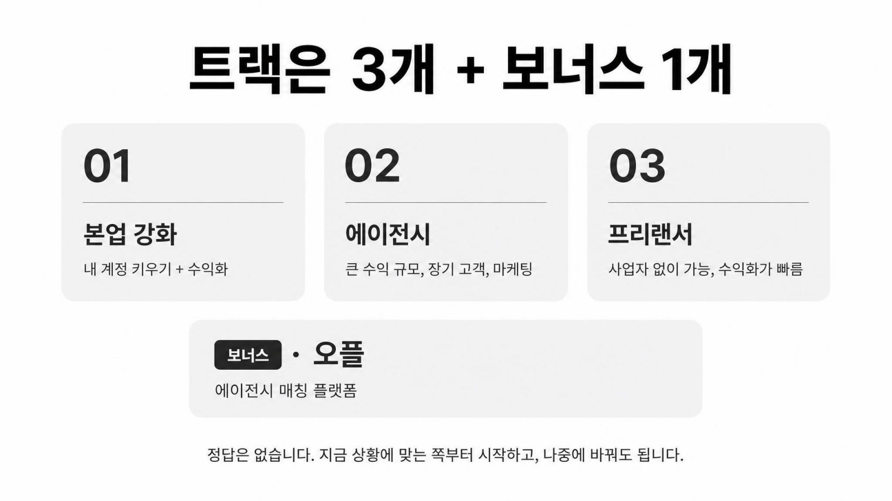

| 트랙 | 목표 | 적합한 출발점 |
|---|---|---|
| **01 본업 강화** | 내 계정·브랜드·상품·서비스의 수익화 | 이미 경험·전문성·사업이 있는 경우 |
| **02 에이전시** | 고객 발굴 → 제안·계약 → 장기 운영대행 수익 | 직접 고객과 일하고 사업 규모를 키우고 싶은 경우 |
| **03 프리랜서** | AI 콘텐츠 제작 → 가벼운 부업 수익 | 부담 없이 제작 기술로 첫 수익을 만들고 싶은 경우 |
| **보너스 오플** | 오파독 에이전시 매칭 플랫폼 | 강의 중 순차적으로 활성화한다고 안내 |

### 트랙 선택 설문 (19~21쪽)

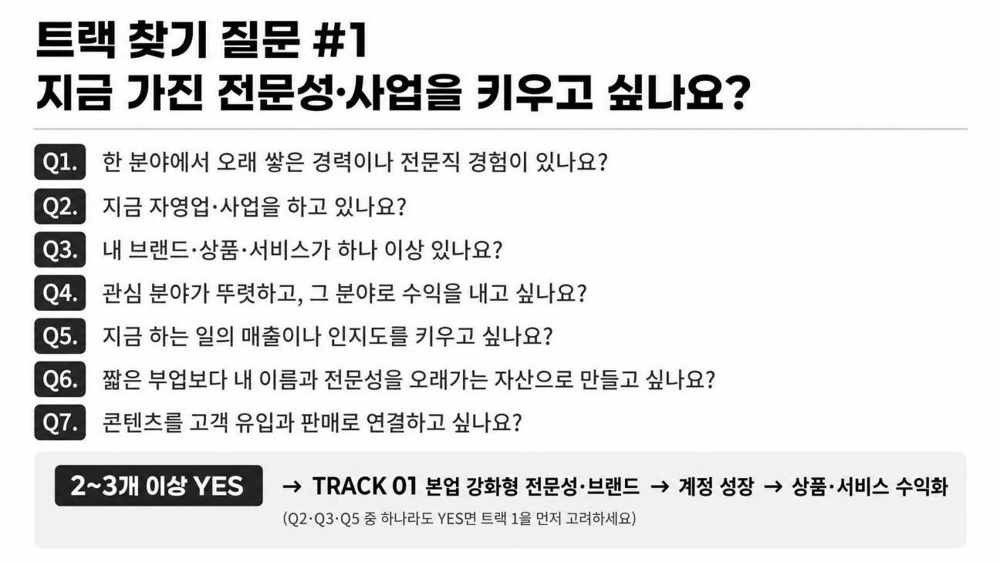

- **본업 강화:** 기존 경험·전문 분야, 현재 사업, 내 브랜드, 장기 자산, 콘텐츠와 고객 유입 연결 등에 대한 질문 7개. **2~3개 이상 YES**면 트랙 01 검토. 특히 Q2·Q3·Q5 중 하나라도 YES면 고려하도록 안내합니다.
- **에이전시:** 고객 직접 발굴, 제안, 계약, 운영·관리, 문제 해결, 수익 확대 의향 등 7개. **2~3개 이상 YES**면 트랙 02 검토. 특히 Q2·Q4·Q5 중 하나라도 YES면 고려하도록 안내합니다.
- **프리랜서:** 본업 병행, 소규모 시작, 빠른 첫 수익, 정해진 시간에 집중, AI 콘텐츠 제작 선호 등 7개. **2~3개 이상 YES**면 트랙 03 검토. 특히 Q1·Q2·Q7 중 하나라도 YES면 고려하도록 안내합니다.

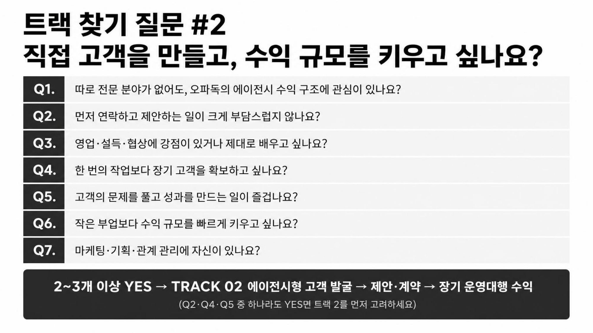
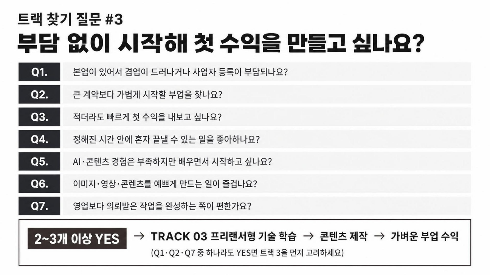

정답은 없으며 지금 상황에 맞는 트랙으로 시작한 뒤 바꿔도 된다고 설명합니다.

### 오플 매칭과 개인별 진단 (22~23쪽)

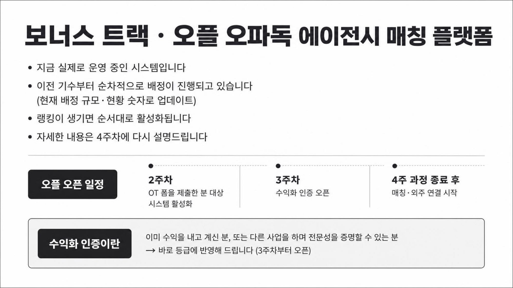

강의에서는 오플이 실제 운영 중이며 이전 기수부터 순차 배정 중이라고 설명합니다. 안내 일정은 **2주차: OT 제출 완료 대상 시스템 활성화 → 3주차: 수익화 인증 오픈 → 4주차 최종 종료 후 매칭·외주 연결 시작**입니다. 이는 강의 당시 일정입니다.

개인별 진단서는 사전조사 설문을 기반으로 **트랙 방향·수익화 방향**을 제안하는 1~2페이지 PDF이며 2~3주차 중 배포 예정이라고 안내합니다(23쪽).

## PART 3 · 지금부터 실습

**원본 24~27쪽**

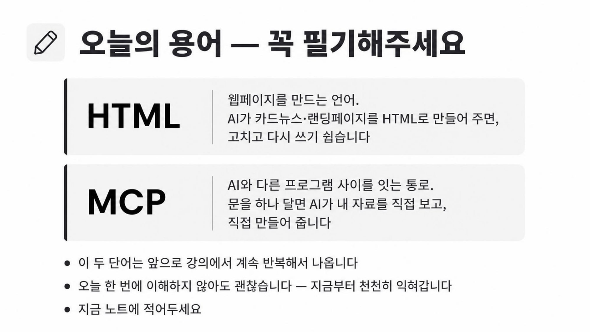

- **HTML:** 웹페이지를 만드는 언어. AI가 카드뉴스·랜딩페이지를 HTML로 만들면 나중에 고치고 다시 쓰기 쉽습니다.
- **MCP:** AI와 다른 프로그램·사이트를 연결하는 통로. AI가 자료를 보고 작업을 수행하는 연결 방식입니다.
- 오늘은 **구글 계정과 GPT 로그인** 두 가지로 실습할 수 있으며, 오파독 AI는 이번 주에 가입만 하고 과제 제출도 없다고 안내합니다(26쪽).

### 강의 제공 자료집 6종 (27쪽)

1. 카드뉴스 제작봇 (GPTs 이미지)
2. 카드뉴스 제작봇 (GPTs HTML)
3. 원페이지 릴스봇 (Gems)
4. 원페이지 릴스봇 (GPTs)
5. 광고 소재 제작봇 (Gems)
6. 광고 소재 제작봇 (GPTs)

실제 자료집 파일·공유 URL은 PDF에 실려 있지 않으므로 별도로 확보해야 합니다.

## PART 4 · 콘텐츠 3종 제작

**원본 28~35쪽**

### 레퍼런스를 먼저 찾는다 (30쪽)

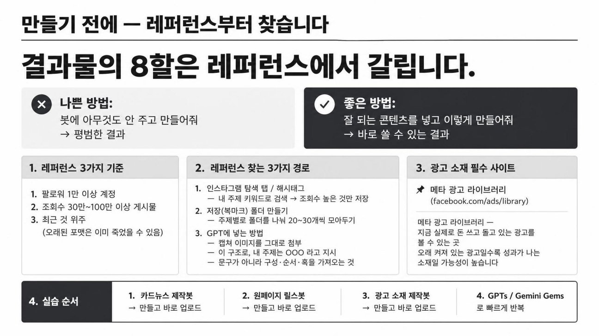

강의의 메시지: **결과물의 8할은 레퍼런스에서 갈린다.** 아무것도 보여주지 않고 만들라고 하는 것보다 잘 만든 예시를 보여주고 원하는 구조를 설명하는 편이 유리합니다.

**레퍼런스 3가지 기준:** 팔로워 1만 이상 계정 / 조회수 30만~100만 이상 게시물 / 최근 2주 위주. 이는 강의가 제시한 *탐색 기준*이지 성과 보장이 아닙니다.

**찾는 경로:** 인스타그램 릴스·해시태그, 직접 관찰한 콘텐츠, GPT를 통한 이미지·구조 분석, 메타 광고 라이브러리 `https://www.facebook.com/ads/library/`.

**실습 순서:** 카드뉴스 제작봇 → 원페이지 릴스봇 → 광고 소재 제작봇 → GPTs/Gemini Gems 비교.

### ① 카드뉴스 제작봇 (31쪽)

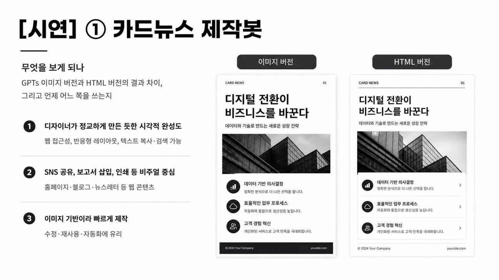

- **이미지 버전:** 디자인을 빠르게 확정하고 완성 이미지를 얻기 좋음.
- **HTML 버전:** 글자·구성·이미지를 다시 수정하고 재사용하기 좋음.
- 목적: 디자인 이해와 SNS 공유·보고서 삽입에 쓸 콘텐츠 제작.

### ② 원페이지 릴스봇 (32쪽)

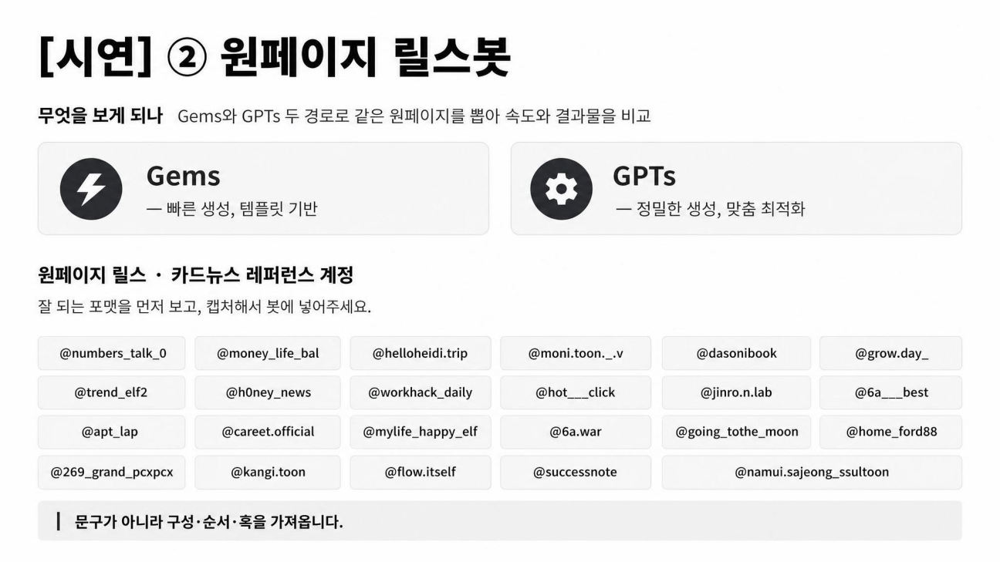

Gems와 GPTs로 같은 원페이지 릴스를 만들어 결과를 비교합니다. 원본은 여러 참고 계정을 보여주며, **문구뿐 아니라 구성·순서·호흡**을 가져오라고 안내합니다. 원본 영상·문구를 그대로 복제하지 말고 본인 주제에 맞춰 새로 제작하세요.

### ③ 광고 소재 제작봇 (34쪽)

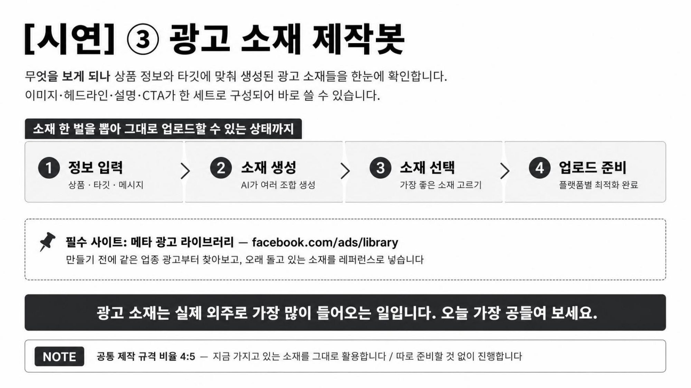

1. 상품 정보·타깃·레퍼런스 입력.
2. AI로 광고 이미지·헤드라인·설명·CTA 생성.
3. 여러 시안 중 선택.
4. 최종 이미지와 문구를 검토해 업로드 준비.

강의는 광고 소재를 **실제 외주에서 많이 들어오는 작업**이라고 설명하고, **4:5 비율**로 광고용·공동구매용 소재를 제작하는 실습을 제시합니다.

### FLOW 대량 생산 (35쪽)

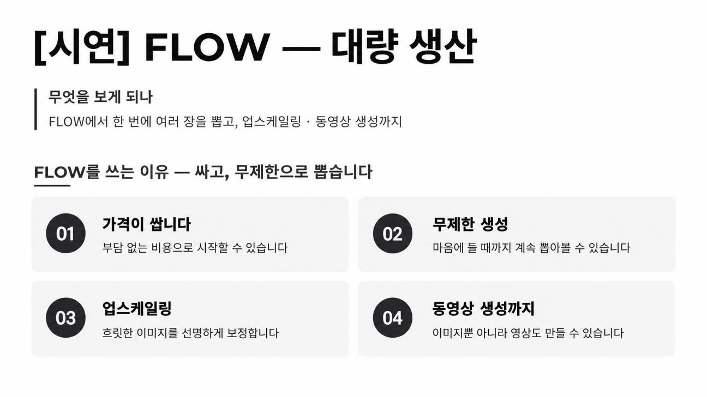

FLOW는 강의에서 **저렴한 비용, 무제한 생성, 업스케일링, 동영상 생성**을 장점으로 소개합니다. 이는 강의 당시 설명이며 실제 서비스별 요금·한도는 확인이 필요합니다.

## 수익화 연결 · 크몽과 숨고

**원본 36~37쪽**

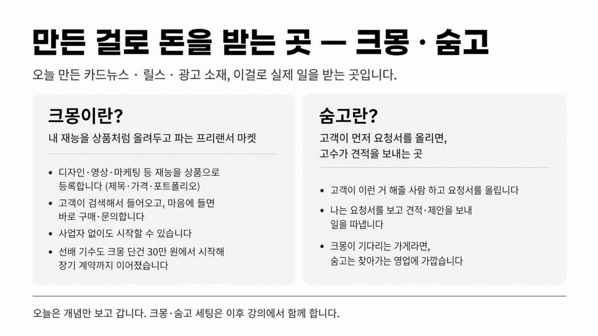

| 플랫폼 | 강의의 설명 | 판매 연결 방식 |
|---|---|---|
| **크몽** | 내 재능을 상품처럼 등록하는 프리랜서 마켓 | 고객이 상품 검색 → 문의·구매 |
| **숨고** | 고객이 요청서를 올리면 전문가가 견적을 보내는 곳 | 요청 확인 → 제안·견적 → 상담 |

강의는 카드뉴스·릴스·광고 소재를 판매 가능한 서비스로 제시합니다. **크몽 프리랜서 플랫폼 세팅 → 리틀리에 크몽 상품 링크 연결**을 이후 수익화 준비로 설명합니다(37쪽).

강의 37쪽에는 카드뉴스·광고 소재, AI 모델·이미지·영상, 숏폼 제작·릴스 운영대행 관련 크몽 예시 링크가 제시됩니다. 개별 링크의 현재 유효성·가격은 별도로 확인해야 합니다.

## PART 5 · 무료 도구와 다음 단계

**원본 38쪽**

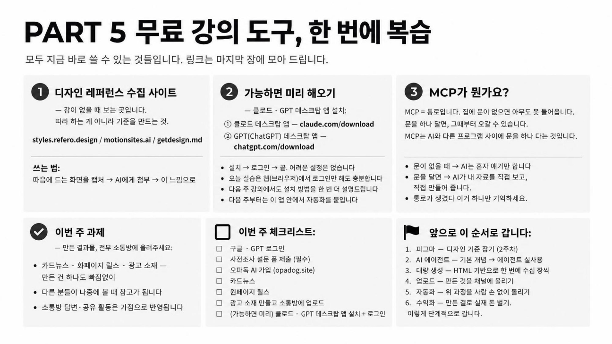

| 구분 | 강의 자료 |
|---|---|
| 디자인 레퍼런스 | `styles.refero.design` · `mobbin.com` 계열 디자인 레퍼런스 · `getdesign.md` |
| 무료 미리보기 | 클로드 `claude.com/download`, GPT `chatgpt.com/download` |
| MCP 예고 | AI와 외부 도구를 연결해 파일·사이트 작업을 돕는 방식 |

**향후 순서(강의 38쪽):** 피그마 기초 → 에이전트 도구 → 대량 제작 → 업로드 자동화 → 노션 관리 → 수익화·외주 연결. 화면의 링크·지원 기능은 변경될 수 있습니다.

## 실습 프롬프트

> 원본은 GPTs/Gems 제작봇 사용을 중심으로 진행합니다. 아래는 강의의 목적에 맞게 작성한 **별도 연습용 프롬프트**이며 원본의 공식 프롬프트를 그대로 옮긴 것은 아닙니다.

### 카드뉴스 — 이미지 버전

```text
인스타그램 카드뉴스 5장을 기획해줘.
주제: [주제], 대상: [타깃], 목표: [정보 전달/문의 유도]
첫 장은 호기심을 끄는 제목, 중간 3장은 핵심 정보,
마지막은 요약과 CTA로 구성해줘.
4:5 비율, 한 장당 글은 짧고 모바일에서 읽기 쉽게 해줘.
```

### 카드뉴스 — HTML 버전

```text
앞서 기획한 카드뉴스를 각 장 1080×1350 비율의
편집 가능한 HTML/CSS로 만들어줘.
문구·이미지·배경색을 나중에 바꿀 수 있도록 구성하고,
각 장을 PNG로 내보내기 쉽게 만들어줘.
```

### 원페이지 릴스

```text
참고한 릴스의 구성과 템포만 분석하고, 원본을 복제하지 말아줘.
[주제]에 대해 9:16 세로 릴스 1개를 기획해줘.
첫 2초 후킹, 본문 핵심 3개, 마무리 CTA를 제안해줘.
자막은 모바일 화면에서 읽기 쉽게 간결하게 써줘.
```

### 광고 소재

```text
[상품/서비스] 광고 소재를 만들어줘.
타깃: [고객층], 주요 장점: [3개], 목표: [문의/구매]
4:5 비율의 광고 이미지 기획안 3개를 제시해줘.
각각 헤드라인, 보조 문구, CTA, 이미지 구도를 구분해줘.
검증되지 않은 효능·수치·후기는 쓰지 마.
```

### 레퍼런스 분석

```text
첨부한 레퍼런스 이미지 3장을 비교해줘.
후킹 방식, 정보 순서, 시각적 계층, 여백, CTA를 분석하고,
내 [업종/주제]에 맞는 독창적인 디자인 방향을 제안해줘.
```

## 체크리스트

- [ ] GPT·Google 계정 로그인 확인
- [ ] 강의 운영 규칙·공식 질문 채널 확인
- [ ] 본업 강화 / 에이전시 / 프리랜서 중 현재 트랙 선택
- [ ] 카드뉴스 레퍼런스 3개 조사
- [ ] 카드뉴스 이미지 버전 제작
- [ ] 카드뉴스 HTML 버전 제작
- [ ] 원페이지 릴스 1개 제작
- [ ] 광고 소재 1개 제작
- [ ] 각 결과물의 문구·저작권·사실관계 검토
- [ ] 작업물 폴더에 결과물 정리
- [ ] 크몽·숨고 판매 방식 비교
- [ ] 무료 디자인 레퍼런스 사이트 확인

### 과제 관련 원문 구분

**26쪽:** 이번 주 오파독 AI는 가입만 하면 되고, **오파독 AI 관련 과제 제출은 없다**고 안내합니다. **38쪽:** 이번 주 과제는 **만든 결과물, 전부 소통방에 올려주세요**라고 적혀 있습니다. 두 안내를 구분해 따르세요.

---

**한 줄 요약:** `운영 규칙 숙지 → 트랙 결정 → 레퍼런스 분석 → 카드뉴스·릴스·광고 제작 → 결과 공유 → 판매 준비`

**출처:** 오파독 1주차 특별강의, 38쪽. 슬라이드 이미지는 학습용 발췌입니다. 공개 GitHub에 올리기 전 이미지의 재배포 권한을 확인하세요.
