🏠 > [ai_agent](../../) > [opadog](../) > **오파독AI | Summary Notes 3**

<table>
  <tr>
    <td><a href="./">[오파독]</a></td>
    <td><a href="S01_notes.md">노트1</a></td>
    <td><a href="S02_notes.md">노트2</a></td>
    <td><b href="S03_notes.md">노트3</b></td>
    <td><a href="S04_notes.md">노트4</a></td>
    <td><a href="S05_notes.md">노트5</a></td>
    <td><a href="S06_notes.md">노트6</a></td>
    <td><a href="S07_notes.md">노트7</a></td>
  </tr>
</table>

---
# 오파독 2주차 정규강의 — GitHub 학습 노트

> **핵심 흐름: 만들고 → 피그마에 올리고 → 고친다**  
> 출처: `오파독 2주차 정규강의.pdf` (35페이지)  
> 강의 순서에 맞춘 요약이며, 화면과 기능·가격은 강의 당시 기준입니다.

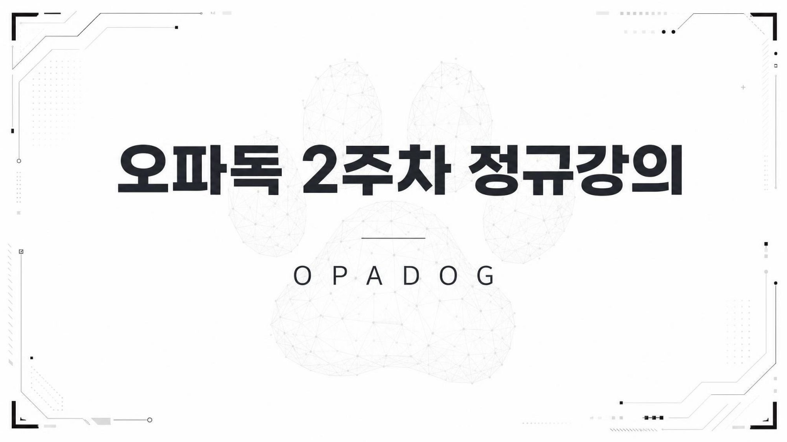

## 목차

1. [강의 목표](#1-강의-목표)
2. [PART 1 — HTML·MCP 복습](#2-part-1--htmlmcp-복습)
3. [PART 2 — 프롬프트팩 4종 실습](#3-part-2--프롬프트팩-4종-실습)
4. [PART 3 — 피그마 기초](#4-part-3--피그마-기초)
5. [PART 4 — 클로드·GPT 앱 설치](#5-part-4--클로드gpt-앱-설치)
6. [PART 5 — 피그마 MCP 연결](#6-part-5--피그마-mcp-연결)
7. [PART 6 — 피그마 업로드·수정·내보내기](#7-part-6--피그마-업로드수정내보내기)
8. [업로드 및 계정 운영 원칙](#8-업로드-및-계정-운영-원칙)
9. [이번 주 공식 과제](#9-이번-주-공식-과제)
10. [실습 체크리스트·링크](#10-실습-체크리스트링크)

---

## 1. 강의 목표

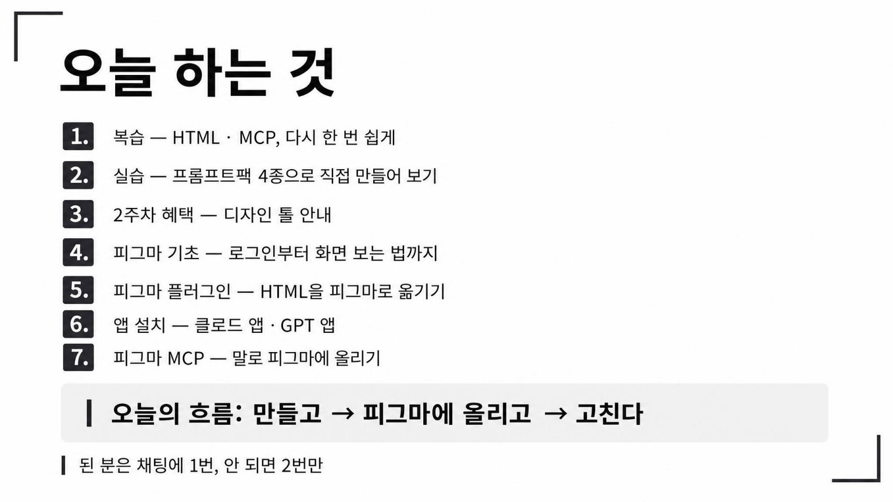

2페이지의 7개 항목: **복습(HTML·MCP) → 프롬프트팩 4종 실습 → 2주차 혜택 → 피그마 기초 → 피그마 플러그인 → 클로드·GPT 앱 설치 → 피그마 MCP**. 실습을 통해 직접 콘텐츠를 만들고, 피그마로 가져와 수정하고, 파일로 내보내는 과정을 익힙니다.

## 2. PART 1 — HTML·MCP 복습

**원본 3~6페이지**

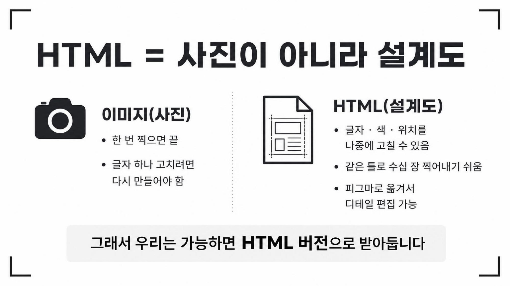

- **이미지**는 한 번 만들면 글자·배치를 고치려면 다시 제작해야 할 수 있습니다.
- **HTML**은 글자·색·위치를 나중에 바꿀 수 있는 설계도입니다.
- 강의는 가능한 경우 **HTML 버전**을 받아 피그마에서 편집하는 작업 흐름을 권합니다.

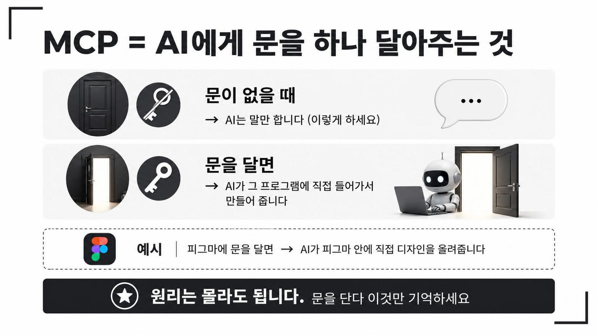

**MCP**는 AI가 외부 도구와 연결해 실제 작업을 수행할 수 있게 하는 방식입니다. 강의의 비유는 **'AI에게 문을 하나 달아주는 것'**입니다. 연결 후에도 실행 가능 범위는 권한·서비스 상태에 따라 달라집니다.

### 강의에서 제시한 3단계 (6페이지)

1. GPT·Gemini 채팅창에서 직접 제작
2. 에이전트에게 같은 작업 지시
3. 오파독 MCP 연결

이번 수업은 1단계를 마무리하고 **2단계와 피그마 MCP**까지 진행합니다.

## 3. PART 2 — 프롬프트팩 4종 실습

**원본 7~11페이지**

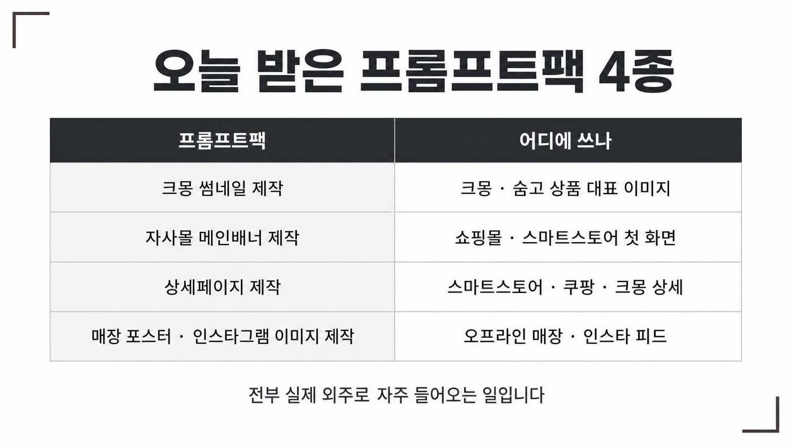

| 프롬프트팩 | 활용 장소 |
|---|---|
| 크몽 썸네일 제작 | 크몽·숨고 상품 대표 이미지 |
| 자사몰 메인배너 제작 | 쇼핑몰·스마트스토어 첫 화면 |
| 상세페이지 제작 | 스마트스토어·쿠팡·크몽 상세 |
| 매장 포스터·인스타그램 이미지 제작 | 오프라인 매장·인스타 피드 |

### 만드는 순서 (9페이지)

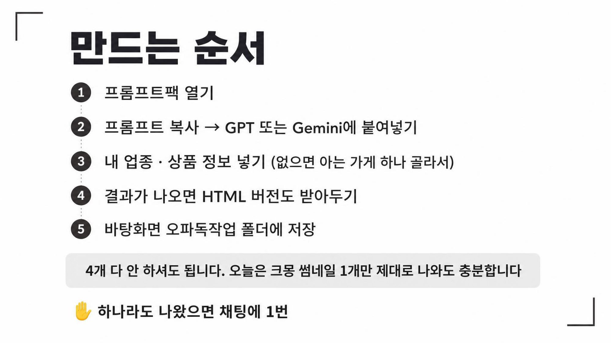

1. 프롬프트팩 열기
2. 프롬프트를 복사해 GPT 또는 Gemini에 붙여넣기
3. 업종·상품 정보 넣기 (없으면 한 가지를 정해 실습)
4. 결과물을 **HTML 버전으로도** 받기
5. 바탕화면의 **오파독작업** 폴더에 저장

**실습용 요청문 (강의 흐름을 따라 재구성):**

```text
다음 프롬프트팩으로 [상품/업종]의 [콘텐츠 유형]을 만들어줘.
먼저 디자인 시안을 보여주고, 나중에 글자와 색을 수정할 수 있도록
HTML 버전도 함께 제공해줘.
완성된 파일을 '오파독작업' 폴더에 정리할 수 있게 파일명을 제안해줘.
```

> 강의 9페이지: 네 가지를 전부 하지 않아도 되며, **크몽 썸네일 하나만 제대로 만들어도 충분**합니다.

### 작업 원칙 (10페이지)

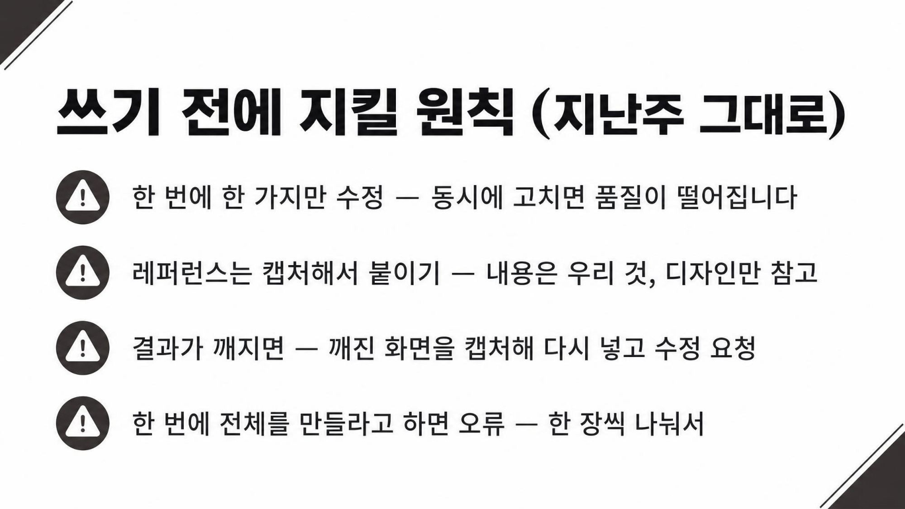

- 한 번에 한 가지만 수정하기
- 레퍼런스는 **디자인 참고**로만 사용하고, 내용은 자신의 것으로 작성하기
- 결과가 깨지면 화면을 캡처해 수정 요청하기
- 전체를 한꺼번에 만들다 오류가 나면 장별로 나누기

### 2주차 혜택 (11페이지)

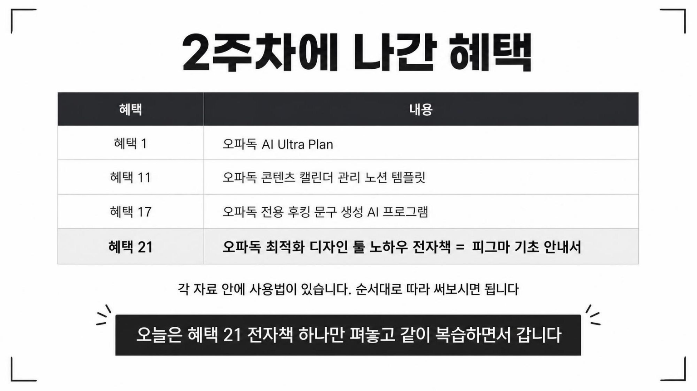

강의에서 소개한 항목: **혜택 1 오파독 AI Ultra Plan**, **혜택 11 콘텐츠 캘린더 관리 노션 템플릿**, **혜택 17 오파독 전용 후킹 문구 생성 AI 프로그램**, **혜택 21 오파독 최적화 디자인 툴 노하우 전자책(피그마 기초 안내서)**. 이용 조건과 제공 여부는 자료실에서 확인합니다.

## 4. PART 3 — 피그마 기초

**원본 12~16페이지**

피그마는 **처음부터 디자인하는 도구라기보다, 이미 만든 결과물의 세부 요소를 수정할 때 활용**하는 것으로 소개합니다. 예: 글자 한 줄 수정, 색상·여백 조정, 고객 요청사항 반영.

### 시작하기 (14페이지)

1. <https://figma.com> 접속
2. 구글 계정으로 로그인
3. 무료 플랜으로 시작
4. 새 디자인 파일 생성

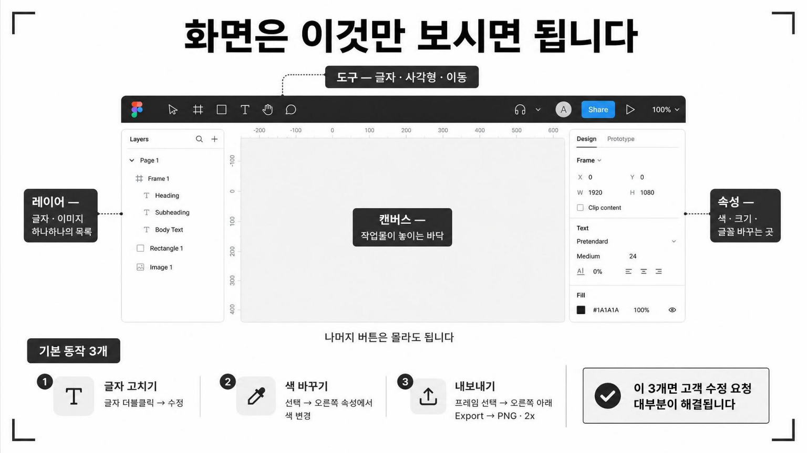

**화면 구성:** 왼쪽 레이어(요소 목록), 가운데 캔버스(작업 화면), 오른쪽 속성(크기·색·글꼴). 기초 동작은 **글자 바꾸기 / 색 바꾸기 / PNG 내보내기**입니다.

### HTML을 피그마로 옮기기 (16페이지)

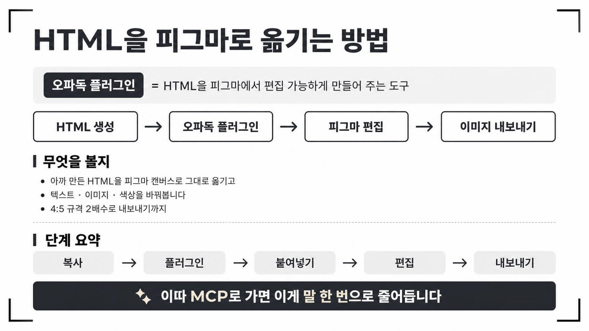

`HTML 생성 → 오파독 플러그인 → 피그마 편집 → 이미지 내보내기`

- HTML을 **편집 가능한 구조**로 가져오기
- 텍스트·이미지·색상 수정
- **4:5 규격, 2배수** 이미지 내보내기

**플러그인 방식 요약:** 복사 → 플러그인 → 붙여넣기 → 편집 → 내보내기. 다음 PART에서는 MCP 방식으로 작업을 더 줄입니다.

## 5. PART 4 — 클로드·GPT 앱 설치

**원본 17~20페이지**

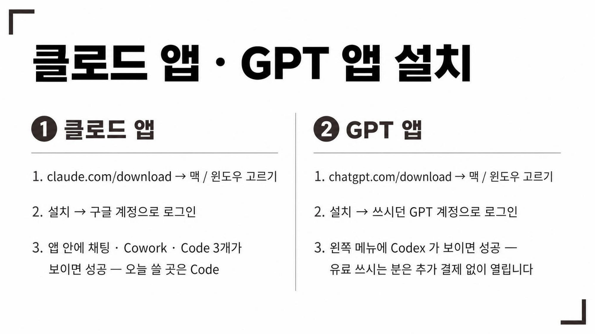

| 프로그램 | 강의에 기재된 다운로드 주소 |
|---|---|
| Claude | <https://claude.com/download> |
| ChatGPT | <https://chatgpt.com/download> |

- PC 운영체제(맥·윈도우)에 맞게 설치 후 로그인
- 강의는 **둘 중 하나만 준비되어도 수업 진행 가능**하다고 설명합니다.
- 클로드 앱에서는 `Chat / Cowork / Code` 중 **Code** 사용, ChatGPT 앱에서는 당시 메뉴의 **Codex** 진입을 안내합니다. 현재 메뉴 구성은 달라질 수 있습니다.

**설치 문제 (20페이지):** 맥 설치 파일 선택, 윈도우 다운로드 폴더에서 설치 파일 실행, 로그인 창 문제 시 앱 재시작, 해결되지 않으면 강의의 1:1 지원.

## 6. PART 5 — 피그마 MCP 연결

**원본 21~25페이지**

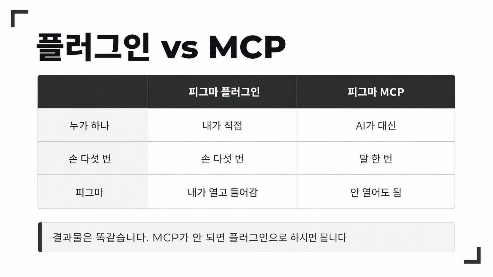

| 구분 | 피그마 플러그인 | 피그마 MCP |
|---|---|---|
| 누가 작업? | 사용자가 직접 | AI가 도구를 사용 |
| 작업 방식 | 직접 클릭·복사·붙여넣기 | 대화로 지시 |
| 피그마 열기 | 직접 열고 작업 | 연결된 환경에 따라 다름 |

### Claude Code 연결 (23페이지)

```bash
claude mcp add --transport http --scope user figma https://mcp.figma.com/mcp
```

### Codex 연결 (23페이지)

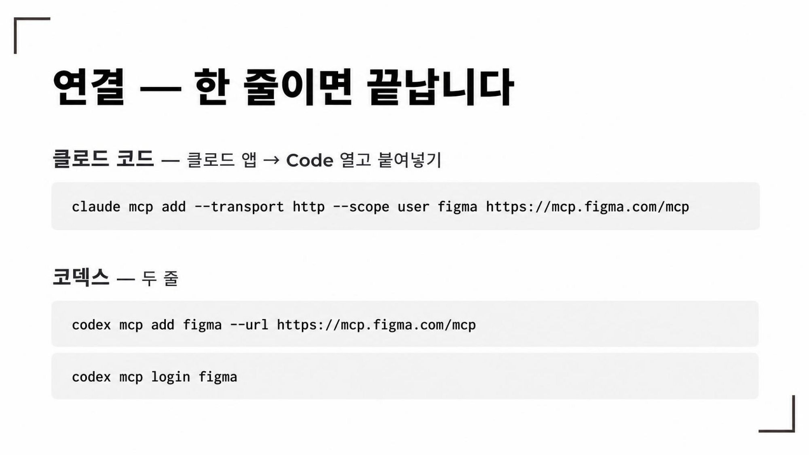

```bash
codex mcp add figma --url https://mcp.figma.com/mcp
codex mcp login figma
```

### 연결 확인 (24페이지)

1. 브라우저가 열리면 피그마 로그인 후 인증
2. 에이전트에서 `/mcp` 입력
3. 목록에 `figma`가 표시되면 연결 확인

### 에이전트 활용 팁 (25페이지)

- 한국어로 작업 지시하기
- 필요한 권한 요청을 확인한 후 승인하기
- 오류가 나면 새 대화에서 다시 시도하기

> **주의:** 강의의 “승인 버튼 누르기”는 실습 안내입니다. 실제로는 연결 대상과 접근 범위, 변경·삭제 권한을 확인한 후 승인하세요.

## 7. PART 6 — 피그마 업로드·수정·내보내기

**원본 26~31페이지**

### STEP 1. 새 파일 만들기 (27페이지)

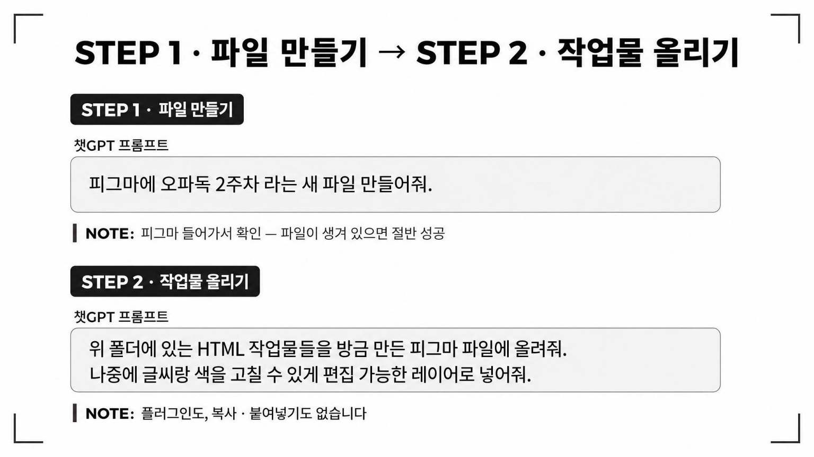

```text
피그마에 오파독 2주차 라는 새 파일 만들어줘.
```

### STEP 2. HTML 작업물 올리기 (27페이지)

```text
이 폴더에 있는 HTML 작업물들을 방금 만든 피그마 파일에 올려줘.
나중에 글씨랑 색을 고칠 수 있게 편집 가능한 레이어로 해줘.
```

**실행 전:** '이 폴더'가 무엇인지 에이전트가 알 수 있도록 **정확한 폴더 경로**를 제공하세요.

### STEP 3. 말로 편집하기 (28페이지)

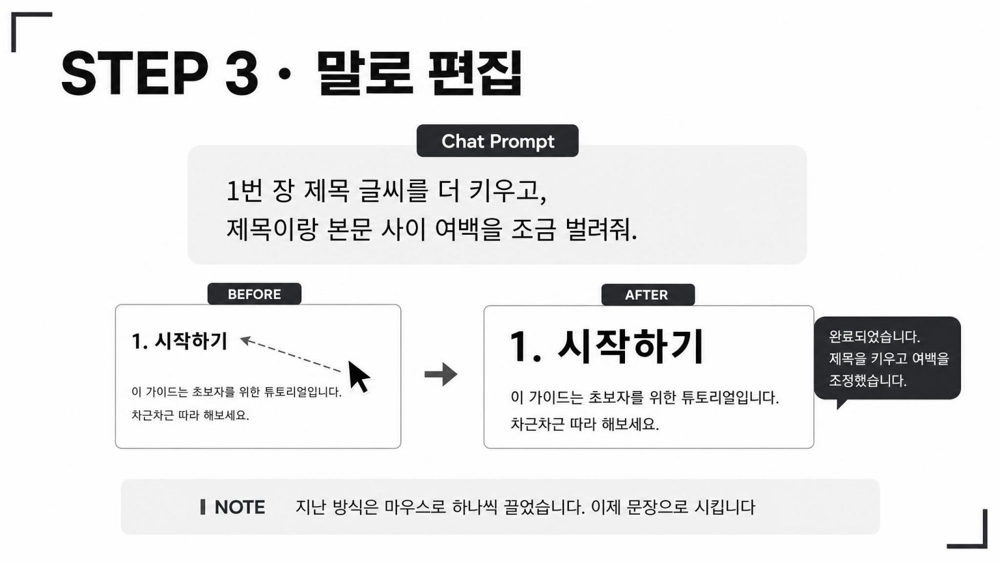

```text
1번 장 제목 글씨를 더 키우고,
제목이랑 본문 사이 여백을 조금 벌려줘.
```

강의는 지난 시간에는 마우스로 하나씩 고쳤지만 이번에는 **말로 고친다**고 설명합니다.

### STEP 4. 이미지 내보내기 (29페이지)

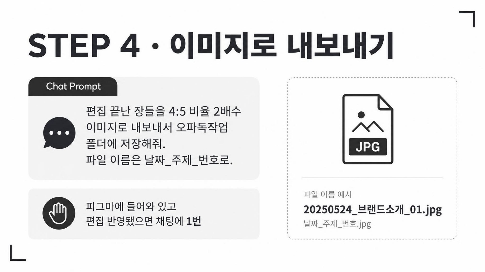

```text
편집 끝난 장들을 4:5 비율 2배수 이미지로 내보내서
오파독작업 폴더에 저장해줘.
파일 이름은 날짜_주제_번호로.
```

강의 파일명 예시: `20250524_브랜드소개_01.jpg`.

### 포트폴리오 폴더 관리 (30페이지)

- 작업물을 버리지 말고 한 폴더에 모으기
- 예시: `오파독작업/포트폴리오`
- 파일명 규칙: **날짜_주제_번호**
- 활용: 내 웹사이트 포트폴리오, 크몽·숨고 상세페이지, 고객사 제안서

### 잘 안 될 때 (31페이지)

| 증상 | 강의의 해결책 |
|---|---|
| figma가 목록에 없음 | 명령어 재입력 후 로그인 다시 |
| 파일은 생성됐지만 작업물 없음 | 폴더 경로를 정확히 알려주기 |
| 이미지 한 장으로 들어감 | 편집 가능한 레이어로 다시 넣어달라고 요청 |
| 반응이 없음 | 새 대화에서 다시 시도 |

## 8. 업로드 및 계정 운영 원칙

**원본 32페이지**

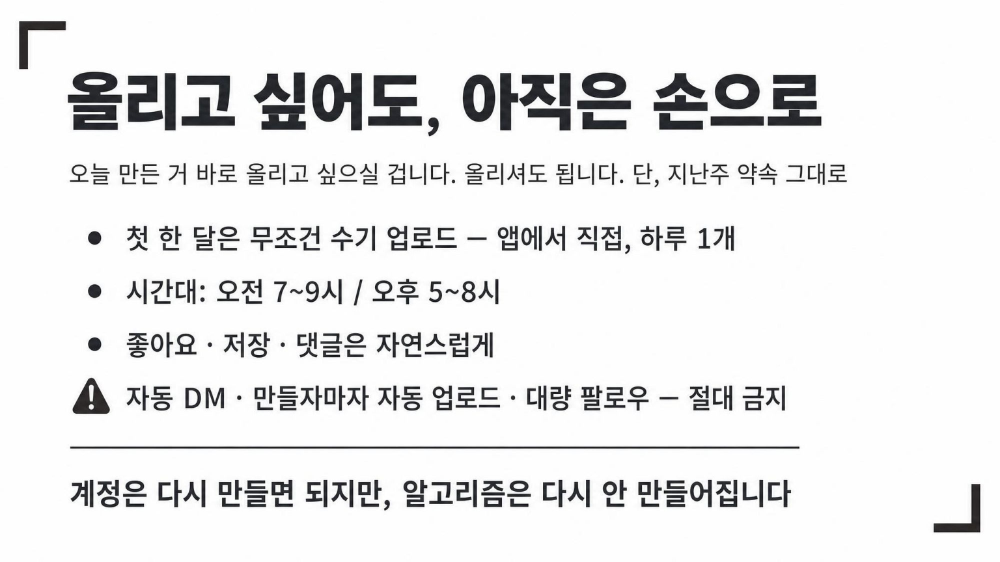

강의는 **첫 한 달은 직접 수기 업로드, 앱에서 하루 1개**를 권합니다. 예시 시간대는 **오전 7~9시 / 오후 5~8시**이며 계정에 맞는 최적 시간은 별도 확인이 필요합니다. 좋아요·저장·댓글은 자연스럽게 운영하고, **자동 DM·만들자마자 자동 업로드·대량 팔로우**는 피하라고 안내합니다.

## 9. 이번 주 공식 과제

**원본 33페이지 — 제출 조건을 원문에 맞춰 정리**

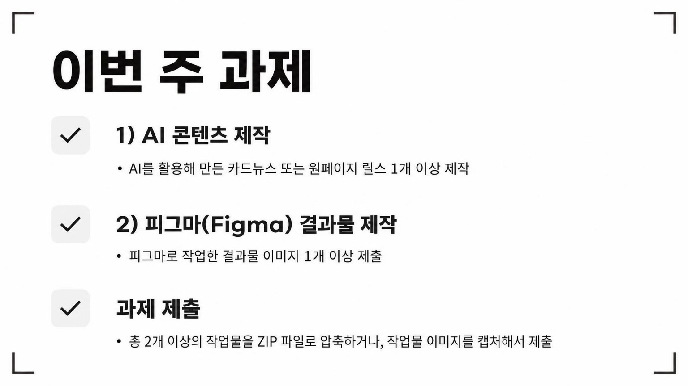

1. **AI 콘텐츠 제작:** AI를 활용해 만든 카드뉴스 또는 웹페이지 **1개 이상** 제작
2. **피그마(Figma) 결과물 제작:** 피그마로 작업한 결과물 이미지 **1개 이상** 제출
3. **과제 제출:** **총 2개 이상의 작업물을 ZIP 파일로 압축**하고 **작업물 이미지를 캡처해서 제출**

> 제출 위치·마감일·ZIP 내부 파일명 규칙은 해당 33페이지에 별도로 제시되지 않습니다. 강의 공지방 등에서 확인하세요.

### 제출용 예시 구조 (권장, 강의 지정 형식 아님)

```text
오파독_2주차_과제/
├── 01_AI_콘텐츠.html
├── 02_Figma_결과물.png
└── screenshots/
    ├── 01_AI_콘텐츠_캡처.png
    └── 02_Figma_결과물_캡처.png
```

위 폴더를 ZIP으로 압축한 뒤 제출합니다. 실제 제출처에서 요구하는 추가 조건이 있다면 그 조건을 우선하세요.

## 10. 실습 체크리스트·링크

- [ ] 프롬프트팩 4종 중 1종 이상 실행
- [ ] AI 콘텐츠 결과물 생성
- [ ] HTML 파일 저장
- [ ] Figma 무료 계정 로그인
- [ ] Claude 또는 ChatGPT 앱 설치·로그인
- [ ] Figma MCP 등록·인증·연결 확인
- [ ] Figma 파일 `오파독 2주차` 생성
- [ ] HTML 작업물을 편집 가능한 레이어로 가져오기
- [ ] 제목 크기·여백 수정
- [ ] 4:5, 2배수 이미지 내보내기
- [ ] AI 콘텐츠 1개 이상과 Figma 이미지 1개 이상 확보
- [ ] 총 2개 이상 작업물을 ZIP으로 압축하고 캡처 이미지 준비

### 강의 34페이지의 링크

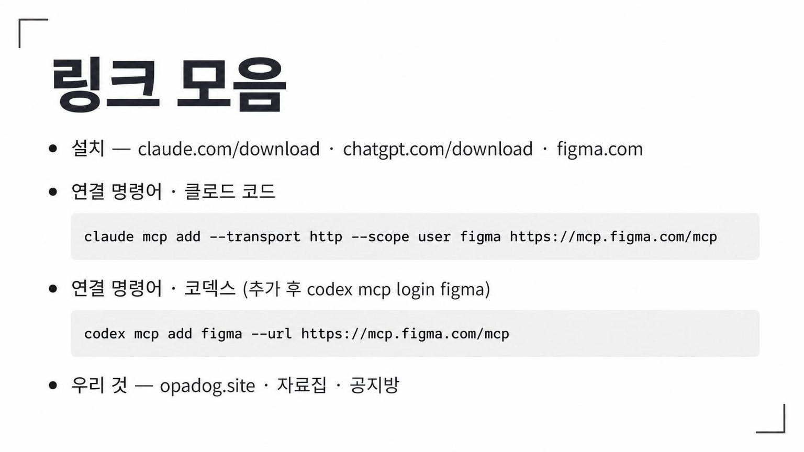

- Claude 다운로드: <https://claude.com/download>
- ChatGPT 다운로드: <https://chatgpt.com/download>
- Figma: <https://figma.com>
- Figma MCP: `https://mcp.figma.com/mcp`
- 오파독: <https://opadog.site> (자료집·공지방 안내)

---

**한 줄 요약:** **AI로 콘텐츠 제작 → HTML로 저장 → Figma에 편집 가능한 레이어로 업로드 → 말로 수정 → 이미지 내보내기 → 과제 ZIP 제출.**

**저작권 유의:** 이 노트의 슬라이드 이미지는 제공된 강의 PDF에서 발췌한 것입니다. GitHub 공개 저장소에 게시할 경우 원본 이미지의 재배포 권한을 먼저 확인하세요. 개인 학습용 비공개 저장소에서는 활용 범위를 별도로 검토하세요.
