🏠 > [ai_agent](../../) > [opadog](../) > **오파독AI | Summary Notes 4**

<table>
  <tr>
    <td><a href="./">[오파독]</a></td>
    <td><a href="S01_notes.md">노트1</a></td>
    <td><a href="S02_notes.md">노트2</a></td>
    <td><a href="S03_notes.md">노트3</a></td>
    <td><b href="S04_notes.md">노트4</b></td>
    <td><a href="S05_notes.md">노트5</a></td>
    <td><a href="S06_notes.md">노트6</a></td>
    <td><a href="S07_notes.md">노트7</a></td>
  </tr>
</table>

---
# 오파독 4기 · 2주차 특별강의 요약 노트

> **문을 하나씩 더 달아봅니다 — MCP 연결 & 업로드 자동화**  
> 원본: `오파독 2주차 특별강의.pdf` · 총 78페이지  
> 학습 흐름: **복습 → MCP 연결 → 오파독 MCP 실습 → 업로드 자동화 → 수익화 예고**

> [!IMPORTANT]
> 본 노트는 **강의 내용의 요약**입니다. 강의 속 앱 화면, 가격, MCP 주소, 모델명, 음원 지원 여부는 강의 당시 기준입니다. 실제 이용 전 최신 화면·약관·비용을 확인하세요. 연결·파일 변경·결제·게시 권한은 작업 범위를 확인한 뒤 승인하세요.

## 목차

- [1. 강의 개요](#1-강의-개요)
- [2. PART 01 — 복습과 웜업](#2-part-01--복습과-웜업)
- [3. PART 02 — MCP 연결 실습](#3-part-02--mcp-연결-실습)
- [4. PART 02-1 — 추가 연결 도구](#4-part-02-1--추가-연결-도구)
- [5. PART 03 — 오파독 MCP](#5-part-03--오파독-mcp)
- [6. PART 04 — 업로드 자동화](#6-part-04--업로드-자동화)
- [7. 정리·다음 주 예고](#7-정리다음-주-예고)
- [8. 복사용 프롬프트 모음](#8-복사용-프롬프트-모음)
- [9. 실습 체크리스트](#9-실습-체크리스트)
- [10. MCP 연결 주소 모음](#10-mcp-연결-주소-모음)

---

## 1. 강의 개요

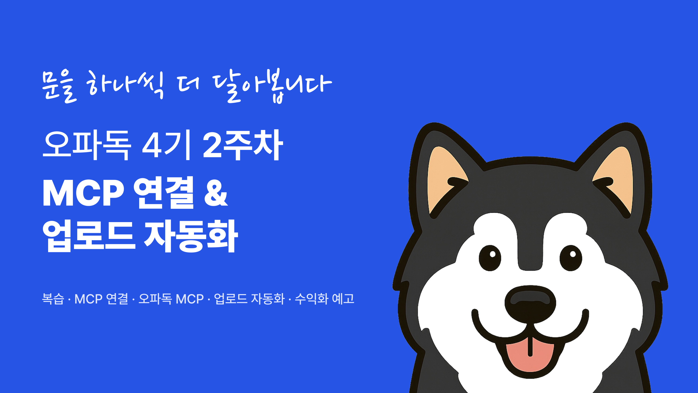

강의의 비유는 **MCP = AI 에이전트에게 다른 프로그램으로 가는 '문'을 달아주는 것**입니다. 하나의 에이전트에서 만들기·편집·관리·업로드 작업을 연결합니다. (1~4쪽)

| 구분 | 하는 일 | 강의의 도구 |
|---|---|---|
| 제작 | 이미지·영상·숏폼 | 오파독, 힉스필드, SUME |
| 편집 | 텍스트·색상·레이어 수정 | 피그마 |
| 관리 | 일정·콘텐츠·보고 | 노션 |
| 연락·일정 | 메일·미팅 | Gmail, Google Calendar |
| 광고 | 광고 관리·분석 | Meta Ads |
| 세무·정산 | 비용·미수금 | 클로브 |
| 업로드 | 인스타 게시 | 브라우저 컨트롤, 안드로이드 에뮬레이터 |

강의는 **클로드 앱 / 클로드 코드(터미널) / ChatGPT 앱의 코덱스** 중 본인이 사용하는 환경 하나로 실습해도 된다고 설명합니다. (4쪽)

## 2. PART 01 — 복습과 웜업

**원본 5~13쪽**

### 핵심 개념

- **HTML:** 나중에 수정할 수 있는 설계도.
- **피그마:** 이미 나온 결과물의 글자·색·간격 등을 다듬는 편집 공간.
- **MCP:** AI 에이전트가 다른 도구를 이용하게 하는 연결 방식.
- **챗봇과 에이전트:** 강의는 챗봇을 '질문에 답하는 도구', 에이전트를 '파일을 만들고 앱에서 작업하는 조수'로 대비합니다. 실제 가능한 작업은 도구 권한과 환경에 따라 달라집니다. (6~8쪽)

### 에이전트에 잘 지시하는 4가지

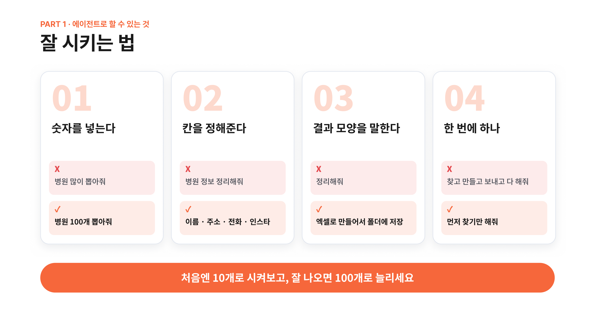

1. **숫자:** '많이' 대신 '10개'.
2. **필드:** 이름·주소·전화·인스타 계정.
3. **결과 형태:** 엑셀 파일로 저장.
4. **단계 분리:** 찾기부터 검증하고, 그다음 제작·발송.

처음 10개로 시험한 후 품질을 확인해 100개로 늘리는 방법을 권합니다. (9~11쪽)

### 웜업 실습 (13쪽)

```text
바탕화면에 오파독작업 폴더를 만들고,
그 안에 test.txt 파일을 만들어서
"오늘도 웜업 완료"라고 써줘.
```

**주의:** 강의 12쪽은 권한 요청에서 승인 버튼을 누르는 과정을 간단히 설명하지만, 실제로는 **어떤 파일·계정·결제 권한을 주는지 확인한 뒤 승인**해야 합니다.

## 3. PART 02 — MCP 연결 실습

**원본 14~38쪽**

### 모든 MCP 연결의 공통 순서

**① 주소 넣기 → ② 서비스 계정 로그인 → ③ 연결 상태 확인**. 도구마다 이름과 주소만 달라집니다. (15~16쪽)

#### 클로드 앱 (17~21쪽)

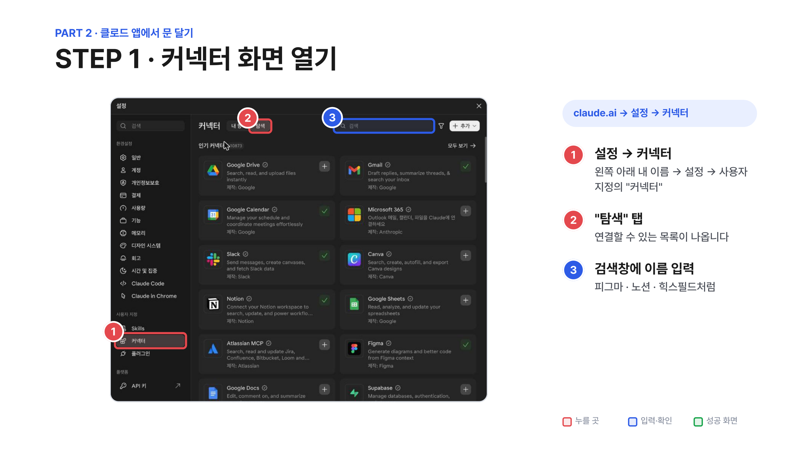

1. 설정 → 사용자 지정 → 커넥터.
2. 탐색에서 도구 이름 검색 → 연결.
3. 목록에 없으면 **+ 추가 → 커스텀 커넥터 추가**.
4. 이름·MCP URL 입력 → 로그인 → 허용.
5. '내 항목'에 **연결됨**으로 표시되는지 확인.

#### 클로드 코드 / 코덱스 (22~23쪽)

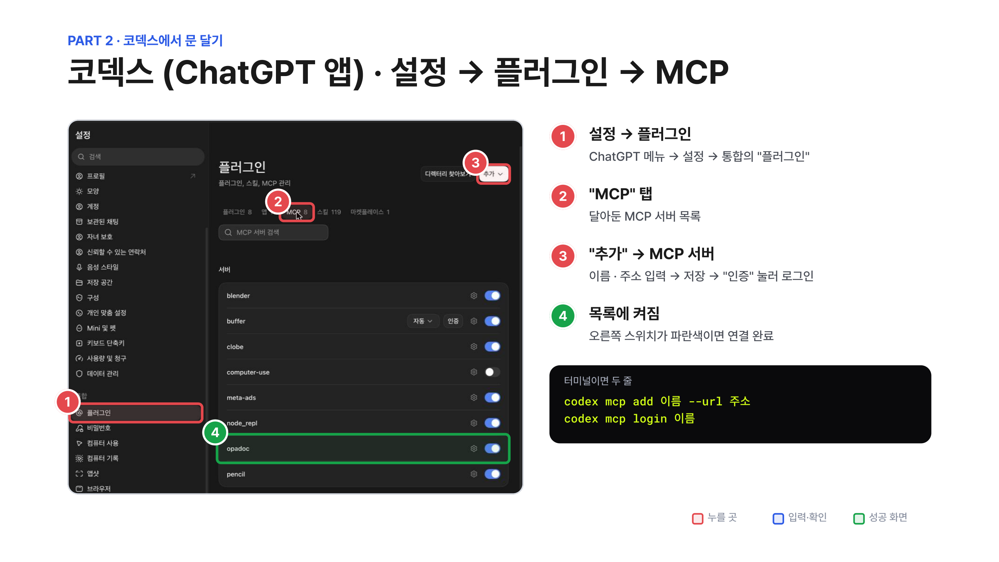

```bash
# Claude Code — HTTP MCP 등록 예시
claude mcp add --transport http --scope user figma https://mcp.figma.com/mcp
claude mcp list
# 인증이 필요하면 Claude Code 안의 /mcp 메뉴에서 로그인

# Codex — MCP 등록·로그인 예시
codex mcp add figma --url https://mcp.figma.com/mcp
codex mcp login figma
```

명령어는 강의 예시이며 설치 버전과 인터페이스에 따라 다를 수 있습니다.

### 실습 A — 피그마 (24~25쪽)

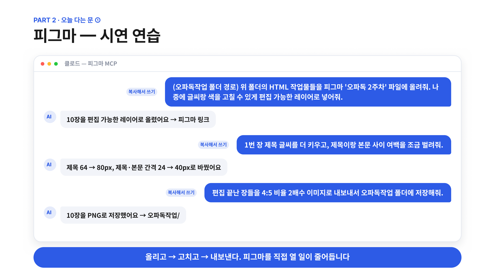

- MCP: `https://mcp.figma.com/mcp`
- **HTML 작업물 → 편집 가능한 피그마 레이어 → 글씨·간격 수정 → PNG 내보내기**.

```text
(오파독작업 폴더 경로) 위 폴더의 HTML 작업물들을
피그마 '오파독 2주차' 파일에 올려줘.
나중에 글씨랑 색을 고칠 수 있게 편집 가능한 레이어로 넣어줘.
```

```text
1번 장 제목 글씨를 더 키우고,
제목이랑 본문 사이 여백을 조금 벌려줘.
```

```text
편집 끝난 장들을 4:5 비율 2배수 이미지로 내보내서
오파독작업 폴더에 저장해줘.
```

### 실습 B — 힉스필드 (26~27쪽)

- MCP: `https://mcp.higgsfield.ai/mcp`
- 영상·이미지 제작. **생성 시 크레딧 차감**.

```text
카드뉴스 주제로 원페이지 릴스용 5초 영상 1개 만들어줘.
세로 9:16으로, 오파독작업 폴더에 저장해줘.
```

```text
이거 만들면 크레딧 얼마 들어?
먼저 알려주고 내가 확인하면 만들어줘.
```

### 실습 C — SUME (28~30쪽)

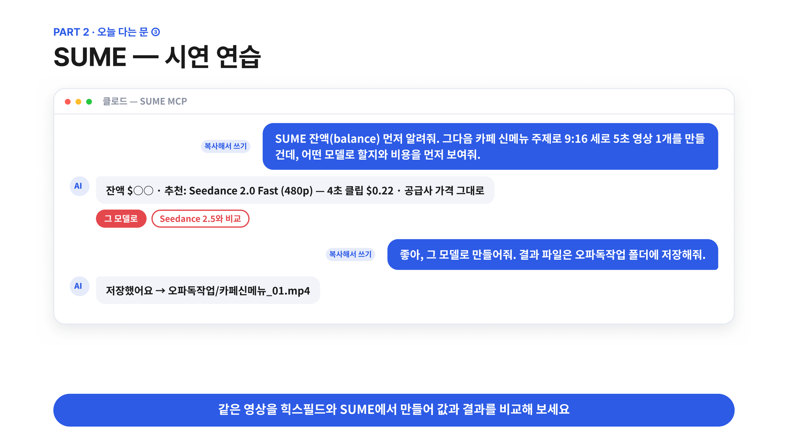

- MCP: `https://mcp.sume.com/mcp`
- 강의에서는 여러 영상·이미지 모델을 공급사 가격으로 제공한다고 소개합니다. 실제 비용·제공 모델은 연결 시 확인하세요.
- 로그인 과정의 **Create and spend credits**는 생성·비용 사용 권한과 관련됩니다.

```text
SUME 잔액(balance) 먼저 알려줘.
그다음 카페 신메뉴 주제로 9:16 세로 5초 영상 1개를 만들 건데,
어떤 모델로 할지와 비용을 먼저 보여줘.
```

```text
좋아, 그 모델로 만들어줘.
결과 파일은 오파독작업 폴더에 저장해줘.
```

**비교 실습:** 동일한 영상 요청을 힉스필드와 SUME에 넣고 비용·품질을 비교합니다.

### 실습 D — 노션 (31~36쪽)

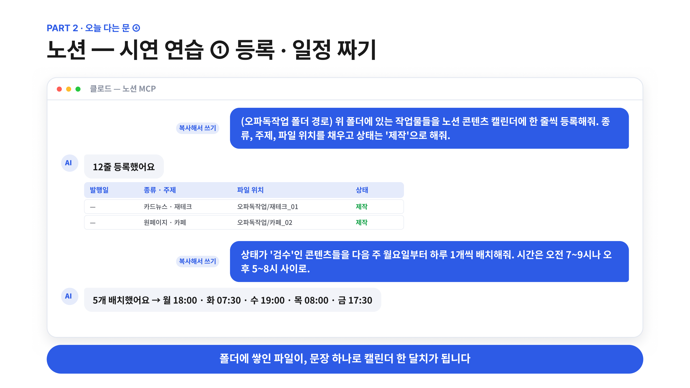

- MCP: `https://mcp.notion.com/mcp`
- 자료집 **혜택 11: 콘텐츠 캘린더 템플릿**을 복제.
- 데이터베이스에서 **한 행 = 콘텐츠 하나**. 필드: 발행 예정일, 계정, 종류·주제, 파일 위치, 캡션, 상태.
- 상태 흐름: **제작 → 검수 → 예약 → 발행**. (34쪽)

```text
(오파독작업 폴더 경로) 위 폴더에 있는 작업물들을
노션 콘텐츠 캘린더에 한 줄씩 등록해줘.
종류, 주제, 파일 위치를 채우고 상태는 '제작'으로 해줘.
```

```text
상태가 '검수'인 콘텐츠들을 다음 주 월요일부터
하루 1개씩 배치해줘.
시간은 오전 7~9시나 오후 5~8시 사이로.
```

```text
이번 주에 올려야 하는 콘텐츠가 뭐야?
캡션 안 쓴 것도 알려줘.
```

```text
콘텐츠 캘린더에서 고객사 A 것만 모아서
이번 주 진행 상황 보고 페이지를 새로 만들어줘.
```

### 연결 문제 해결 (37~38쪽)

| 증상 | 강의의 해결 방법 |
|---|---|
| 목록에 이름이 없음 | 정확한 URL로 커스텀 커넥터 추가 |
| 로그인 창이 안 열림 | 해당 도구의 연결/로그인 재시도 |
| `Needs authentication` | `/mcp`에서 인증 완료 |
| 엉뚱한 도구가 실행됨 | '노션에서…'처럼 도구명 명시, 한 번에 한 작업 |
| 반응 없음 | 새 대화에서 재시도 |

## 4. PART 02-1 — 추가 연결 도구

**원본 39~41쪽**

| 도구 | 용도 | 예시 |
|---|---|---|
| Gmail | 메일 | 답장할 메일 선별 및 초안 |
| Google Calendar | 일정 | 고객 미팅 시간 확인·등록 |
| Meta Ads | 광고 | 최근 7일 광고 성과 분석 |
| 클로브 | 정산 | 지출·미수금 정리 |

강의의 핵심: 모든 도구를 한꺼번에 연결할 필요 없이 **지금 필요한 도구부터** 연결합니다. 메일 발송·일정 생성·광고 변경·금전 관련 작업은 실행 전에 결과와 권한을 확인하는 편이 안전합니다.

## 5. PART 03 — 오파독 MCP

**원본 42~53쪽**

### 오파독 MCP란?

오파독 웹사이트에서 버튼을 눌러 제작하던 작업을 **클로드/코덱스 등 에이전트 대화창에서 명령**해 실행하는 방식입니다. 강의에서 소개한 기능은 숏폼 공장, 오파독 모션, 이미지·영상, 홈페이지, 멀티룸, 스킬 갤러리입니다. (43쪽)

- 연결 URL: `https://mcp.opadog.site/api/mcp/connect`
- 안내: `https://opadog.site/mcp`
- 강의에서는 유료 요금제 **Plus 이상**에서 기능 사용이 가능하다고 설명합니다. (44쪽)

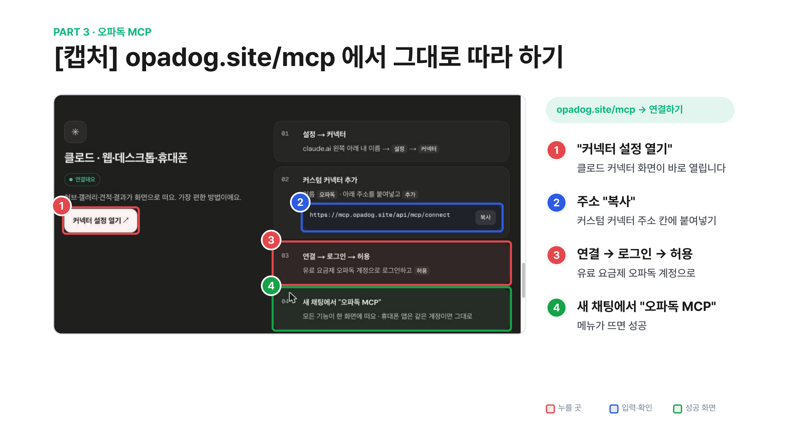

### 작동 순서 (47쪽)

**부른다 → 고른다 → 값을 듣는다 → 확인한다 → 받는다**

크레딧을 사용하는 작업은 **비용 확인 후 생성 승인**이 원칙입니다.

### 실습 1 — 메뉴·잔액 (48쪽)

```text
오파독 MCP
```

```text
오파독 크레딧 잔액 알려줘.
```

### 실습 2 — 숏폼 공장 (49쪽)

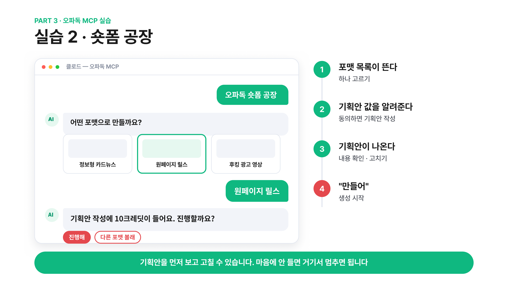

1. `오파독 숏폼 공장` 호출.
2. 정보형 카드뉴스 / 원페이지 릴스 / 후킹 광고 영상 등 포맷 선택.
3. 기획안 작성 비용 확인.
4. 기획안 검토·수정.
5. 승인 후 생성.

### 실습 3 — 이미지 한 장 (50쪽)

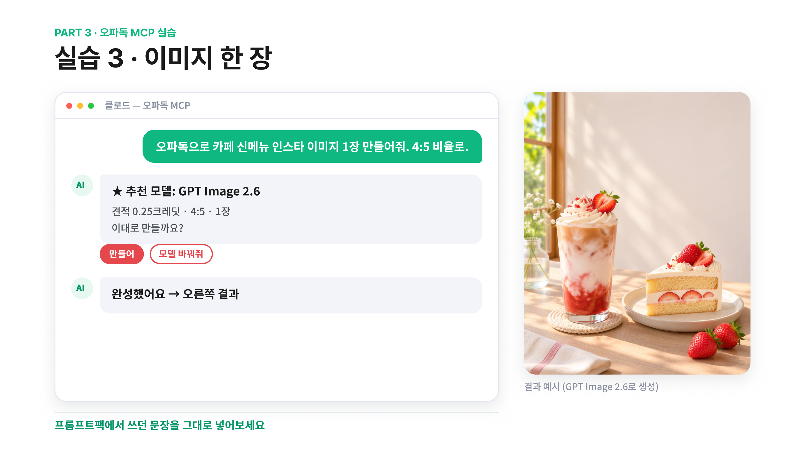

```text
오파독으로 카페 신메뉴 인스타 이미지 1장 만들어줘.
4:5 비율로.
```

강의 화면의 모델명·견적 크레딧은 **예시**이며 실제 비용은 생성 직전에 확인합니다.

### 실습 4 — 스킬 갤러리·웹사이트 (51쪽)

```text
오파독 스킬
```

```text
오파독 웹사이트
```

스킬 갤러리에서 템플릿을 고르거나 개인 브랜딩·매장 소개·포트폴리오 웹사이트를 만드는 흐름입니다.

### 복합 작업 (52쪽)

```text
오파독으로 만든 이미지를 피그마 '오파독 2주차' 파일에 올리고,
노션 콘텐츠 캘린더에 한 줄 등록해줘.
피그마 링크도 넣어줘.
```

제작 **오파독 → 편집 피그마 → 관리 노션**을 하나의 워크플로로 묶는 예시입니다. 처음에는 각 단계를 따로 검증한 뒤 연결하는 것이 좋습니다.

**4대 운영 원칙 (53쪽):** 비용 먼저 확인 / 1개로 테스트 후 확대 / 한 번에 한 작업 / 결과물은 한 폴더에 모으기.

## 6. PART 04 — 업로드 자동화

**원본 54~71쪽**

### 두 경로 비교 (55~56쪽)

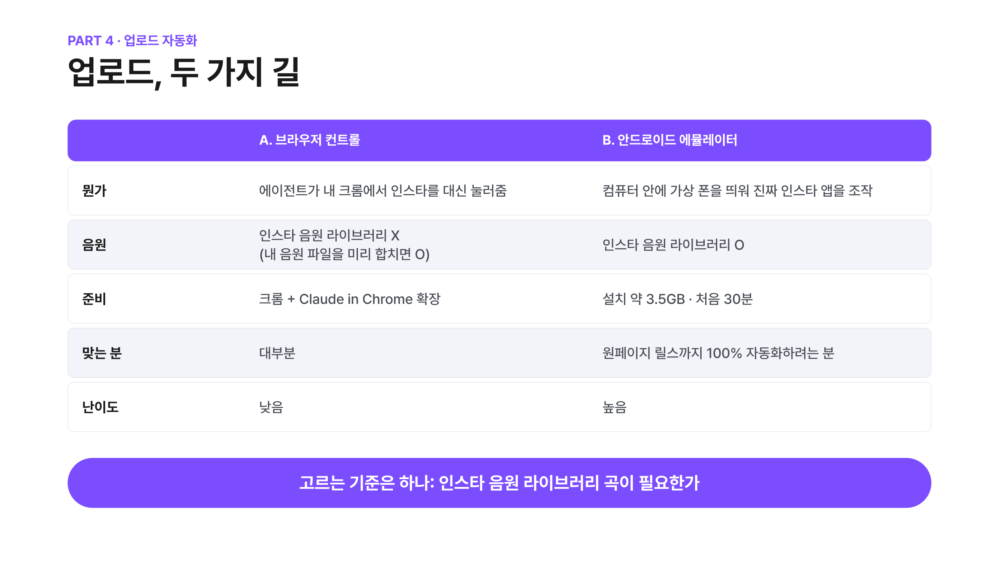

| 항목 | A. 브라우저 컨트롤 | B. 안드로이드 에뮬레이터 |
|---|---|---|
| 방식 | PC 크롬의 인스타그램 웹 조작 | 가상 안드로이드 폰의 인스타 앱 |
| 장점 | 준비가 비교적 간단 | 앱 내 음원 라이브러리 이용 가능 |
| 단점 | 강의 환경에서는 인스타 음원 선택 불가 | 초기 설치·로그인 복잡 |
| 권장 | 일반적인 릴스 업로드 | 인스타 앱 음원 필요 시 |

**중요:** 56쪽의 PC 웹·메타 비즈니스 스위트·예약 도구 음원 지원 불가 내용은 **2026-11-13 직접 확인한 강의 사례**입니다. 플랫폼 기능은 바뀔 수 있습니다.

### A. 브라우저 컨트롤 (58~64쪽)

1. 크롬에서 인스타 로그인(본인이 수행).
2. 왼쪽 **만들기 → 게시물**.
3. 파일 선택.
4. **자르기 → 원본**으로 9:16 전체 화면 유지.
5. **소리 켜기** 확인.
6. 캡션·해시태그·AI 레이블·페이스북 공유 설정 확인.
7. **공유하기** 후 프로필에서 영상·음원·캡션 검수.

강의의 복사용 요청:

```text
크롬에서 인스타그램 열고 이 영상 릴스로 올려줘.
영상: /Users/내이름/Desktop/릴스/01.mp4
캡션: [캡션 입력]
비율은 원본(9:16), 소리 켜고,
페이스북 공유는 끄고 올려줘.
```

> **업로드 전 최종 확인 권장:** 파일·캡션·공유 설정을 모두 확인하고 마지막 '공유하기'는 본인이 승인하도록 요청하세요.

58쪽에는 큰 파일을 **9.5MB씩 분할 → 페이지에서 재조립 → SHA-256 해시 비교**하는 실습 문구가 나옵니다. 이는 강의의 특정 브라우저 자동화 구현 사례로, 일반적인 인스타 업로드 필수 절차는 아닙니다. 임의의 페이지 코드 실행은 안전성을 확인해야 합니다.

### B. 안드로이드 에뮬레이터 (65~70쪽)

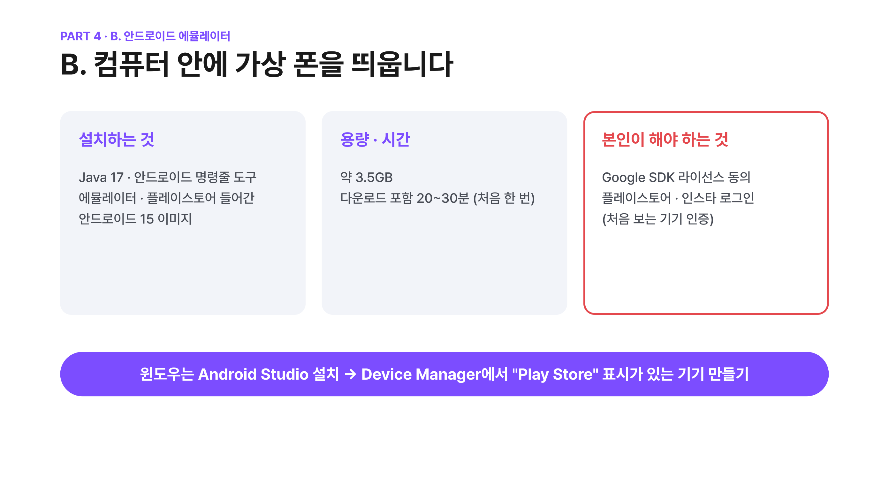

- 강의의 맥 환경: Java 17, Android 명령줄 도구, Play Store 지원 Android 15 이미지. 약 3.5GB, 초기 20~30분 설명.
- **Windows:** Android Studio 설치 → Device Manager → **Play Store 표시**가 있는 가상 기기 생성.
- SDK 라이선스 동의, Google/Instagram 로그인과 새 기기 인증은 본인이 수행.
- PC 영상을 `adb push`로 가상 폰에 복사하고 미디어 스캔 후 인스타 앱에서 릴스 업로드.
- 비즈니스 계정은 상업용으로 허용된 음원만 보일 수 있습니다.

맥용 강의 프롬프트 요지:

```text
안드로이드 에뮬레이터를 설치해서
플레이스토어가 되는 가상 폰을 켜줘.
SDK 라이선스 동의가 필요하면 내가 확인한 뒤 진행해줘.
```

영상 복사 예시:

```bash
adb push 01.mp4 /sdcard/Movies/
adb shell am broadcast -a android.intent.action.MEDIA_SCANNER_SCAN_FILE   -d file:///sdcard/Movies/01.mp4
```

### 계정 운영 원칙 (71쪽)

- 새 계정 첫 한 달은 수기 업로드를 권장.
- 강의의 예시 업로드 시간: **오전 7~9시 / 오후 5~8시**. 계정별 최적 시간은 실제 인사이트로 검증.
- 자동 DM·대량 팔로우 등 스팸성 활동은 피하기.
- 자동화는 계정이 안정된 뒤, 필요할 때 도입.

## 7. 정리·다음 주 예고

**원본 72~78쪽**

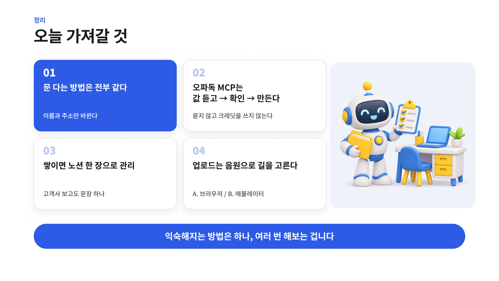

1. MCP 연결 방법은 **주소 → 로그인 → 확인**으로 동일.
2. 오파독 MCP는 **값 듣고 → 승인 → 생성**.
3. 작업물이 쌓이면 **노션 콘텐츠 캘린더**로 관리.
4. 업로드 방식은 **인스타 음원 라이브러리 필요 여부**로 선택.

### 다음 주 수익화 예고 (74~75쪽)

- **내 계정:** 협찬·공동구매·제휴.
- **고객사 외주:** 광고 소재·운영대행·제작.
- **영업 채널:** 크몽·숨고·직접 제안.

74쪽의 인플루언서 등급 선호도·참여율 수치는 **강의 자체에 '수치 출처 확인 필요'라고 표시**되어 있습니다. 검증된 최신 통계로 인용하지 마세요.

### 이번 주 실습 (76쪽)

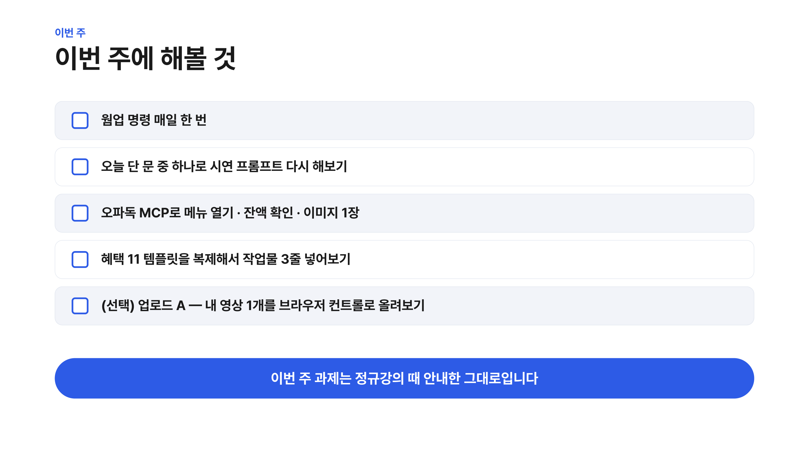

- 매일 웜업 명령 한 번.
- 연결한 MCP 중 하나로 시연 프롬프트 반복.
- 오파독 MCP 메뉴 열기·잔액 확인·이미지 1장 제작.
- 노션 **혜택 11** 템플릿 복제 후 작업물 3줄 등록.
- 선택: 브라우저 컨트롤로 영상 1개 업로드.
- **공식 과제는 앞선 정규강의에서 안내한 과제와 동일**하다고 명시되어 있으며, 이 특별강의에는 새 과제의 상세 제출 조건이 다시 기재되어 있지 않습니다.

## 8. 복사용 프롬프트 모음

아래는 위 실습 문구를 작업별로 빠르게 복사할 수 있게 모은 **색인**입니다.

| 목적 | 바로가기 |
|---|---|
| 폴더·파일 만들기 | [웜업](#웜업-실습-13쪽) |
| 피그마 편집 | [실습 A](#실습-a--피그마-2425쪽) |
| 힉스필드 영상 | [실습 B](#실습-b--힉스필드-2627쪽) |
| SUME 잔액·영상 | [실습 C](#실습-c--sume-2830쪽) |
| 노션 등록·일정·보고 | [실습 D](#실습-d--노션-3136쪽) |
| 오파독 MCP | [PART 03](#5-part-03--오파독-mcp) |
| 인스타 업로드 | [PART 04](#6-part-04--업로드-자동화) |

## 9. 실습 체크리스트

- [ ] 사용하는 AI 에이전트 환경 선택 (클로드 앱 / 클로드 코드 / 코덱스)
- [ ] `오파독작업/test.txt` 생성
- [ ] Figma MCP 연결·편집·PNG 내보내기
- [ ] Higgsfield MCP 연결·영상 비용 먼저 확인
- [ ] SUME MCP 연결·잔액·견적 확인
- [ ] Notion MCP 연결 및 콘텐츠 캘린더 복제
- [ ] 콘텐츠 3개 이상 등록 및 상태 설정
- [ ] 오파독 MCP 메뉴·크레딧 확인
- [ ] 이미지 1장 테스트 후 비용 확인
- [ ] 브라우저/에뮬레이터 중 업로드 경로 선택
- [ ] 인스타 게시 전후 영상·음원·캡션 확인
- [ ] 계정 권한·자동화 정책 점검

## 10. MCP 연결 주소 모음

**원본 77쪽 기준**

| 서비스 | MCP 주소 |
|---|---|
| Figma | `https://mcp.figma.com/mcp` |
| Higgsfield | `https://mcp.higgsfield.ai/mcp` |
| SUME | `https://mcp.sume.com/mcp` |
| Notion | `https://mcp.notion.com/mcp` |
| 오파독 | `https://mcp.opadog.site/api/mcp/connect` |
| Meta Ads | `https://mcp.facebook.com/ads` |
| 클로브 | `https://api.clobe.ai/mcp` |

```bash
# Claude Code 형식
claude mcp add --transport http --scope user 이름 주소

# Codex 형식
codex mcp add 이름 --url 주소
codex mcp login 이름
```

---

**학습 한 줄 요약:** `AI 에이전트 + MCP 연결 + 콘텐츠 제작 + 피그마 편집 + 노션 관리 + 업로드 = 반복 가능한 제작·운영 워크플로`

**출처:** 오파독 4기 2주차 특별강의, 총 78쪽. 본문 이미지는 원본 슬라이드의 일부를 발췌한 것입니다. **공개 GitHub 저장소에 올릴 때 원본 슬라이드의 재배포 허용 여부를 확인하세요.**
