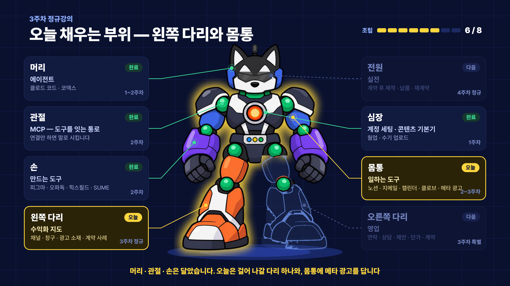
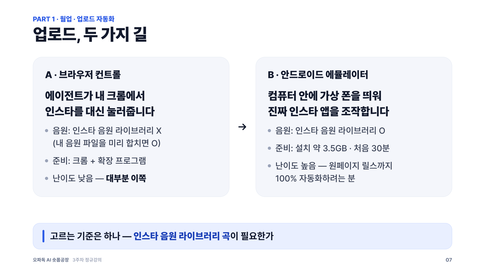
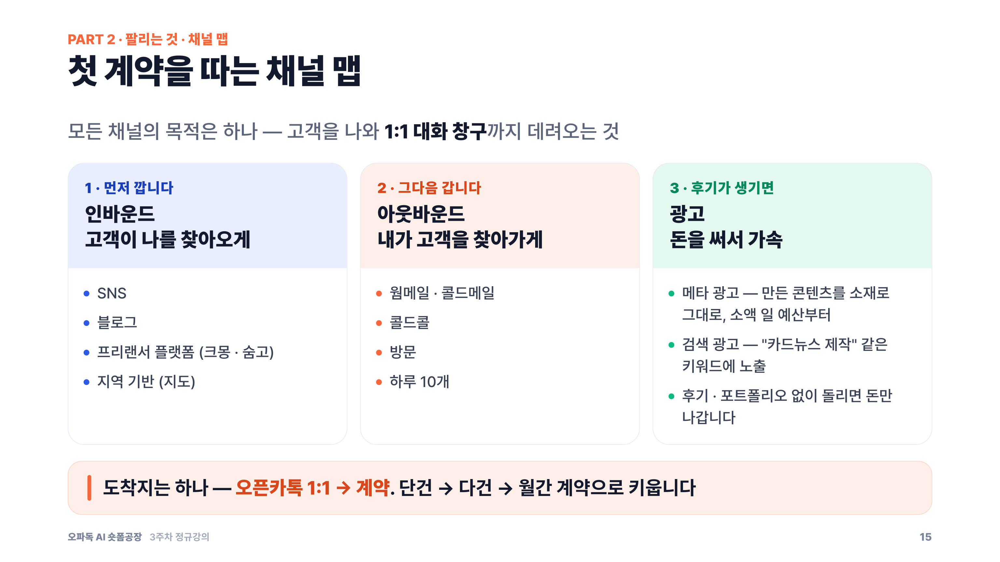
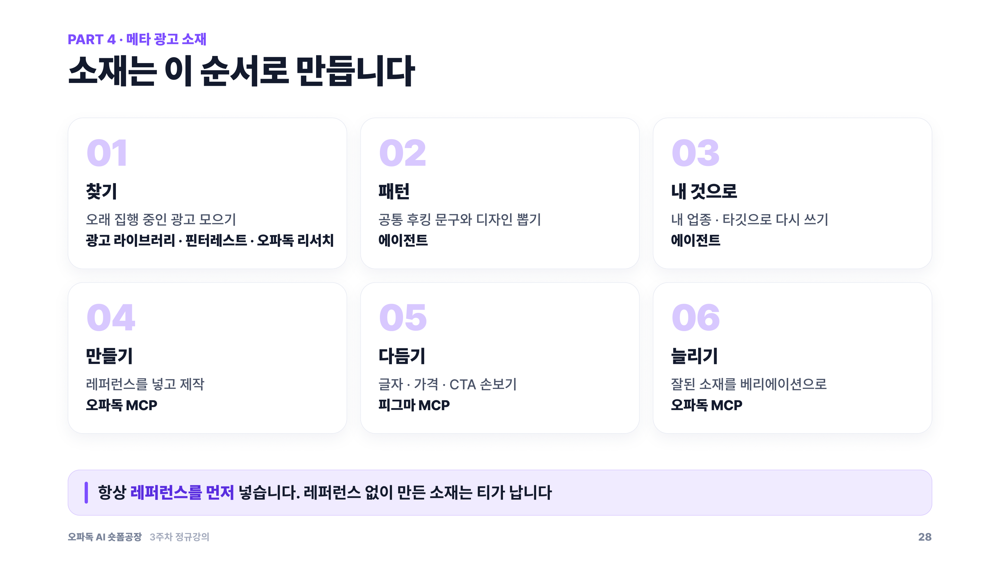
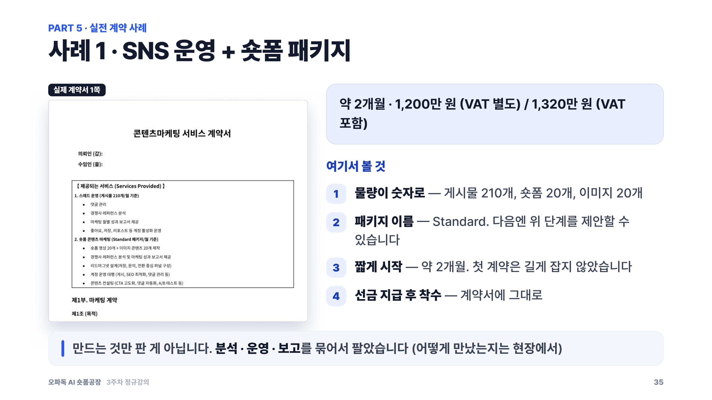
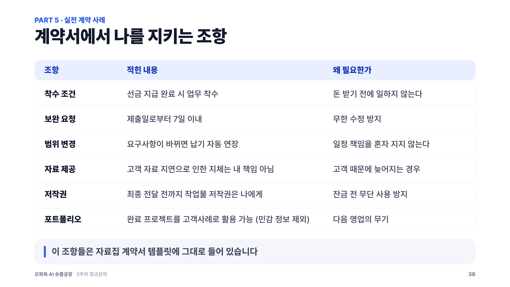
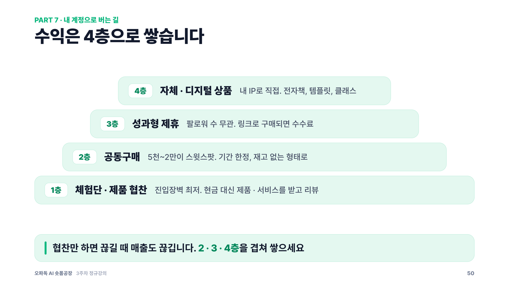
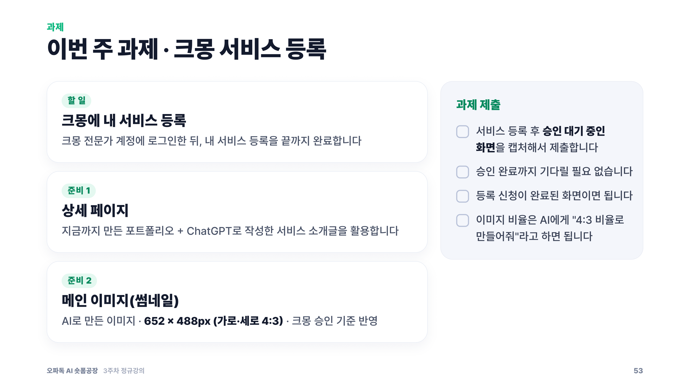

🏠 > [ai_agent](../../) > [opadog](../) > **오파독AI | Summary Notes 5**

<table>
  <tr>
    <td><a href="./">[오파독]</a></td>
    <td><a href="S01_notes.md">노트1</a></td>
    <td><a href="S02_notes.md">노트2</a></td>
    <td><a href="S03_notes.md">노트3</a></td>
    <td><a href="S04_notes.md">노트4</a></td>
    <td><b href="S05_notes.md">노트5</b></td>
    <td><a href="S06_notes.md">노트6</a></td>
    <td><a href="S07_notes.md">노트7</a></td>
  </tr>
</table>

---
# 오파독 AI 숏폼공장 — 3주차 정규강의 요약 노트

> **이제 파는 것만 남았습니다**  
> 부제: **돈이 들어오는 길 — 첫 계약을 따는 전체 지도**  
> 원본: `오파독 3주차 정규강의.pdf` (54쪽)  
> 목적: GitHub에서 다시 찾아보기 쉬운 강의 요약 및 실습 노트

> [!NOTE]
> 이 문서는 **3주차 정규강의**를 요약한 학습 노트입니다. 별도 자료인 **3주차 특별강의**와 혼동하지 마세요. 아래 가격·성과·팔로워 기준은 강의에 제시된 당시의 사례 또는 설명이며, 현재 시장의 보장 수치가 아닙니다. 실제 서비스 정책, 법률 및 광고 플랫폼 기능은 별도로 확인해야 합니다.

## 목차

1. [강의 전체 지도](#1-강의-전체-지도)
2. [PART 1 — 웜업과 업로드 자동화](#2-part-1--웜업과-업로드-자동화)
3. [PART 2 — 지금 팔리는 것과 채널 맵](#3-part-2--지금-팔리는-것과-채널-맵)
4. [PART 3 — 상담 창구 만들기](#4-part-3--상담-창구-만들기)
5. [PART 4 — 메타 광고 소재](#5-part-4--메타-광고-소재)
6. [PART 5 — 실전 계약 사례](#6-part-5--실전-계약-사례)
7. [PART 6 — 첫 계약까지](#7-part-6--첫-계약까지)
8. [PART 7 — 내 계정으로 버는 길](#8-part-7--내-계정으로-버는-길)
9. [실습 프롬프트 모음](#9-실습-프롬프트-모음)
10. [실행 체크리스트와 과제](#10-실행-체크리스트와-과제)
11. [핵심 요약](#11-핵심-요약)

---

## 1. 강의 전체 지도

**핵심 메시지:** 제작 도구를 익힌 뒤에는 **고객 유입 → 상담 → 제안 → 계약 → 납품 → 재계약**의 구조를 구축해야 한다.

강의 3쪽은 학습 과정을 로봇 조립에 비유한다. 머리(에이전트), 관절(MCP), 손(제작 도구)을 준비했다면, 이번 정규강의는 **왼쪽 다리(수익화 지도)**와 **몸통의 메타 광고 연결**에 집중한다. 오른쪽 다리(영업)는 3주차 특별강의, 계약 후 제작·납품은 다음 정규강의에서 이어진다.



| 수익화 길 | 고객/수익원 | 대표 상품·방법 |
|---|---|---|
| A. 남의 것을 만들어준다 | 사장님, 브랜드, 대행사 | 카드뉴스·숏폼 제작, SNS 운영대행, 광고 소재 |
| B. 내 계정으로 번다 | 팔로워, 브랜드 | 협찬, 공동구매, 성과형 제휴, 자체 디지털 상품 |

두 길을 병행해 한쪽 수익이 흔들리는 위험을 분산한다. **단건 → 다건 → 월간 계약**으로 상품을 확장하는 것이 강의의 핵심 수익화 방향이다. (14쪽)

## 2. PART 1 — 웜업과 업로드 자동화

**원본 4~9쪽**

### MCP 준비 확인
- 제작: 오파독·힉스필드·SUME
- 수정: 피그마
- 관리: 노션
- 연락·일정: 지메일·구글 캘린더
- 광고: 메타 Ads
- 강의의 워밍업은 연결 확인, 크레딧 확인, 노션 콘텐츠 캘린더 조회이다.

### 인스타그램 업로드의 두 경로 (7~8쪽)

| 구분 | A. 브라우저 컨트롤 | B. 안드로이드 에뮬레이터 |
|---|---|---|
| 방식 | PC 크롬 화면 조작 | 가상 스마트폰의 인스타 앱 조작 |
| 장점 | 설정과 조작이 비교적 쉬움 | 앱 내 음원 라이브러리 사용 가능 |
| 한계 | 강의 시점에는 PC에서 인스타 음원 선택 불가 | 설치·설정 복잡, 약 3.5GB 준비 |
| 강의 권장 | 일반적인 게시 준비 | 앱 음원이 꼭 필요한 경우 |



강의에서는 PC 웹, 모바일 모드, 예약 도구 등에서 인스타그램 음원을 붙이는 데 제약이 있다고 설명한다. 이는 **강의 당시의 환경·실습 결과**로 이해한다.

**운영 원칙:** 자동화로 파일·캡션을 준비하되 **최종 게시 버튼은 사람이 확인하고 누른다.** 새 계정은 첫 한 달 수기 업로드를 권한다. 게시 후 노션 상태를 `발행`으로 변경한다. (9쪽)

## 3. PART 2 — 지금 팔리는 것과 채널 맵

**원본 10~18쪽**

### 크몽에서 상품을 조사하는 이유 (11~12쪽)
강의의 크몽 예시 목록 가격: 카드뉴스 5,000원부터, AI 광고 이미지 19,000~20,000원, SNS 운영대행 550,000~600,000원 등. **검색 목록의 최저가가 실제 평균 계약금액을 뜻하지 않는다.** 스탠다드·디럭스·프리미엄 구성, 수량, 후기, 상세가격을 비교해야 한다.

### 고객 유입 채널 (15~16쪽)



1. **인바운드:** 인스타그램·스레드·유튜브·틱톡·링크드인, 블로그, 크몽·숨고, 지역 검색.
2. **아웃바운드:** 잠재고객 조사 후 웜메일·콜드메일·DM·전화·방문.
3. **광고:** 후기와 포트폴리오가 확보된 뒤 메타·검색 광고로 확대.

**모든 유입의 목적지:** 고객과 직접 대화할 수 있는 **1:1 상담 창구**.

### 잠재고객 발굴
- 네이버지도·구글맵에서 업종과 지역을 정해 업체를 찾는다.
- 상호, 주소, 전화번호, 인스타그램 유무를 확인해 CRM에 기록한다.
- 처음에는 10곳부터 검증하고 이후 50곳으로 확장한다. (17쪽)
- 강의는 하루 10건 연락을 예시로 제시한다. `100명 접촉 → 10명 전환` 등의 숫자는 **설명용 가정**이며 실제 전환율 보장이 아니다. (18쪽)
- 콜드메일보다 **기존 게시물 확인 → 가벼운 상호작용 → 맞춤형 웜메일**을 권한다.
- 메일은 초안만 작성하고 **발송 전 사람이 검토**한다.

## 4. PART 3 — 상담 창구 만들기

**원본 19~22쪽**

### 3가지 창구
1. **오픈카톡 1:1:** 상담 목적지. 채팅방 링크를 복사해 각 채널에 연결.
2. **리틀리:** 인스타그램 프로필의 한 링크에 상담·크몽·포트폴리오·SNS·이메일을 모음.
3. **소개 웹사이트:** 서비스 3종, 작업물, 연락처, SNS 계정, 가장 눈에 띄는 상담 링크를 배치.

강의의 리틀리 배치 순서: `1:1 상담 → 크몽 서비스 → 포트폴리오 → SNS → 이메일/견적 문의`.

**소개 사이트 필수 요소:** 상담 링크 / 제공 서비스 / 레퍼런스 / 연락처 / SNS. 모바일 화면과 링크 권한을 반드시 확인한다. (21쪽)

**크몽 서비스 등록:** 고객이 실제 검색하는 키워드로 제목을 짓고, 초반에는 서비스 하나에 집중해 후기 분산을 막는다. (22쪽) 개인 프리랜서의 사업자·세무 문제는 실제 상황과 최신 기준을 별도 확인한다.

## 5. PART 4 — 메타 광고 소재

**원본 23~32쪽**

### 왜 광고 소재인가?
강의는 광고 이미지·영상 제작을 비교적 짧은 단위로 반복 수주할 수 있는 상품으로 소개한다. 광고 운영 실무와 소재 제작은 구분한다. (24쪽)

### 메타 광고의 3층 구조 (25쪽)

| 층 | 역할 | 예시 |
|---|---|---|
| 캠페인 | 목표 | 리드, 구매, 트래픽 |
| 광고 세트 | 타깃·예산·노출 위치 | 누구에게 얼마를 쓸지 |
| 광고 | 실제 소재 | 이미지·영상·문구 |

- **CTR:** 노출 대비 클릭 비율(강의에서는 본 사람 중 클릭 비율로 소개)
- **CPL:** 리드 1건 확보 비용
- **ROAS:** 광고비 대비 매출 비율

메타 Ads MCP 연결 예시 주소: `https://mcp.facebook.com/ads` (26~27쪽). 실제 지원 여부와 권한은 연결 시점에 확인한다.

### 광고 소재 제작 6단계 (28~32쪽)



1. **찾기:** 메타 광고 라이브러리·핀터레스트 등에서 레퍼런스 조사
2. **패턴:** 오래 집행된 광고의 후킹·구도·디자인 특징 분석
3. **내 것으로:** 고객 업종·타깃에 맞는 새 문구 작성
4. **만들기:** 오파독 MCP로 1:1 광고 이미지 제작
5. **다듬기:** 피그마 MCP에서 헤드라인·가격·CTA 수정
6. **늘리기:** 색상·배경·헤드라인 베리에이션, 9:16 릴스 확장

**후킹 공식:** `타깃 호출 + 가치 약속`. **3초 안에 읽히는 분량**을 목표로 한다. 타사 광고는 **디자인의 원리만 참고**하고, 문구와 내용은 새로 만든다. 장기 집행 광고는 성과를 추정하는 참고 신호이지 실제 수익의 증거는 아니다.

## 6. PART 5 — 실전 계약 사례

**원본 33~40쪽**

### 문서 흐름
`견적서(가격 제안) → 계약서(범위·책임 합의) → 세금계산서(청구)` (34쪽)

### 강의 사례 1 — SNS 운영 + 숏폼 패키지
- 약 2개월 / **1,200만 원(VAT 별도)**, **1,320만 원(VAT 포함)**.
- 게시물 210개, 숏폼 20개, 이미지 20개 등 **수량을 숫자로 명시**.
- 분석·운영·보고를 묶은 패키지, 선금 후 착수. (35쪽)



### 강의 사례 2 — SNS 운영 + 인스타 브랜딩
- 6개월 / 월 1,300만 원, 합계 **7,800만 원 + VAT 780만 원 = 8,580만 원**.
- 6개월 총량(릴스 90건 등)과 월별 보고 포함.
- 정가를 먼저 제시한 뒤 기간별 할인안을 제시한다. (36쪽)
- 촬영·모델 섭외·광고비·홈페이지 개발·행사 등은 기본 범위 밖으로 별도 명시. (37쪽)

### 계약서에서 지킬 조항 (38쪽)



| 항목 | 강의에서 제시한 예 |
|---|---|
| 착수 | 선금 지급 완료 후 시작 |
| 보완 요청 | 제출일로부터 7일 이내 |
| 범위 변경 | 추가 요구 시 납기 조정 |
| 자료 지연 | 고객 자료 제공 지연의 책임 구분 |
| 저작권 | 최종 전달 전 권리 처리 조건 명시 |
| 포트폴리오 | 민감정보 제외, 사례 활용 가능 여부 명시 |

계약서 문구는 실제 거래 조건과 법률에 맞춰 검토해야 한다. 39쪽에는 **4,290만 원 전자세금계산서 사례**가 소개된다. 개별 사례 금액을 일반적인 매출 기대치로 해석하지 않는다.

## 7. PART 6 — 첫 계약까지

**원본 41~46쪽**

- 리드(문의)가 생겼다고 바로 계약되는 것은 아니다.
- 준비가 완벽하지 않아도 상담을 통해 고객이 고민하는 지점을 배운다.
- 즉시 공유할 수 있는 **개인 랜딩페이지**와 **포트폴리오 PPT/PDF**를 준비한다.
- 명함 이미지, 업무용 연락처, 상담 체크리스트, 견적서·계약서 양식을 마련한다.
- 상담 신청은 메일·시트·DB 등 **기록이 남는 곳**에 수집한다.
- 모바일 화면, 링크 권한, 문의 접수 후 알림을 직접 테스트한다.
- 첫 정기계약까지의 상담 횟수 등은 강사의 경험 사례이지 보장 수치가 아니다.

## 8. PART 7 — 내 계정으로 버는 길

**원본 47~52쪽**

### 계정 수익화 4층 구조 (50쪽)



| 층 | 수익 모델 | 설명 |
|---|---|---|
| 1층 | 체험단·제품 협찬 | 제품·서비스 제공을 받고 콘텐츠 제작 |
| 2층 | 공동구매 | 기간 한정 상품 판매 연결 |
| 3층 | 성과형 제휴 | 링크 구매·성과에 따른 수수료 |
| 4층 | 자체 디지털 상품 | 전자책, 템플릿, 클래스 |

48~49쪽의 팔로워 규모별 협찬 선호·단가·참여율 수치는 강의에서 소개된 **참고치**이며, 조사 시점·표본·업종별 편차가 있다. 실제 단가는 참여율·콘텐츠 형식·브랜드 적합도에 좌우된다.

### 협업 제안용 미디어킷 (51쪽)
- 계정 소개: 카테고리, 타깃
- 운영 포맷: 릴스·피드·스토리 등
- 최근 성과: 조회·저장·참여
- 협업 범위 및 대표 게시물 3개

### 계정 안전 (52쪽)
- 협찬·광고 등 대가성 콘텐츠는 적절하게 표시.
- 계정 카테고리와 타깃을 일관되게 유지.
- 인스타그램 하나에만 의존하지 말고 링크 허브·이메일·자체 채널을 병행.
- 새 계정의 과도한 자동화·반복 활동을 피하고 공식 정책을 준수.

## 9. 실습 프롬프트 모음

> 아래 프롬프트는 강의 내용을 바탕으로 **복사하기 쉽게 정리한 버전**입니다. MCP 또는 연결 서비스가 실제로 있어야 실행 가능한 요청이 포함되어 있습니다.

### ① MCP 상태와 일정 확인 — 5쪽

```text
오파독 MCP 연결 상태를 확인하고 크레딧 잔액을 알려줘.
노션 콘텐츠 캘린더에서 이번 주 발행 예정 콘텐츠도 정리해줘.
```

### ② 게시 준비 — 9쪽

```text
노션 콘텐츠 캘린더에서 상태가 '예약'인 첫 번째 콘텐츠를 찾아
인스타그램 게시 준비를 해줘. 파일과 캡션을 채우되
최종 게시 버튼은 누르지 말고 내 확인을 받아.
```

### ③ 크몽 경쟁 서비스 조사 — 12쪽

```text
크몽에서 '카드뉴스 제작' 상위 서비스 20개를 조사해줘.
서비스명, 목록 가격, 3단 가격, 후기 수, 제공 수량을
표로 정리하고 엑셀로 저장해줘.
```

### ④ 잠재고객 조사 — 17쪽

```text
네이버지도와 구글맵에서 [지역]의 [업종]을 검색해
홈페이지나 인스타 운영이 약한 곳 10곳을 찾아줘.
상호, 주소, 전화번호, 인스타 유무를 표로 정리해줘.
확인되지 않은 정보는 추측하지 말고 빈칸으로 둬.
```

### ⑤ 웜메일 초안 — 18쪽

```text
잠재고객 10곳에 보낼 맞춤형 영업 메일 초안을 작성해줘.
인스타 카드뉴스·릴스 제작 서비스를 소개하고
무료 진단을 제안해줘. 5줄 이내, 제목 3개 버전으로.
발송하지 말고 임시보관함에만 저장해줘.
```

### ⑥ 소개 웹사이트 — 21쪽

```text
서비스를 SNS 운영대행, 숏폼 제작, 카드뉴스 제작 3개로 구성해줘.
상단에 1:1 카톡 상담 버튼을 크게 넣고,
포트폴리오·이메일·SNS 계정도 배치해줘.
모바일에서 읽기 쉽게 만들어줘.
```

### ⑦ 광고 레퍼런스 조사와 패턴 추출 — 29~30쪽

```text
[업종] 광고를 조사해 오래 집행 중인 광고 10개의
광고주, 헤드라인, 소구점, 형식을 정리해줘.
그중 3개의 공통 후킹 문구와 디자인 특징을 분석하고,
[고객사]에 맞는 새로운 헤드라인 5개를 제안해줘.
```

### ⑧ 광고 이미지 제작과 수정 — 31~32쪽

```text
첨부한 레퍼런스 2장의 구도와 글자 배치를 참고해
메타 광고용 1:1 이미지를 만들어줘.
헤드라인은 '[문구]', CTA는 '상담 후 결정하세요 →'.
실제 브랜드 상표는 사용하지 말고 제작 전 비용을 알려줘.
이후 헤드라인과 배경색을 바꾼 버전 4개를 만들어줘.
```

### ⑨ 운영대행 견적서 — 40쪽

```text
[업종] 고객을 위한 인스타그램 운영대행 견적서 초안을 작성해줘.
월 릴스 [n]건, 카드뉴스 [n]건 기준으로 품목을 나누고,
정가와 6개월 장기 계약 할인가를 비교해줘.
촬영, 광고비, 개발 등 기본 범위 제외 항목도 명시해줘.
```

### ⑩ 상담 준비와 미디어킷 — 44·51쪽

```text
SNS 운영대행 고객 상담용 질문 체크리스트를 만들어줘.
예산, 목표, 일정, 콘텐츠 수량, 수정 범위, 자료 제공을 포함해줘.

내 인스타 계정의 미디어킷도 구성해줘.
카테고리, 타깃, 운영 포맷, 최근 성과, 협업 범위,
대표 게시물 3개를 넣되 수치는 확인된 것만 사용해줘.
```

## 10. 실행 체크리스트와 과제

### 영업 준비
- [ ] 오파독 및 필요한 MCP 연결 점검
- [ ] 포트폴리오와 서비스 소개서 준비
- [ ] 크몽 경쟁 서비스·가격 조사
- [ ] 오픈카톡 1:1 상담 창구 개설
- [ ] 리틀리에 상담·포트폴리오·크몽 링크 연결
- [ ] 모바일에서 소개 웹사이트와 링크 확인
- [ ] CRM에 잠재고객 10곳 등록
- [ ] 맞춤형 웜메일 초안 작성 후 직접 검토
- [ ] 견적서·계약서·상담 체크리스트 준비
- [ ] 광고 소재 1개 및 베리에이션 제작
- [ ] 협업 미디어킷 초안 작성

### 공식 과제 — 53쪽
- [ ] 크몽 전문가 계정 로그인
- [ ] 서비스 상세페이지 작성 (포트폴리오 + 서비스 소개)
- [ ] 메인 썸네일 준비: **652 × 488px**, 약 4:3
- [ ] 크몽 서비스 등록 신청 완료
- [ ] **승인 대기 화면 캡처 제출** (승인 완료까지 기다릴 필요 없음)



## 11. 핵심 요약

1. **제작 능력만으로는 수익이 나지 않는다.** 고객이 들어올 경로와 상담 창구가 필요하다.
2. **인바운드·아웃바운드·광고**는 모두 1:1 상담으로 연결한다.
3. **목록 최저가가 상품의 전부는 아니다.** 수량과 서비스 범위를 묶어 패키지로 판매한다.
4. **광고 소재는 레퍼런스 조사 → 패턴 분석 → 새 제작 → 수정 → 확장** 순서로 만든다.
5. **계약은 숫자로 명확히 한다.** 물량, 수정, 일정, 선금, 범위 제외 항목을 적는다.
6. **외주 수익과 내 계정 수익을 병행**하고, 특정 플랫폼에 대한 의존도를 낮춘다.
7. **이번 주의 구체적 행동은 크몽 서비스 등록**이다.

---

**다음 강의 연결:** 3주차 특별강의는 *첫 연락부터 계약서까지*를 다룬다. 이 정규강의의 채널·창구·상품 전략을 실제 영업과 계약으로 이어가는 과정이다.

**출처:** `오파독 3주차 정규강의.pdf` (54페이지). 슬라이드 이미지는 개인 학습용 발췌이며, 공개 GitHub 저장소에 원본 슬라이드 이미지를 올리기 전 재배포 권한을 확인하세요.
