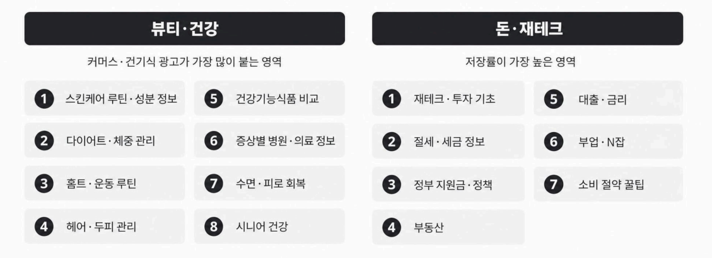
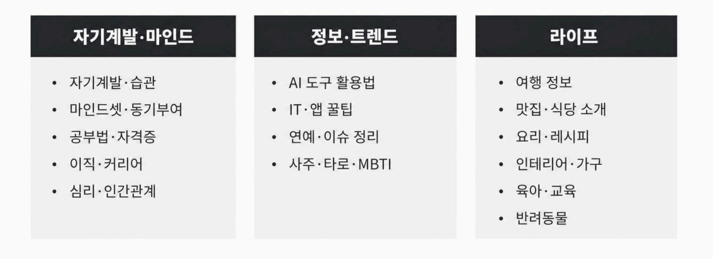
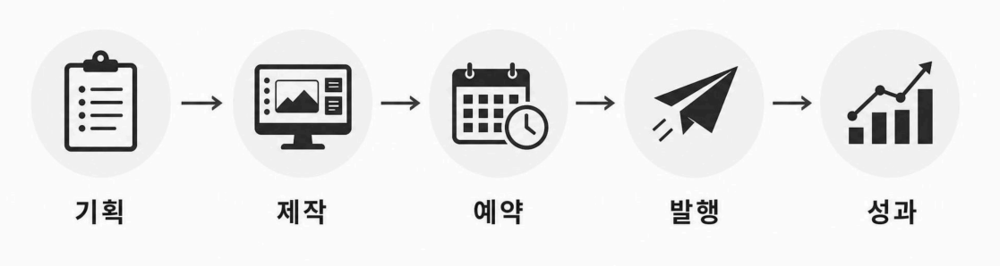
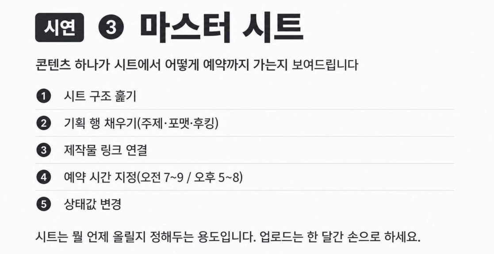
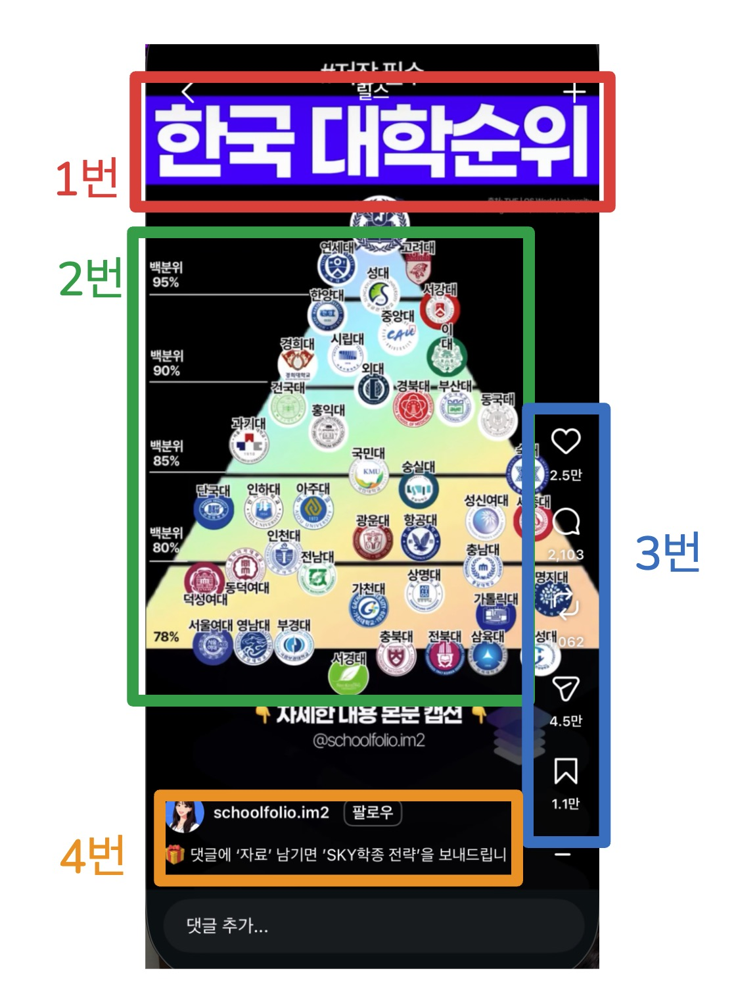

🏠 > [ai_agent](../../) > [opadog](../) > `S01_강의`

<table>
  <tr>
    <td><a href="./">[오파독]</a></td>
    <td><a href="S00_강의.md">O.T</a></td>
    <td><b href="S01_강의.md">강의1</b></td>
    <td><a href="S02_강의.md">강의2</a></td>
    <td><a href="S03_강의.md">강의3</a></td>
    <td><a href="S04_강의.md">강의4</a></td>
    <td><a href="S05_강의.md">강의5</a></td>
    <td><a href="S06_강의.md">강의6</a></td>
    <td><a href="S07_강의.md">강의7</a></td>
  </tr>
</table>

### INDEX
- [1. 4주 로드맵과 운영안내](#1-4주-로드맵과-운영안내)
- [2. 바이럴을 만드는 3가지](#2-바이럴을-만드는-3가지)
- [3. 레퍼런스 찾는 법](#3-레퍼런스-찾는-법)
- [4. 계정 지키는 법](#4-계정-지키는-법)
- [5. 콘텐츠 발행 관리](#5-콘텐츠-발행-관리)
- [Tip. 유용한 도구](#tip-유용한-도구)
- [Tip. 웜업시 참조](#tip-웜업시-참조)

---
## 1차 강의
> 오늘하는 것
> - 인스타 보면서 레퍼런스 수집
> - 계정 웜업 (좋아요, 저장, 관심있음)
> - 오파독 AI 가입, 로그인

### 1. 4주 로드맵과 운영안내
> - 1주차 : 계정세팅, 웜업, 레퍼런스 수집
> - 2주차 : 콘텐츠 자동화 제작 + 오파독 AI 오픈
> - 3주차 : 발행운영‧수익화

- 인스타그램 계정 : 
  - 디지털 크리에이터
  - 프로페셔널 프로필로 전환
  - 비즈니스
- 비즈니스 계정 id
  - [x] @standon.agency
  - [x] @bigpy_craft
  - [] @aicampaign.lab
  - [] @adpilot.ai
  - [] @nextad.ai
  - [] @ai2xpert.jace

 

[[TOP]](#index)

---
### 2. 바이럴을 만드는 3가지 
> **썸네일, 정보의 질, 저장‧공유**

- **썸네일이 전부**
  - 돋보기 탭에서 한눈에 들어오게, 멀리서봐도 읽히면 된다.
- **조회수보다 저장‧공유** 
  - 알고리즘은 저장을 더 세게 본다
  - 기획할 때 딱 하나만 물어본다. 이거 저장하고 싶은가?
- **캡션 첫 줄이 승부처** 
  - 첫 줄에 행동유도(CTA, Call To Action)
    - 댓글에 '자료'남기면 'OOO전략'을 보내드립니다.
    - 저장해두고 하나씩 해보세요, 지금 바로 실철해 보세요, 친구에게 공유해보세요.
  - 첫줄만 보입니다. 나머지는 안봅니다.
- **무료 자료로 문의를 만든다.**
  - 무료 자료 ⇒ 링크 유도 ⇒ 자동화 응대
  - 계정을 수익 통로로 바꾸는 지점이다. 
- **올리는 시간대**
  - 오전 7~9시
  - 오후 5~8시
  - 정답은 내 인사이트에 있다.
  - 이시간에 올리면 숙성이 되서 새벽시간에도 많이 보게 된다.
- **Edits + 트렌드음악**
  - Edits‧제작
  - 제작 표기가 뜨면 노출에 도움이 된다
- 인사이트 읽는 법
  - 영상별 유입 비율을 본다
  - 탐색 탭 비중이 높으면 잘 퍼진 겁니다
  - 팔로워 유입만 높으면 도달이 안 터진거다

 

[[TOP]](#index)

---
### 3. 레퍼런스 찾는 법
- 인스타를 어떻게 보는지 그대로 보여드립니다
  - 검색 : 관심 주제와 키워드로 콘텐츠를 찾아낸다
  - 판별 : 콘텐츠의 가치와 신뢰도를 빠르게 판단한다
  - 수집 : 유용한 콘텐츠를 체계적으로 저장하고 정리한다
- 레퍼런스 리서치
  - 돋보기 탭 ⇒ 주제 검색 ⇒ 스크롤하며 소리내어 판별 ⇒
  - 좋아요 ⇒ ... ⇒ 관심 있음 ⇒ 계정진입 ⇒ 팔로우 ⇒ 추천계정 재수집
- 참조할 것
  - [ ] 움직이는 영상 → 우리가 못 만듬, 패스
  - [x] 원페이지, 텍스트 큼직 → 우리 거
  - [x] 카드뉴스, 배경 정지 → 자동화 가능
- 모범 영상 기준
  - **계정 팔로워 : 1만 명 이상**
  - **영상 조회수 : 30만~100만 이상**
  - 기준 없이 보면 그냥 인스타 하다가 30분 날립니다.
- 카테고리는 넓게
  - 야구 X  ⇒ 스포츠 O
  - 좁게 잡으면 그 분야 광고만 들어온다.
  - **우리 목적은 잠재 고객사 입니다.**
- 추천 주제 30선
  카테고리 | 추천주제
  --------|--------------
  뷰티‧건강      | 커머스‧건기식 광고가 가장 많이 붙는 영역
  돈‧재테크      | 저장률이 가장 높은 영역
  자기계발‧마인드 | 
  정보‧트랜드    | AI도구 활용법, IT‧앱 꿀팁, 연예‧이슈 정리
  라이프        | 여행정보, 맛집‧식당 소개, 요리‧레시피 등

- 인스타그램 운영기획 => [[참고]](인스타그램_운영기획.md)

 

[[TOP]](#index)

---
### 4. 계정 지키는 법

- 규정에 걸리는 패턴
  - 봇 판정1순위 - 만들자마자 자동화 업로드
  - 대량 활동 감지 - 좋아요‧관심있음 몰아서
  - 스팸 행동 - 무분별한 대량 팔로우
  - 중복 콘텐츠 - 동일 콘텐츠 반복 업로드
- 절대 금지 3가지
  - 자동 DM‧소셜비즈류
  - 만들자마자 자동 업로드
  - 대량 팔로우
  - 특히, 자동 DM은 바로 정지입니다. 절대 쓰지 마세요.
- 첫 한달은 무조건 수기
  - 인스타‧스레드용 구글 계정 분리 생성
  - 첫 한달 수기 업로드, 하루 1개
  - 좋아요‧저장‧댓글 등 자연스러운 활동 병행
  - 한달뒤 자동화 단계 확대
  - ⇒ 자동화는 속도 얻으려고 하는게 아니라 반복가능성 얻으려고 하는겁니다
  - ⇒ 급하게 돌리다 계정 날아가면 효율 0입니다.
- 다계정 기준
  - 휴대폰 1대당 계정 2~3개 까지
  - 주의 : 4개 이상은 공기계 분리(중고폰 약10만원) / 중복 로그인 최소화
  - 고객사 계정 늘어나면 업무용 폰 하나 사는게 훨씬 쌉니다.
- **계정은 다시 만들면 되지만,** 
- **알고리즘은 다시 안 만들어집니다.**

 

[[TOP]](#index)

---
### 5. 콘텐츠 발행 관리

- 왜 시트가 필요한가
  - 고객사 계정 3개만 돼도 머리로 관리가 안됩니다

 

[[TOP]](#index)

---
### Tip. 유용한 도구
- 매니챗, Manychat : 댓글 대응
- 소셜비즈, 자동화 메시지 솔루션
- Edits + 트렌드 음악 : 간편한 동영상 제작 및 편집
  - 인스타그램이 만듬
  - Edits.제작 -> 라벨을 달아준다. 노출에 도움
  - 영상안에 음악을 넣는게 아니라(무음이나 효과음만), 배경음악은 무조건 여기서 넣는다. 
  - Trending, 유행 카테고리의 음악을 고른다
- 인사이트 읽는 법
  - 영상별 유입 비율을 본다
  - 유입경로 등

제목, 내용, 좋아요댓글수...

 

[[TOP]](#index)

---
### Tip. 웜업시 참조 

 

<!-- 

  

 -->
[인스타그램레퍼런스모음]: https://htmlpreview.github.io/?https://github.com/JaceKim-TheAL/ai_agent/blob/master/opadog/A1_수업/reference/인스타그램레퍼런스모음.html

- ⭐️ [Instagram 레퍼런스 모음][인스타그램레퍼런스모음]
- 📌 [원페이지 릴스 · 카드뉴스 레퍼런스 계정] @all 
  - 잘 되는 포맷을 먼저 보고, 웜업하세요!
- ✅ 원페이지 릴스 · 카드뉴스
  - https://www.instagram.com/numbers_talk_0/reels/
  - https://www.instagram.com/money_life_bal/reels/
  - https://www.instagram.com/helloheidi.trip/reels/
  - https://www.instagram.com/moni.toon..v/reels/
  - https://www.instagram.com/dasonibook/reels/
  - https://www.instagram.com/grow.day/reels/
  - https://www.instagram.com/trend_elf2/reels/
  - https://www.instagram.com/h0ney_news/reels/
  - https://www.instagram.com/workhack_daily/reels/
  - https://www.instagram.com/hot___click/reels/
  - https://www.instagram.com/jinro.n.lab/reels/
  - https://www.instagram.com/6a___best/reels/
  - https://www.instagram.com/apt_lap/reels/
  - https://www.instagram.com/careet.official/reels/
  - https://www.instagram.com/mylife_happy_elf/reels/
  - https://www.instagram.com/6a.war/
  - https://www.instagram.com/going_tothe_moon/
  - https://www.instagram.com/home_ford88/reels/
  - https://www.instagram.com/269_grand_pcxpcx/reels/
  - https://www.instagram.com/kangi.toon/reels/
  - https://www.instagram.com/flow.itself/reels/
  - https://www.instagram.com/successnote/
  - https://www.instagram.com/namui.sajeong_ssultoon/reels/
- ✅ 카드뉴스 전문 참고용
  - https://www.instagram.com/ai_margin_/
  - https://www.instagram.com/platformtree_/
  - https://www.instagram.com/sliq_ai/

 

[[TOP]](#index)

---