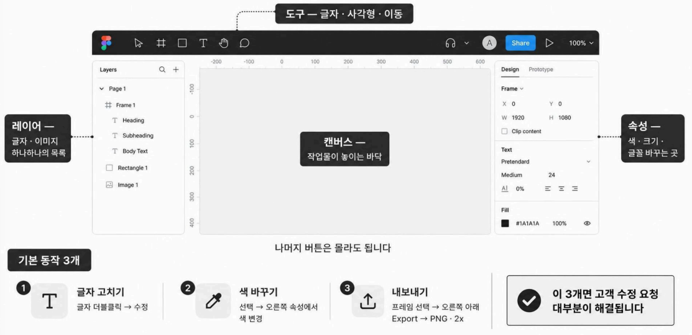
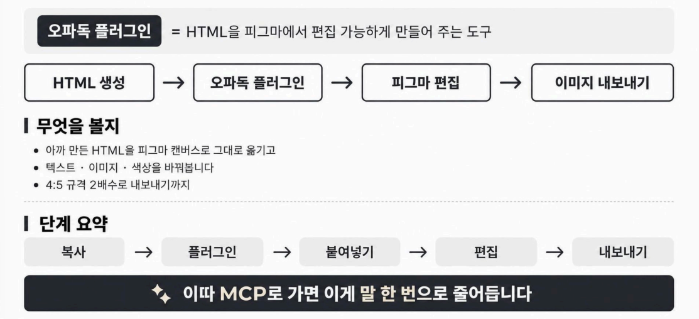

🏠 > [ai_agent](../../) > [opadog](../) > `S03_강의`

<table>
  <tr>
    <td><a href="./">[오파독]</a></td>
    <td><a href="S00_강의.md">O.T</a></td>
    <td><a href="S01_강의.md">강의1</a></td>
    <td><a href="S02_강의.md">강의2</a></td>
    <td><b href="S03_강의.md">강의3</b></td>
    <td><a href="S04_강의.md">강의4</a></td>
    <td><a href="S05_강의.md">강의5</a></td>
    <td><a href="S06_강의.md">강의6</a></td>
    <td><a href="S07_강의.md">강의7</a></td>
  </tr>
</table>

### INDEX
- [1️⃣ 복습 - HTML ‧ MCP, 다시 한 번 쉽게](#1️⃣-복습---html--mcp-다시-한-번-쉽게)
- [2️⃣ 실습 - 프롬프트 4종으로 직접 만들어 보기](#2️⃣-실습---프롬프트-4종으로-직접-만들어-보기)
  - [▶️ [실습] 크몽 썸네일 제작 프롬프트팩](#실습-크몽-썸네일-제작-프롬프트팩) 
  - [▶️ [실습] 자사몰 메인배너 제작 프롬프트팩](#실습-자사몰-메인배너-제작-프롬프트팩) 
  - [▶️ [실습] 상세페이지 제작 프롬프트팩](#실습-상세페이지-제작-프롬프트팩) 
  - [▶️ [실습] 매장 포스터·인스타그램 이미지 제작 프롬프트팩](#실습-매장-포스터인스타그램-이미지-제작-프롬프트팩) 
- [3️⃣ 2주차 혜택 - 디자인 툴 안내](#3️⃣-2주차-혜택---디자인-툴-안내)
- [4️⃣ 피그마 기초 - 로그인부터 화면 보는 법까지](#4️⃣-피그마-기초---로그인부터-화면-보는-법까지)
- [5️⃣ 피그마 플러그인 - HTML을 피그마로 옮기기](#5️⃣-피그마-플러그인---html을-피그마로-옮기기)
- [6️⃣ 앱 설치 - 클로드 앱 ‧ GPT 앱](#6️⃣-앱-설치---클로드-앱--gpt-앱)
- [7️⃣ 피그마 MCP - 말로 피그마에 올리기](#7️⃣-피그마-mcp---말로-피그마에-올리기) 

### 2주차 실습

구분  | 실습 | 문서파일 | 프롬프트 | TXT복사 
:---:|------|:------:|:-----:|:-----:
🟥 | [실습] 크몽 썸네일 제작 프롬프트팩     | [[PDF보기]][실습자료_PDF4] | [[프롬프트]][프롬프트_MD4] | [[원본]][프롬프트_TXT4]
🟨 | [실습] 자사몰 메인배너 제작 프롬프트팩  | [[PDF보기]][실습자료_PDF3] | [[프롬프트]][프롬프트_MD3] | [[원본]][프롬프트_TXT3]
🟩 | [실습] 상세페이지 제작 프롬프트팩      | [[PDF보기]][실습자료_PDF2] | [[프롬프트]][프롬프트_MD2] | [[원본]][프롬프트_TXT2]
🟦 | [실습] 매장 포스터·인스타그램 이미지 제작 프롬프트팩  | [[PDF보기]][실습자료_PDF1] | [[프롬프트]][프롬프트_MD1] | [[원본]][프롬프트_TXT1]


[실습자료_PDF1]: https://drive.google.com/file/d/1GnQnk-6bcoVwy6ps5BoNZqR-SH5l22Y5/view?usp=drive_link
[실습자료_PDF2]: https://drive.google.com/file/d/14W6AFF3SD3th7_ao_73BlIZbgxsUh-0t/view?usp=drive_link
[실습자료_PDF3]: https://drive.google.com/file/d/10Vi0frhNGeSrNC1CKfW1kBIM1pS2hx4Q/view?usp=drive_link
[실습자료_PDF4]: https://drive.google.com/file/d/1PS2P8-kToEtrgeqo34W0ZN7UTRCkIycv/view?usp=drive_link

[프롬프트_MD1]: ./D3_실습/실습_2주차/실습2-1_이미지제작.md 
[프롬프트_MD2]: ./D3_실습/실습_2주차/실습2-2_상세페이지.md 
[프롬프트_MD3]: ./D3_실습/실습_2주차/실습2-3_자사몰배너.md 
[프롬프트_MD4]: ./D3_실습/실습_2주차/실습2-4_크몽썸네일.md 

[프롬프트_TXT1]: ./D3_실습/실습_2주차/P1_이미지제작.txt
[프롬프트_TXT2]: ./D3_실습/실습_2주차/P2_상세페이지.txt
[프롬프트_TXT3]: ./D3_실습/실습_2주차/P3_자사몰배너.txt
[프롬프트_TXT4]: ./D3_실습/실습_2주차/P4_크몽썸네일.txt

--- 
## PART 1

### 1️⃣ 복습 - HTML ‧ MCP, 다시 한 번 쉽게

- **HTML = 사진이 아니라 설계도**
<table>
  <tr align="center">
    <td width="400"><b>이미지(사진)</b></td>
    <td width="400"><b>HTML(설계도)</b></td>
  </tr>
  <tr valign="top">
    <td>
      <ul>
        <li> 한번 찍으면 끝
        <li> 글자 하나 고치려면 다시 만들어야 함
      </ul>
    </td>
    <td>
      <ul>
        <li> 글자‧색‧위치를 나중에 고칠 수 있음
        <li> 같은 틀로 수십장 찍어내기 쉬움
        <li> 피그마로 옮겨서 디테일 편집 가능
      </ul>
    </td> 
  </tr>
  <tr align="center">
    <td colspan="2"><b>그래서 우리는 가능하면 HTML 버전으로 받아둔다</b></td>
  </tr>
</table>

- **MCP = AI에게 문을 하나 달아 주는 것**
  - 문이 없을때 → AI는 말만 합니다 (이렇게 하세요) 
  - 문이 있을때 → AI가 그 프로그램에 직접 들어가서 만들어 준다
  - 예시 : 피그마에 문을 달면 → AI가 프그마 안에 직접 디자인을 올려준다.
  - ★ 원리는 몰라도 된다. **문을단다** 이것만 기억하라.

<!-- **단계**  | **작업내용**
:---:|-----------------------------
**1단계** | GPT‧Gemini 제작봇으로 직접 만들기
**2단계** | 에이전트로 같은 작업 시키기
**3단계** | 오파독 MCP 연결 -->

- 작업 순서 (지난주 그래도)
<table>
  <tr align="center">
    <td width="100"><b>단계</b></td><td width="500"><b>작업내용</b></td>
  </tr>
  <tr><td align="center">1단계</td><td>GPT‧Gemini 제작봇으로 직접 만들기</td></tr>
  <tr><td align="center">2단계</td><td>에이전트로 같은 작업 시키기</td></tr>
  <tr><td align="center">3단계</td><td>오파독 MCP 연결</td></tr>
</table>
<br/>

---
### TIP. 파일명 일괄변경
> 파일명이 N으로 시작하는 파일만 찾아서 앞에 [실습]을 자동으로 추가

```bat
@echo off
setlocal DisableDelayedExpansion
cd /d "%~dp0"

echo ==============================
echo N으로 시작하는 파일명 변경
echo ==============================

for /f "delims=" %%F in ('dir /b /a-d "N*" 2^>nul') do (
    ren "%%F" "[실습]%%F"
)

echo.
echo 파일명 변경 완료!
pause

```
- 처음에는 복잡해 보이지만, 4개 부분으로 나누면 쉽습니다.
- ① for /f "delims="
  - /f는 명령어 실행 결과를 한 줄씩 읽어 반복한다는 뜻입니다.
  - "delims="는 파일명에 공백이 있어도 전체 이름을 그대로 읽도록 합니다.
- ② %%F
  - 현재 처리 중인 파일명을 저장하는 임시 변수입니다.
  - 예를 들어 첫 번째 파일이 N001.jpg라면 %%F에는 N001.jpg가 들어갑니다.
- ③ in ('dir /b /a-d "N*" 2^>nul')
  - 파일을 찾는 부분입니다.
    - dir : 폴더의 파일 목록 조회
    - /b : 파일명만 간단하게 출력
    - /a-d : 폴더는 제외하고 파일만 조회
    - "N*" : N으로 시작하는 이름 검색
    - 2^>nul : 오류 메시지를 표시하지 않음
- ④ do ( ren "%%F" "[실습]%%F" )
  - 찾은 파일의 이름을 변경합니다.
  - ren은 파일명을 변경하는 명령어입니다.
  - %%F가 N001.jpg라면 실제 실행되는 명령은 다음과 같습니다.

<br/>

[[TOP]](#index)

---
## PART 2

### 2️⃣ 실습 - 프롬프트 4종으로 직접 만들어 보기

**프롬프트팩**  | **어디에 쓰나**
:---:|-----------------------------
**크몽 썸네일 제작** | 크몽‧숨고 상품 대표 이지지
**자사몰 메인 배너** | 쇼핑몰‧스마트스토어 첫 화면
**상세 페이지 제작** | 스마트스토어‧쿠팡‧크몽 상세
**매장 포스터 ‧ 인스타그램 이미지 제작** | 오프라인 매장‧인스타 피드

- 만드는 순서 
  **단계**  | **작업 내용**
  :---:|-----------------------------
  ❶ | 프롬프트팩 열기
  ❷ | 프롬프트 복사 → GPT 또는 Gemini에 붙여넣기
  ❸ | 내 업종‧상품 정보 넣기 (없으면 아는 가게 하나 골라서)
  ❹ | 결과가 나오면 HTML 버전도 받아두기
  ❺ | 바탕화면 오파독작업 폴더에 저장

- 쓰기전에 지킬 원칙
  - 한번에 한가지만 수정 - 동시에 고치면 품질이 떨어진다
  - 레퍼런스는 캡처해서 붙이기 - 내용은 우리 것, 디자인만 참고
  - 결과가 깨지면 - 깨진 화면을 캡처해 다시 넣고 수정 요청
  - 한번에 전체를 만들라고 하면 오류 - 한 장씩 나눠서

---
### [실습] 크몽 썸네일 제작 프롬프트팩
> 📰 [[실습자료_PDF]][실습자료_PDF4]
> ‧ [[프롬프트_MD]](./D3_실습/실습_2주차/실습2-4_크몽썸네일.md)
> ‧ [[프롬프트_TXT]](./D3_실습/실습_2주차/P4_크몽썸네일.txt)

- 챗GPT에 프롬프트를 붙혀넣고 실행시켜본다
  - 제공해 주신 크몽 대표 썸네일 제작 가이드를 기준으로 작업하겠습니다
  - 라고 뜨며 알아서 썸네일 이미지를 만들어 준다
- 얼굴이 너무 달라, 그냥 사람 없는 썸네일로 제작해보기
  - 모델없이 이미지 뚝딱
- 이번에는 참조할 이미지를 복사하여 붙혀넣고 음성으로 다시 요청
  ```prompt
  자 이번에는 내가 지금 첨부한 이 정도 가독성 이 정도 느낌으로 예쁘게 만들어 주는데 색상은 좀 다른 색깔로 조금 전문성 있게 이렇게 변경해 줘.
  ```
- **레퍼런스를 넣으면 잘 나온다!!**

<br/>

[[TOP]](#index)

---
### [실습] 자사몰 메인배너 제작 프롬프트팩
> 📰 [[실습자료_PDF]][실습자료_PDF3]
> ‧ [[프롬프트_MD]](./D3_실습/실습_2주차/실습2-3_자사몰배너.md)
> ‧ [[프롬프트_TXT]](./D3_실습/실습_2주차/P3_자사몰배너.txt)

- 이번에는 새채팅창을 열고, 프롬프트중에서 **기본프롬프트** 만 복사해서 실행시켜보자
  - 제작 전에 필수 정보 2가지만 확인할게요. CTA는 별도 지정이 없으므로 세일 보러 가기로 적용하겠습니다.
  - 그냥 설정되어 있는데로 배너 제작하기 클릭 
  ```prompt
  PC용 여름 시즌 세일 배너를 제작해줘. 최대 할인율은 최대 50%, PC 배너 크기는 1920 × 700 px, CTA는 '세일 보러 가기'. 브랜드 로고는 없으므로 비워두고 앞서 요청한 디자인 방향대로 이미지 1개를 만들어줘.
  ```
  - PC용 여름 시즌 세일 배너 제작 완료

- 레퍼런스 붙혀서 작업해보기
  - 이번에는 파일안에 있는 레퍼런스 중에서, **BLACK FRIDAY** 이미지를 붙혀 놓고 실행시켜 보자
  ```prompt
  이번에는 우리가 블랙프라이데이 준비하는 느낌으로 근데 색상이랑 톤앤매너는 조금 다르게 참고하고 내가 지금 첨부한 이미지 참고를 해서 만들어 줘.
  ```
  - 이미지 뚝딱 : 참고 이미지의 고급스러운 블랙프라이데이 광고 구도를 활용하되, 딥 네이비·메탈릭 실버·레드 포인트로 차별화했습니다

- 작업을 할때 내가 머리를 쓰지말고, 그냥 AI에게 맡기자
  - 그냥 음성버튼 누르고 내 상황을 얘기해본다
  ```prompt
  좋아 결과물 좋았는데 내가 자사몰에 들어가는 배너 중에서 또 뭐 만들어 볼 만한 게 있을까? 더 만들어 보고 싶은데 왜냐하면 나 지금 포트폴리오를 많이 만들어야 돼서 결과물들 예시를 너가 제안해
  ```
  - 와~ 제가 추천하는 방향은 10가지 기획 주제 × 서로 다른 디자인 스타일로 포트폴리오를 만드는 것입니다.
  - 결과도 보여주고 다음에 제작할 배너를 뭘로 할지 물어보네. 하나 선택
  ```prompt
  08. 크리스마스 홀리데이 세일 주제로 자사몰 PC 메인 히어로 배너 1개를 제작해줘. 1920×700 비율을 목표로, 실제 기업 광고 대행사 포트폴리오 수준의 고급스러운 디자인으로 만들어줘. 브랜드와 카피, 컬러는 주제에 맞게 창의적으로 기획해줘.
  ```
- 한꺼번에 다 작업 요청하기 
  - 앞에서 만든 결과물에 대해서 전부 요청
  ```prompt
  앞에서 만든 자사몰 포트폴리오 추천 배너 열 가지 다 마음에 드는데, 너가 만들어준 제안이 다 좋아서 순차적으로 하나씩 천천히 다 만들어줘.
  ```
  - 작업 하나 끝날때마다 이어서 제작하기 클릭하여 작업

### 중요한 2가지 
- 첫번째, 내가 이 결과물을 왜 만들어라고 하면 내가 무엇을 만들 수 있는지 아는 것
- 두번째, 그렇게 나온 결과물들을 내가 정리해서 가지고 있는 것

<br/>

[[TOP]](#index)

---
### [실습] 상세페이지 제작 프롬프트팩
> 📰 [[실습자료_PDF]][실습자료_PDF2]
> ‧ [[프롬프트_MD]][프롬프트_MD1]
> ‧ [[프롬프트_TXT]](./D3_실습/실습_2주차/P2_상세페이지.txt)

- 하나의 상품 상세페이지를 상단·중앙·하단으로 나누어 제작하기 위한 가이드
  - 쿠팡이나 네이버에서 제작할 상품을 선택하고,
  - 제품이미지를 복사하고 챗GPT에 붙여놓고,
  - 프롬프트에서 **[공통 입력 양식]** , **[상단 프롬프트]** 를 입력후 상단이미지 제작
  - **[중앙 프롬프트]** , **[하단 프롬프트]** 를 순차적으로 입력해서 각각의 이미지를 출력한다
- 사용순서
  순서 | 작업내용
  :---:|-------------------------------------------------
  ❶ | 아래 준비 항목을 채우고 제품 사진을 첨부합니다.
  ❷ | 공통 입력 양식과 상단 프롬프트를 함께 입력해 상단을 제작합니다.
  ❸ | 선택한 상단 결과를 참고 이미지로 지정하고, 연결 요청문과 중앙 프롬프트를 입력합니다.
  ❹ | 선택한 상단·중앙 결과와 하단에 필요한 정보를 첨부하고, 연결 요청문과 하단 프롬프트를 입력합니다.
  ❺ | 후속 프롬프트로 구간별 문제를 수정하고, 편집 도구(예: 피그마)에서 세 이미지를 같은 폭으로 맞춰 연결합니다.
  ❻ | 제품 형태, 문구, 수치, 연결 부분을 확인하고 실제 쇼핑몰 화면에서 점검한 뒤 배포합니다.

<br/>

[[TOP]](#index)

---
### [실습] 매장 포스터·인스타그램 이미지 제작 프롬프트팩
> 📰 [[실습자료_PDF]][실습자료_PDF1]
> ‧ [[프롬프트_MD]][프롬프트_MD1]
> ‧ [[프롬프트_TXT]][프롬프트_TXT1]

- 신메뉴를 소개하는 매장 내 A2 포스터와 인스타그램 이미지를 제작하기 위한 가이드 
- 프롬프트의 대괄호[ ] 안의 내용은 매장과 메뉴 정보로 바꾼다
- 포스터 시안을 먼저 제작하고, 선택한 결과를 참고해 인스타그램용 이미지를 제작한다

<br/>

[[TOP]](#index)

---
### 3️⃣ 2주차 혜택 - 디자인 툴 안내

혜택  | 내용 | 문서파일 
:---:|------|:------:
혜택01 | 오파독 AI Ultra Plan                | [[PDF보기]][혜택01_PDF] 
혜택11 | 오파독 콘텐츠 캘린더 관리 노션 템플릿   | [[PDF보기]][혜택11_PDF] 
혜택17 | 오파독 전용 후킹 문구 생성 AI 프로그램  | [[PDF보기]][혜택17_PDF] 
혜택21 | 오파독 최적화 디자인툴 노하우 전자책 = 피그마 기초 안내서  | [[PDF보기]][혜택21_PDF] 

[혜택01_PDF]: https://drive.google.com/ 
[혜택11_PDF]: https://drive.google.com/file/d/1VaDIa0QsGkYAEGuxDwn9IYebTvS8dTP1/view?usp=drive_link
[혜택17_PDF]: https://drive.google.com/file/d/1NtB_NJoEUvCygEPtIxLBuhvtXMto_0K7/view?usp=drive_link
[혜택21_PDF]: https://drive.google.com/file/d/1Qn8eTpbaeaH6Hq0f2lOmE_jmIp7Q-WP9/view?usp=drive_link

<br/>

[[TOP]](#index)

---
## PART 3 

### 4️⃣ 피그마 기초 - 로그인부터 화면 보는 법까지
- 피그마란?
  - **무료 디자인 도구**
  - 설치없이 인터넷 브라우저에서 바로 사용 가능
  - 카드뉴스, 포스터, 배너 등 다양한 이미지 작업
  - 저장된 파일은 언제든지 불러와서 다시 수정할 수 있다
  - ∵ **MCP랑 작업하기가 너무 좋다**
- 피그마 작업화면



<br/>

[[TOP]](#index)

---
### 5️⃣ 피그마 플러그인 - HTML을 피그마로 옮기기



<br/>

[[TOP]](#index)

---
### 6️⃣ 앱 설치 - 클로드 앱 ‧ GPT 앱

<br/>

[[TOP]](#index)

---
### 7️⃣ 피그마 MCP - 말로 피그마에 올리기 

<br/>

[[TOP]](#index)

---