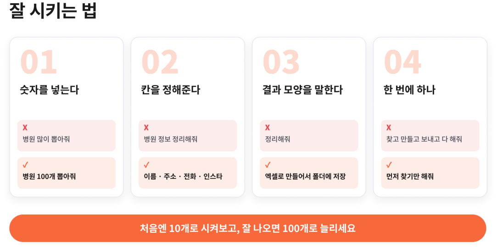
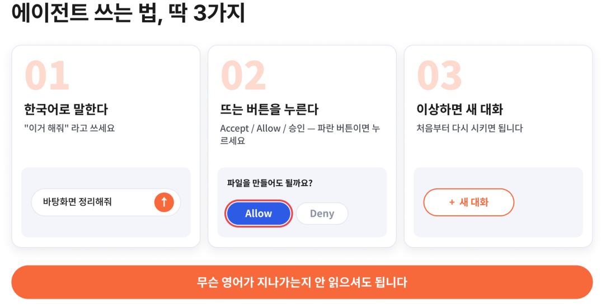
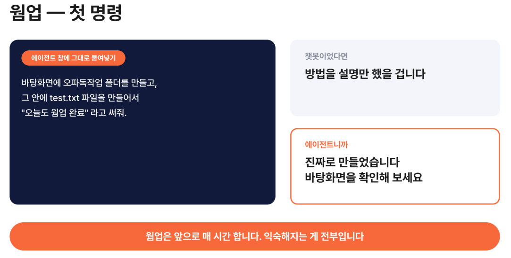
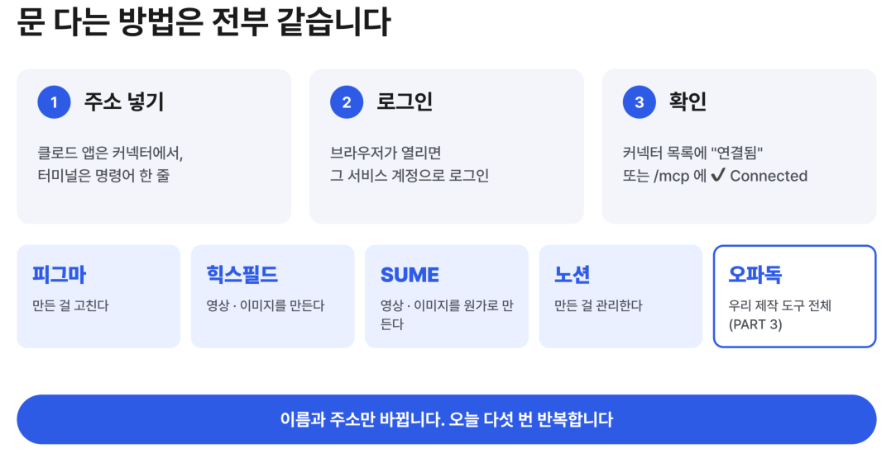
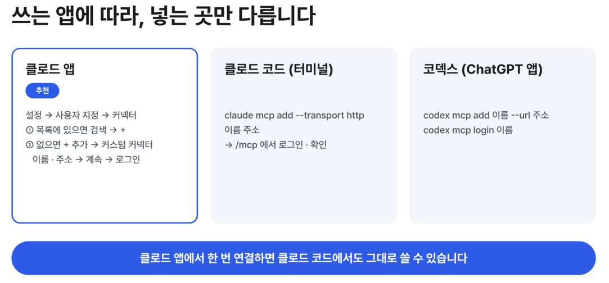
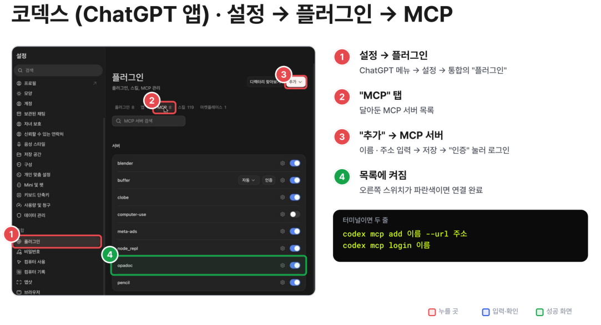
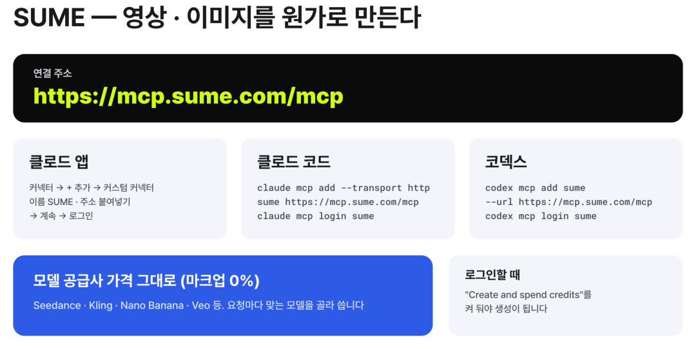

🏠 > [ai_agent](../../) > [opadog](../) > `S04_강의`

<table>
  <tr>
    <td><a href="./">[오파독]</a></td>
    <td><a href="S00_강의.md">O.T</a></td>
    <td><a href="S01_강의.md">강의1</a></td>
    <td><a href="S02_강의.md">강의2</a></td>
    <td><a href="S03_강의.md">강의3</a></td>
    <td><b href="S04_강의.md">강의4</b></td>
    <td><a href="S05_강의.md">강의5</a></td>
    <td><a href="S06_강의.md">강의6</a></td>
    <td><a href="S07_강의.md">강의7</a></td>
  </tr>
</table>

### INDEX
- [1️⃣ 복습‧웜업](#1️⃣-복습웜업)
- [2️⃣ MCP 연결‧시연 연습](#2️⃣-mcp-연결시연-연습)
- [3️⃣ 더 연결하면 좋은 것들](#3️⃣-더-연결하면-좋은-것들)
- [4️⃣ 오파독 MCP](#4️⃣-오파독-mcp)
- [5️⃣ 업로드 자동화](#5️⃣-업로드-자동화)
- 오늘의 흐름 : **문을달고 → 시켜보고 → 익숙해진다**

---
## 4차 강의

- 구글미트: https://meet.google.com/vqs-shpd-seb
- 유튜브: https://www.youtube.com/watch?v=H8vpH-mFml8
- 공지사항
```
[출시] 오파독 MCP — 클로드 안에서 오파독을 바로 쓰세요
안녕하세요, 오파독입니다.
오파독 MCP가 열렸어요. 이제 클로드 채팅창에서 말 한마디로 오파독 기능을 쓸 수 있어요.

할 수 있는 것
① 숏폼 공장 — 포맷을 고르면 기획안부터 영상까지
② 오파독 모션 — 레퍼런스 영상·사진으로 모션 영상
③ 홈페이지 제작 · 멀티룸 · 스킬 갤러리
④ 이미지·영상 생성, 광고·채널 리서치

수강생 여러분은 모두 바로 쓸 수 있어요.
연결 방법과 사용법은 아래 페이지에 정리해 두었어요.
👉 https://opadog.site/mcp

출시 영상은 아래 첨부에서 볼 수 있어요.
```

---
### 1️⃣ 복습‧웜업
> 지난 시간 내용, 손 풀기

- 채팅AI 3대장 + 하나더
  채팅 AI          | 에이전트
  ----------------|------------------
  챗지피티(GPT)    | 코덱스(Codex)
  클로드(Claude)   | 클로드코드(Claude Code)
  제미나이(GEmini)  | 안티그래비티(Antigravity)
  그록(Grok)        | 그록봇(Grok bot)

- AI 이야기
  - 어사이드(Aside) : 미국에서 투자받은 한국기업 <- 캣럿(AI미팅 어시스턴트) 를 하던 회사 
  - 그록봇(Grok bot) : 캐릭터별
  - 피클(PIckle)
- 수많은 AI들이 많지만, **결론은 챗GPT와 클로드를 못이긴다!!**
- 그외 AI
  - kimi.ai : 중국에서 만든 굉장히 저렴한 AI 모델, 클로드의 1/10 
  - Hugging Face: 
  - DeepSeek

- Wrapup Note
  ```
  그롯봇(Grok bot) : 일론머스크가 만든 AI
    - 전 세계인들이 많이 사용
    - 하나하나에 캐릭터를 부여

  어사이드(Aside)  :
    - 그록봇과 유사, 최근 급성장
    - 미국에서 투자받은 한국회사
    - 배경 : Caret를 하다가 갑자기 종료된 한국 AI

  피클(Pickle)     :
    - 한국에 최적화
    - 세금계산서 발행, 쿠팡에서 발행하는 것

  kimi.ai
    - 중국에서 만든 아주 저렴한 AI

  허깅페이스, https://huggingface.co/
    - 다양한 AI 모델
    - open api 를 활용하면 비용은 거의 들지 않고, 모든게 자동화가 가능

  클로브, https://clobe.ai/
    - 재무·회계부터 금융과 협업까지
    - 사업을 하는 사람들은 이것을 반드시 기억하라!

  ```

- 다 사용해봤지만, 결론은 **클로드와 챗GPT를 못이긴다!**
- [클로드 인 크롬 확장](https://claude.com/ko/claude-in-chrome)
- 지난 시간에 한것
  ```
  HTML

  피그마
    - 결과물의 디테일을 수정

  오파독 플러그인
    - HTML을 피그마로 옮기는 도구

  MCP
    - AI에게 문을 하나 달아 주는것

  ```

- 에이전트로 할 수 있는 것

① **찾기 · 모으기**
  이렇게 말하면 | 이렇게 나옵니다 
  ------------|-----------------------
  강남구 피부과 병원 리스트 100개 뽑아줘. 이름 · 주소 · 전화 · 인스타 계정까지  | 엑셀 파일 한 개
  서울 인근 주말에 빌릴 수 있는 촬영 스튜디오 10곳 찾아서 가격 비교해줘         | 비교표
  크몽에서 카드뉴스 제작 상위 20개 서비스의 가격 · 구성 · 후기 수 정리해줘      | 시장 조사표
  메타 광고 라이브러리에서 다이어트 업종 광고 20개 모아서 후킹 문구만 정리해줘    | 레퍼런스 모음 
  이 인스타 계정 5개의 최근 게시물에서 반응 좋은 주제를 뽑아줘                  | 경쟁 계정 분석

② **만들기 · 보내기 · 정리하기**
  이렇게 말하면 | 이렇게 나옵니다
  ------------|-----------------------
  카페 신메뉴 주제로 숏폼 만들고 업로드해줘                            | 영상 + 캡션 + 업로드까지 
  같은 주제로 카드뉴스 10장 만들어서 피그마에 올려줘                    | 편집 가능한 10장
  아까 뽑은 병원 리스트 보고, 업체마다 맞춤 제안 메시지 써줘             | 제안 문구 100개 
  오파독작업 폴더 파일들을 날짜_주제_번호로 이름 바꾸고 폴더별로 정리해줘  | 정리된 폴더
  고객사 A 이번 주 작업 내용을 보고서 한 장으로 만들어줘                 | 주간 보고서
  
  **찾기 → 만들기 → 보내개.**  이 세 개가 이어지면 그게 영업이고 운영입니다. 


- Q. 작업중 **"node_repl을(를) 사용하도록 허용할까요?"** 묻는 경우
  ```
  그건 내가 작업을 하려고 node_repl이라는 코드 실행 도구를 사용할 때 뜨는 승인 창이야.

  node_repl은 자바스크립트를 실행하는 도구인데, 예를 들면 이런 작업에 쓸 수 있어.
  - 수집한 광고 데이터 정리하기
  - 엑셀·문서 같은 결과물 만들기
  - 연결된 도구로 브라우저나 앱 작업하기
  도구 사용에 승인이 필요하도록 설정돼 있으면, 실행 전에 앱이 물어보는 거야. 위험한 작업일 때만 뜨는 건 아니야. 도구별 승인 설정 때문에 단순한 데이터 처리에도 뜰 수 있어.
  ```






<br/>

[[TOP]](#index)

---
### 2️⃣ MCP 연결‧시연 연습
> 피그마 ‧ 힉스필드 ‧ SUME ‧ 노션




- 클로드코드(Cload Code)와 코덱스(Codex) 중 하나만 사용한다
  - 클로드코드는 유료버전에서만 가능




- MCP 문을 달기
  구분 | MCP   | 설명            | 연결주소
  :---:|------|----------------|--------------------
  🟥 | 피그마   | 디자인, 코드, AI를 위한 협업 캔버스          | https://mcp.figma.com/mcp
  🟩 | 힉스필드 | 이미지 & 동영상 생성하기                    | https://mcp.higgsfield.ai/mcp
  🟩 | SUME    | 이미지 & 동영상 원가로 만든다                | https://mcp.sume.com/mcp
  🟦 | 노션     | 만든 걸 관리한다                           | https://mcp.notion.com/mcp
  🟦 | 오파독AI  | 유튜브 분석, 콘텐츠 생성, 자동화를 한 곳에서  | https://mcp.opadog.site/api/mcp/connect

  - 클로드코드에서는 무료버전에서는 커넥터가 지원되지 않는다
  - 코덱스에서 플러그인에서 안되면, 사이트의 MCP 연결방법을 붙혀서 설치하자

---
- SUME MCP연결하기 
```
  claude mcp add 이름 --url 주소
  claude mcp login 이름
```
- 코덱스(ChatGPT 앱)
```
  codex mcp add sume --url https://mcp.sume.com/mcp
  codex mcp login sume
```

- MCP
  - [이미지/영상 생성] → 오파독 MCP / 힉슬필드 MCP / SUME MCP

---
### 노션MCP
> [[혜택 11] 오파독 콘텐츠 캘린더 관리 노션 템플릿](https://drive.google.com/file/d/1VaDIa0QsGkYAEGuxDwn9IYebTvS8dTP1/view?usp=drive_link)

- 노션: 메모장 같은것
- 그냥 작성해서 공유
- 노션 프롬프트 1
  ```
    나한테 올해 백만원 내는 고객사다. 관련해서 기본 첫 번째 기획안 하나 만들어서 올려주고 그다음에 리드 마그넷도 지금 하나 필요한데 자료집. 자료집도 하나 초안 잡아주고 여기 회사는 뭐 업종이 교육 쪽이야 교육 쪽 브랜드니까 너가 가상의 뭐 교육 그런 서비스하는 회사를 잡아가지고 기획안 구축을 싹 해줘.
  ```
- 노션 프롬프트 2
  ```
    내가 고객사가 지금 세 개 더 생겼는데 지금 조금 한 곳에 다 모아두니까 헷갈려서 그냥 고객사별로 좀 체계적으로 관리할 수 있는 그런 뭐 갤러리나 아니면 좀 폴더를 좀 깔끔하게 쪼개서 좀 정리를 해줄래? 이렇게 얘기해 보는 거야.
  ```
- 노션 프롬프트 3
  ```
    아 나는 노션 잘 쓸 줄 몰라가지고 조금 더 사용법 쉽게 나한테 알려주고 좀 더 사용하기 쉽게 만들어줄래?
  ```

---
### 오파독AI 
- 오파독MCP : 
  ```
  https://mcp.opadog.site/api/mcp/connect
  ```
- 오파독 기능 : 오파독으로는 콘텐츠 제작, 리서치, 홈페이지 제작 등을 할 수 있어요.  
  기능	            | 요청 예시
  -----------------|-----------------------------
  숏폼 영상 기획·제작	| “오파독 숏폼 공장 열어줘”
  이미지·AI 영상 생성	| “오파독으로 제품 광고 이미지 만들어줘”
  모션·모션그래픽	    | “오파독 모션 보여줘”
  홈페이지 제작	     | “오파독으로 브랜드 홈페이지 만들어줘”
  광고 리서치	        | “오파독에서 뷰티 광고 훅 10개 찾아줘”
  전문 작업 스킬	    | “오파독 카피라이팅 스킬 보여줘”
  생성물·크레딧 관리	 | “오파독 내 생성물 보여줘”, “오파독 잔액 알려줘”


스킬 갤러리에는 마케팅·코딩·디자인·분석 등 115개 스킬이 있지만, 방금 조회에서는 모두 잠김으로 표시됐어요.

이미지·영상 등 유료 생성은 견적을 확인하고 승인한 뒤 진행합니다.


<br/>

[[TOP]](#index)

---
### 3️⃣ 더 연결하면 좋은 것들
> 지메일 ‧ 구글캘린더 ‧ 메타 Ads ‧ 클로브
<br/>

[[TOP]](#index)

---
### 4️⃣ 오파독 MCP
> 작동 방식 익히고 몇 가지 실습

<br/>

[[TOP]](#index)

---
### 5️⃣ 업로드 자동화
> 브라우저 컨트롤 / 안드로이드 에뮬레이터

```
작업

1. 고객한테 기획안 보고 및 콘텐츠 업로드
클로드/코덱스 명령 → 기획안을 작성(노션 MCP) → 보고(채팅앱/카톡/슬랙 등) → 업로드(인스타키고 업로드 해)

2. 콘텐츠 제작 및 수정·업로드
클로드/코덱스 → 제작(Sume/오파독/힉스필드 MCP) → 수정(피그마 MCP) → 업로드

3. 고객 문의부터 결과보고까지
고객 문의 → 계약서 작성 → 고객한테 기획안 보고 및 콘텐츠(배너, 카드뉴스, 릴스) 제작 → 수정 → 업로드 → 결과보고 → 고객 문의(오파독 MCP) → 계약서 작성(오파독 MCP) → 클로드/코덱스 명령 → 기획안을 작성(노션 MCP) → 보고(채팅앱/카톡/슬랙 등) → 제작(Sume/오파독/힉스필드 MCP) → 수정(피그마 MCP) → 업로드 → 결과보고서(노션 MCP) -

4. 세금계산서 발행 및 미수금 관리를 포함한 업무
고객 문의 → 계약서 작성 → 세금계산서 발행 → 고객한테 기획안 보고 및 콘텐츠(배너, 카드뉴스, 릴스) 제작 → 수정 → 업로드 → 미수금 관리 → 결과보고

고객 문의(오파독 MCP) → 계약서 작성(오파독 MCP) → 세금계산서 발행(클로브 MCP) → 클로드/코덱스 명령 → 기획안을 작성(노션 MCP) → 보고(채팅앱/카톡/슬랙 등) → 제작(Sume/오파독/힉스필드 MCP) → 수정(피그마 MCP) → 업로드 → 미수금 관리(클로브 MCP) → 결과보고서(노션 MCP) -

※ 원문의 서비스명과 표현을 유지했으며, 2~4번 소제목은 가독성을 위해 추가했습니다.

```

영업에서 제일 중요한 것
  - 리드매칭
  - 모수가 늘면 수혜를 받게 된다
  - 광고비를 인원수에 맞게 증액
  - 한국에 에이전시 회사가 얼마나 많은데...
  - 오파독MCP는 수강생내에서만 사용할수있다.


<br/>

[[TOP]](#index)

---
### 강의를 마친후 Talking about AI

캐럿, 세일즈 미팅에서 실시간으러 뜨는건데...
고객을 만날때도 말이 술술나오면 성공률이 높은데..

Aside, 이를 도와주는게 어사이드(Aside)

Y Combinator, 전세계 통틀어서 스타트업을 발굴 잘하는 초기 투자사
와이씨가 발굴하는 회사는 전세계에서 인정


오파독으로 성장하려면 1인기업으로 가야할거 같아요. 직원 뽑아서 가르치면 왠지 독립해서 나갈거 같음.


결제나 이런거 붙히다 보면, 프론트단 말고 보이지 않는 백오피스 관리와 데이터베이스 구축 이런거 까지 고려해야 될거 같은데. 혹시 오파독 확장시 이런것까지 MCP로도 가능할까요? 대표님 플랜에 혹시 염두해두는지 궁금합니다.

몇달전에 마이크로소프트에서 SW엔지니어만 대략 5천명 감원했다는 뉴스를 본기억이 납니다.   
이런게 MCP로 인해서 그런게 아닌가 라는 생각이 드네요.

인스타 계정을 


<br/>

[[TOP]](#index)

---