🏠 > [ai_agent](../../) > [opadog](../) > `S05_강의`

<table>
  <tr>
    <td><a href="./">[오파독]</a></td>
    <td><a href="S00_강의.md">O.T</a></td>
    <td><a href="S01_강의.md">강의1</a></td>
    <td><a href="S02_강의.md">강의2</a></td>
    <td><a href="S03_강의.md">강의3</a></td>
    <td><a href="S04_강의.md">강의4</a></td>
    <td><b href="S05_강의.md">강의5</b></td>
    <td><a href="S06_강의.md">강의6</a></td>
    <td><a href="S07_강의.md">강의7</a></td>
  </tr>
</table>

### INDEX
- [5차 강의](#5차-강의)
- [01. 웜업 · 업로드 자동화](#01-웜업--업로드-자동화)
- [02. 지금 실제로 팔리는 것](#02-지금-실제로-팔리는-것) : 크몽에서 보는 시장
- [03. 두 갈래 길과 채널 맵](#03-두-갈래-길과-채널-맵) : 고객이 들어오는 길 전부
- [04. 창구 만들기](#04-창구-만들기) : 오픈카톡 · 리틀리 · 소개 웹사이트
- [05. 마케팅](#05-마케팅) : 메타 광고 MCP 연결과 광고 소재 제작
- [06  실전 계약 사례](#06--실전-계약-사례) : 실제 계약서 · 견적서로
- [07. 첫 계약까지](#07-첫-계약까지)
- [08. 내 계정으로 버는 길](#08-내-계정으로-버는-길)

---
### 3주차 혜택

구분 | 번호 | 내용 | 바로가기
:-----:|-------|-------------------------------|:-----:
**3주** |       | **계정관리 & 수익화 진입 - 오파독AI MCP**                     | 🗂[[드라이브3]][혜택_3주차]
🟦 | [혜택 5]   | 수익화 성공률 300% UP AI 세일즈봇 & 가이드북                   | 💻[[PDF자료]][혜택_5]
🟦 | [혜택 6]   | 오파독 최적화 고객 응대 AI 프로그램 C_S 봇                     | 💻[[PDF자료]][혜택_6]
🟦 | [혜택 7]   | 오파독 최적화 광고 제안서 퍼펙트 템플릿                         | 💻[[PDF자료]][혜택_7]
🟦 | [혜택 8 ]  | 오파독 최신화 실제 계약서 템플릿                               | 💻[[PDF자료]][혜택_8 ]
🟦 | [혜택 9]   | 오파독 단건 & 다건 견적서 마스터 템플릿                         | 💻[[PDF자료]][혜택_9]
🟦 | [혜택 12]  | 월 1억 오파독 고객사 관리(CRM) 노션 템플릿                      | 💻[[PDF자료]][혜택_12]
🟦 | [혜택 16]  | 파트너 외주사 최적화 선별 체크리스트                            | 💻[[PDF자료]][혜택_16]
🟦 | [혜택 18]  | 오파독 외주 플랫폼 상세페이지 최적화 템플릿                      | 💻[[PDF자료]][혜택_18]
📑 | [VOD 1]   | 오파독 AI 견적서 생성기 사용 가이드 VOD                          | 💻[[PDF자료]][VOD_1]
📑 | [VOD 2]   | 오파독 AI 계약서 생성기 사용 가이드 VOD                          | 💻[[PDF자료]][VOD_2]
📑 | [VOD 3]   | 오파독 AI 세일즈봇 사용 가이드 VOD                              | 💻[[PDF자료]][VOD_3]
📑 | [VOD 4]   | 오파독 AI C_S 봇 사용 가이드 VOD                               | 💻[[PDF자료]][VOD_4]
🅿️ | [프리미엄 1]   | 오파독 AI 캐릭터 실사화 특별 확장 패키지                     | 💻[[PDF자료]][프리미엄_1]
🅿️ | [프리미엄 2]   | 오파독 AI 광고 모델 특별 제작 패키지                        | 💻[[PDF자료]][프리미엄_2]
🅿️ | [프리미엄 3]   | 에이전시 전용 홈페이지 제작 AI 프로그램                      | 💻[[PDF자료]][프리미엄_3]
🅿️ | [프리미엄 4]   | 에이전시 제안 이메일 대량 발송 AI 프로그램                    | 💻[[PDF자료]][프리미엄_4]
🅿️ | [프리미엄 5]   | 에이전시 제안서 자동 작성 AI 프로그램                        | 💻[[PDF자료]][프리미엄_5]
🅿️ | [프리미엄 VOD] | 오파독 AI 광고 제안서 생성기 사용 가이드 VOD                 | 💻[[PDF자료]][프리미엄_VOD_1]
🅿️ | [프리미엄 VOD] | 오파독 AI 이메일 대량 발송 가이드 VOD                       | 💻[[PDF자료]][프리미엄_VOD_2]

[혜택_3주차]: https://drive.google.com/drive/folders/1lONf1RyFW8iPbQWc3G-nl-UxXk_uRQcF?usp=drive_link
[혜택_5]:  https://drive.google.com/file/d/1eLFlg4vZwsKZmXfrW41cuctjg4uEVty_/view?usp=drive_link
[혜택_6]:  https://drive.google.com/file/d/1WWvya8ItO-sNm7zAjEvihRD-HVSvAaEv/view?usp=drive_link
[혜택_7]:  https://drive.google.com/file/d/1oZknpnQEpPv7cYaClMPUlhriv9LnA8xN/view?usp=drive_link
[혜택_8]:  https://drive.google.com/file/d/1wJil746412GvxRSG8vXtpPTGe5rClUAZ/view?usp=drive_link
[혜택_9]:  https://drive.google.com/file/d/14cNwZ5WSgUBkTZC9vOW21W_Vc9kC8l5I/view?usp=drive_link
[혜택_12]: https://drive.google.com/file/d/1HFPYcdJJH733-ZxH5nDsAEBfvGYkmmU1/view?usp=drive_link
[혜택_16]: https://drive.google.com/file/d/1azvzoyDQWtp7K_zBCUB8QlXSxyCYp4Aw/view?usp=drive_link
[혜택_18]: https://drive.google.com/file/d/1a6J2C-j2XdkMNiYW51eMnXVmTmUuoYe4/view?usp=drive_link
[VOD_1]:  https://drive.google.com/file/d/1piBdPyrCt98QdGfwQ8wMB0cZ2YWVJXNu/view?usp=drive_link
[VOD_2]:  https://drive.google.com/file/d/1KXljR6WpDISuYilk7uvG8vv3f3RyVysX/view?usp=drive_link
[VOD_3]:  https://drive.google.com/file/d/1tDUj7a9lNVeoS1JSAIOVAWztASITykrV/view?usp=drive_link
[VOD_4]:  https://drive.google.com/file/d/1ecxPDfrs1LyZnR0RvFZH8vvu-93uBaX6/view?usp=drive_link
[프리미엄_1]: https://drive.google.com/file/d/1GmjtSmiebLQhzXJvkXG_Rw12O4D1Zodp/view?usp=drive_link
[프리미엄_2]: https://drive.google.com/file/d/1rKUrtIvJ-4khxxo-N6HLOIiiPLIPx37a/view?usp=drive_link
[프리미엄_3]: https://drive.google.com/file/d/1ckhMUPkjW4847b45xbtNbTsq43WOjFqH/view?usp=drive_link
[프리미엄_4]: https://drive.google.com/file/d/1lCQYEnhym6rIYOoSrPSdp_jjBkPrgEkF/view?usp=drive_link
[프리미엄_5]: https://drive.google.com/file/d/1TmsrEtB7Uh20x9MjnJWmqFhLKYvjsTz6/view?usp=drive_link
[프리미엄_VOD_1]: https://drive.google.com/file/d/1-dS9iq9Gyf0Pexuel41Qw-h42jK74yXx/view?usp=drive_link
[프리미엄_VOD_2]: https://drive.google.com/file/d/1CfOlyycY4_VkI1yAbx1QLX1tdnOJJ6ns/view?usp=drive_link

---
## 5차 강의
> 안녕하세요 오파독입니다! 오늘 강의 링크 전달드립니다! @all 
> - 구글미트 링크: https://meet.google.com/sjh-rqmv-ozd
> - 유튜브 링크: https://www.youtube.com/watch?v=9SM9Vx0Cc8E

- AI 이야기
  - 어사이드(Aside) : 미국에서 투자받은 한국기업 <- 캣럿(AI미팅 어시스턴트) 를 하던 회사 
  - 그록봇(Grok bot) : 캐릭터별
  - 피클(PIckle)
- 수많은 AI들이 많지만, **결론은 챗GPT와 클로드를 못이긴다!!**
- 그외 AI
  - kimi.ai : 중국에서 만든 굉장히 저렴한 AI 모델, 클로드의 1/10 
  - Hugging Face: 
  - DeepSeek


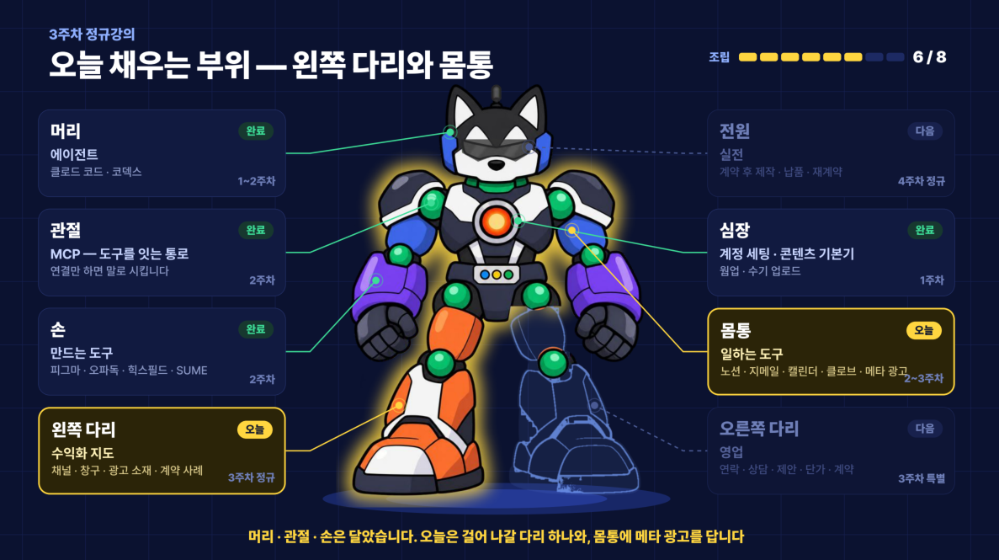

<br/>

[[TOP]](#index)

---
### 01. 웜업 · 업로드 자동화
> 문은 다 달았습니다. 지난 시간 마지막 한 칸

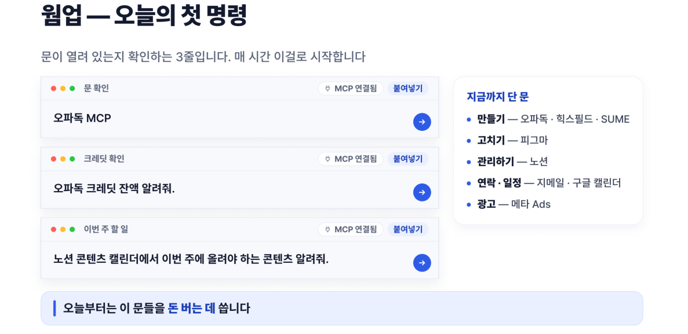
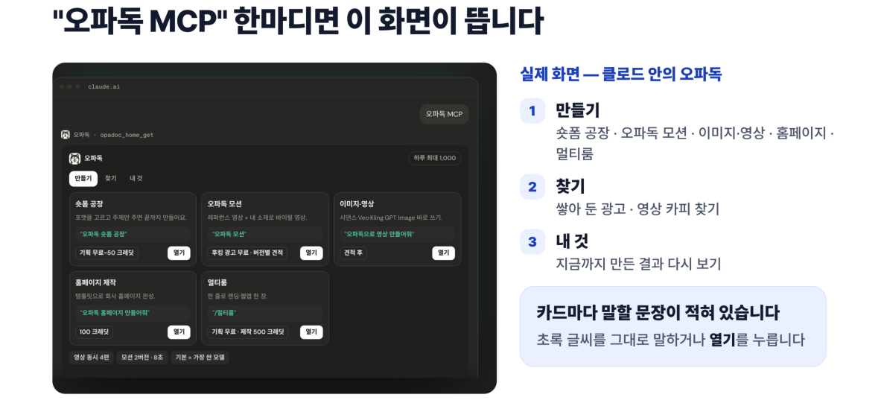
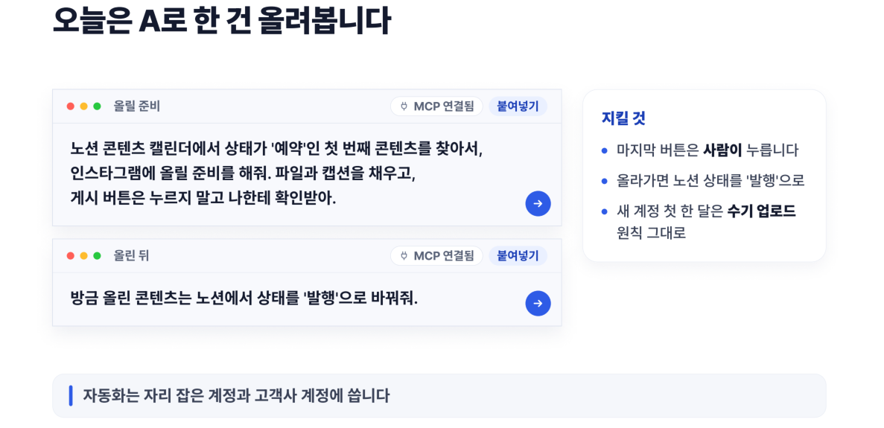


- 업로드 자동화 
  - 프롬프트 : 업로드자동화 → Android Emulator 설치
  ```
  자, 내가 지금 업로드 자동화를 하려고 안드로이드 에뮬레이터를 설치를 하려고 하는데 너가 설치부터 세팅까지 싹 다 해줘. 지금 내가 첨부한 이미지를 참고해서.
  ```
  - 프롬프트 : 에뮬레이터로 릴스 등록
  ```
  자 코덱스야 너가 지금 안드로이드 에뮬레이터인가 뭔가 저거를 만들었... 저거 설치가 끝났잖아. 그러면 지금 로그인된 인스타 저 빌독 AI 계정에다가 이 원페이지 릴스를 여기서부터 중요합니다. 캡션을 초반 첫줄 후킹하게 댓글에 자료 남기면 보내준다. 그리고 캡션 잘 써주고 그 다음에 음악은 최신 유행 음악 입혀서 그 다음에 제가 맨날 말씀드리는 AI 라벨도 설정해서 그 다음에 업로드까지 해라. 요거.
  ```
  - 프롬프트 : 에뮬레이터로 릴스 예약 등록
  ```
  그러면 너가 앞으로 내가 하루에 하나씩 콘텐츠 올릴 건데 원페이지 릴스 내가 30개 만들었거든? 근데 30개 나 만드는 데 뭐 얼마나 걸렸냐면 한 10분 정도 걸리더라. 근데 그 만든 내 30개를 너가 하루에 하나씩 오후 5파독이 오후 6시쯤에 올리라고 했거든. 그러니까 오후 6시쯤에 매일 업로드하는 예약을 해서 너가 올려. 그 에뮬레이터 켜가지고 원페이지 릴스야 다. 그리고 캡션 설명글도 잘 썼어 잘 썼고 아까처럼 그냥 계속 너가 해주면 좋을 것 같아. 그러면 나는 이제 그렇게 되면은 나는 앞으로 그냥 컴퓨터만 그 시간에 켜 있으면은 너가 자동으로 다 올려주면 좋을 것 같다. 에뮬레이터 켜가지고 이렇게
  ```

- 참조하기 
  - 카톡 오픈채팅방에서 1:1 대화를 위한 오픈프로필 설정방법 : [[Blog 바로가기]](https://m.blog.naver.com/lifeinddot/223012793969)
  - Start with a design you love : [[Styles.Refero]](https://styles.refero.design/)

- 프롬프트 : 
```
내가 지금 첨부한 그 구조를 바탕으로 내 에이전시 전용 웹사이트를 만들 거다. 디자인을 기가 막히게 예쁘게 만들 거거든? 우리 에이전시 이름은 오파독 에이전시.
```
- 프롬프트 : 
```
내가 방금 첨부한 저 스타일을 참고해서 디자인을 개선해줘. 근데 에이전시의 그 구조는 유지하면서.
```
- 프롬프트 : 
```
자, 내가 에이전시 구조 참고하라고 HTML 하나 넣어줬고, 그 다음에 내 포트폴리오 예시도 저기 모든 내 포트폴리오가 있는 그 폴더도 캡처해서 보냈어. 자, 내 작업물들 전부 다 올려서 웹사이트 만들어주고, 그리고 근데 그 기존에 지금 내가 정한 템플릿의 구조는 꼭 참고해줘. 디자인은 참고해줘.
```
- 프롬프트 : 
```
내가 지금 만들고 있는 게 오파독 에이전시의 그 에이전시 웹사이트를 만들려고 하는 거라서 디자인 유형은 참고만 하고 오파독 에이전시를 홍보하는 그런 웹사이트 에이전시 전용 디자인으로 만들어 줘.
```
- 크몽가이드 : 쉽고 빠르게 크몽 회원 가입하는 방법 - [[바로가기]](https://kmong.com/article/1718--%ED%81%AC%EB%AA%BD-%EA%B0%80%EC%9D%B4%EB%93%9C-%7C-%EC%89%BD%EA%B3%A0-%EB%B9%A0%EB%A5%B4%EA%B2%8C-%ED%81%AC%EB%AA%BD-%ED%9A%8C%EC%9B%90%EA%B0%80%EC%9E%85-%ED%95%98%EB%8A%94-%EB%B0%A9%EB%B2%95)

- 프롬프트 : 
```
내가 지금 서비스 소개 그 크몽에서 만들려고 하는데 새롭게. 제목부터 시작해서 뭐 카테고리, 그다음에 설명글, 서비스 소개 설명글 이런 것까지 전부 다 지금 넣은 위에 레퍼런스 참고해서 만들어줘. 근데 우리가 주로 하는 게 SNS 운영 대행, 그다음에 릴스, 그리고 카드뉴스, 광고 소재. 그리고 만들 수 있는 게 저희가 뭐가 있었죠? 바로 AI 모델, AI 이미지, AI 영상 이런 거다
```

<br/>

[[TOP]](#index)

---
### 02. 지금 실제로 팔리는 것
> 크몽에서 보는 시장

- 크몽 프로필 작성 할것!
- 크몽에서 실제로 팔리는 것
  - 카드뉴스, 썸네일, 배너, 이벤트페이지, AI모델‧AI광고이미지
  - 단건 제작은 5천원, 운영대행은 55만원

<br/>  
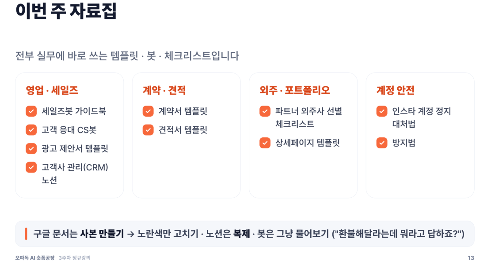 

```note
  템플릿 : 구글문서, 노션
```

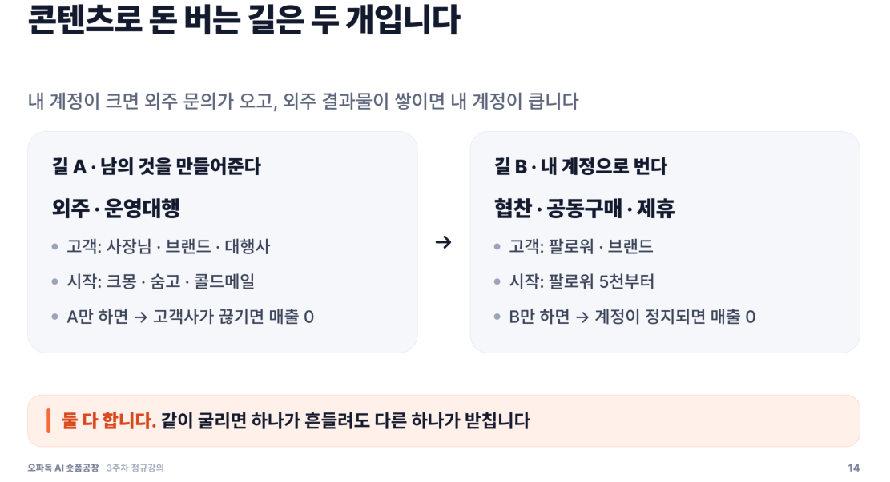 

```note
  외주‧운영대행 ⇒ 협찬‧공동구매‧제휴
  두개다 해야 안정적!
```

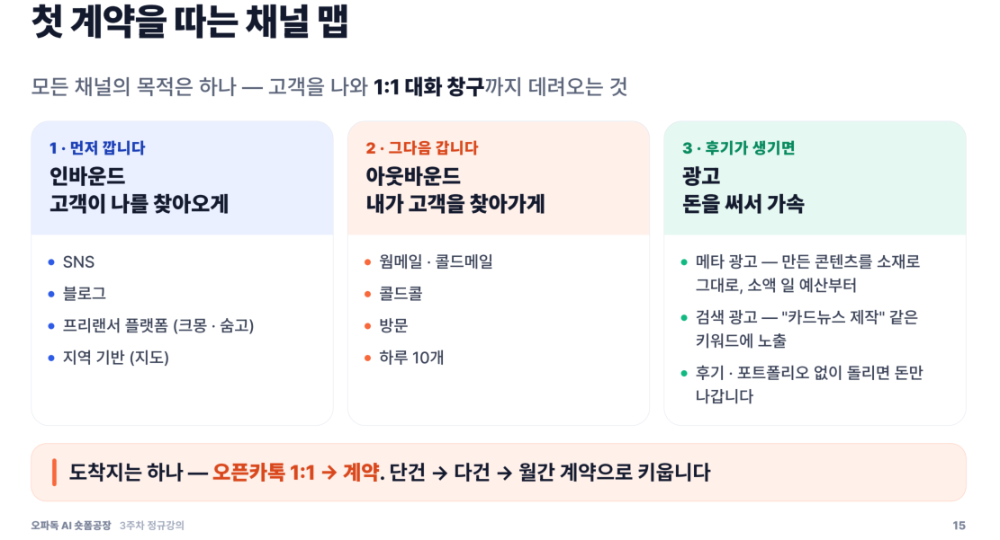

- 인바운드
- 아웃바운드
- 광고

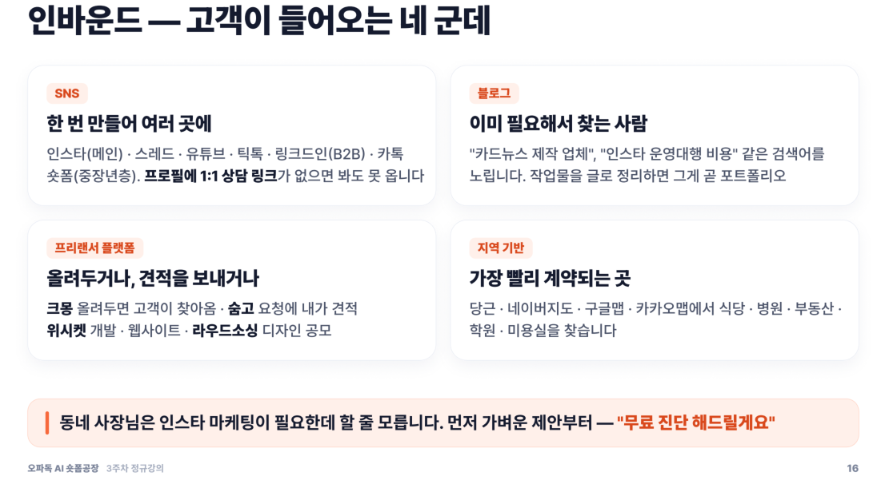

- 인바운드 : SNS, 블로그, 프리랜서플랫폼, 지역기반

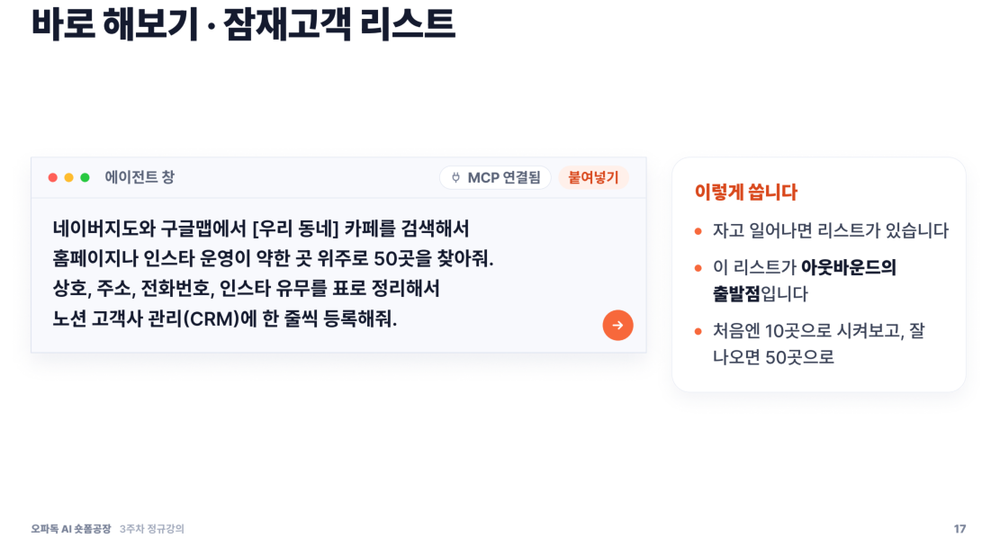

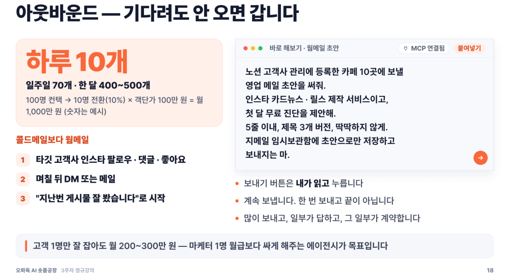

- 마케터 단한명 인건비보다 싸게 해주는 에이전시면 된다!

<br/>

[[TOP]](#index)

---
### 03. 두 갈래 길과 채널 맵
> 고객이 들어오는 길 전부

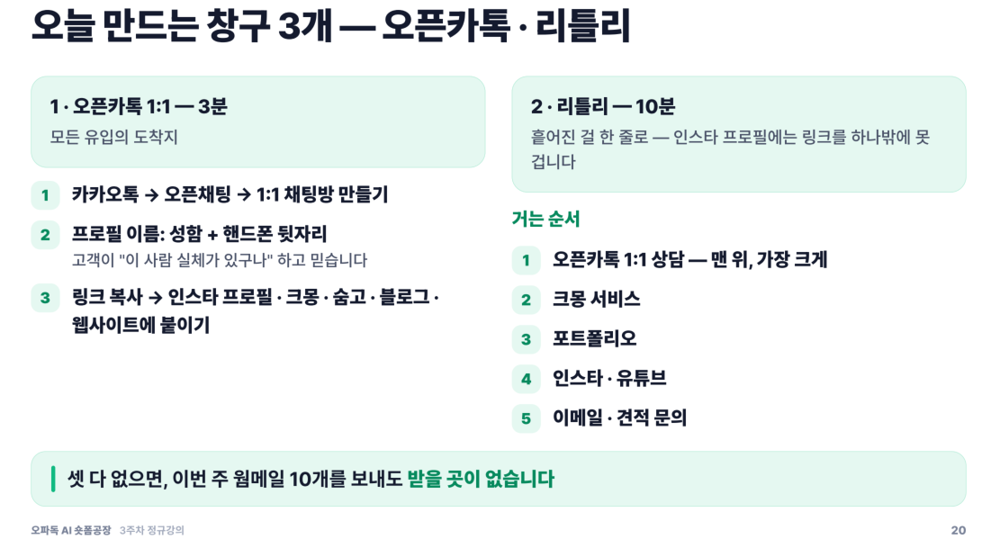
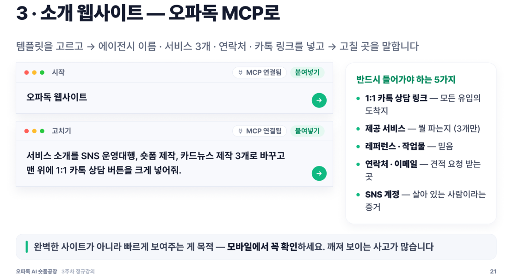
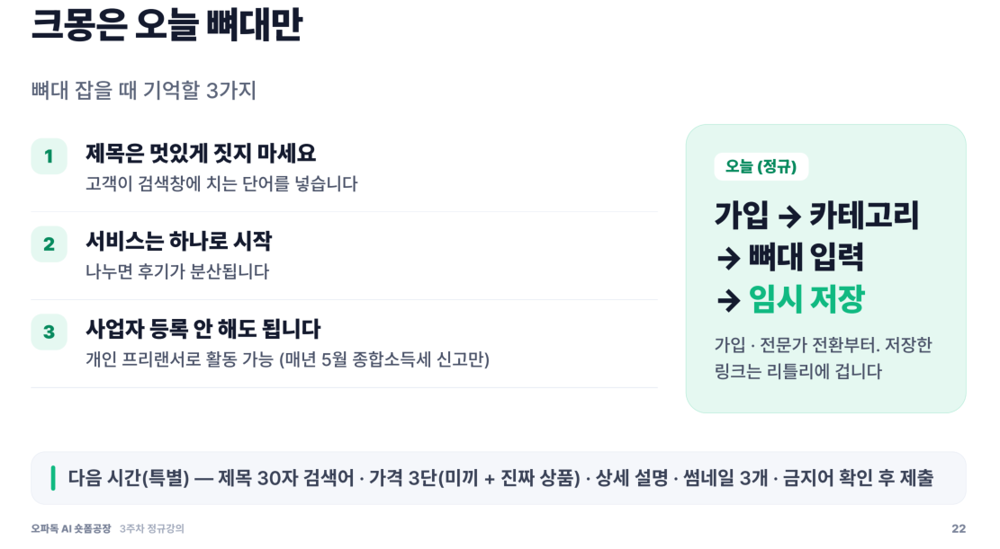

<br/>

[[TOP]](#index)

---

### 04. 창구 만들기 
> 오픈카톡 · 리틀리 · 소개 웹사이트

<br/>

[[TOP]](#index)

---

### 05. 마케팅
> 메타 광고 MCP 연결과 광고 소재 제작

<br/>

[[TOP]](#index)

---

### 06  실전 계약 사례
> 실제 계약서 · 견적서로


### 계약 따는 방법
> 메타광고 광고소재 -> 메타광고 센터(https://business.meta.com/?locale=ko_KR)

```
<첫 계약을 따는 방법>

[인바운드]
SNS(인스타그램/스레드/유튜브/틱톡/링크드인/카톡숏폼 등) -> 최종적으로 나랑 소통 창구(오픈카톡 1:1)
블로그(네이버/티스토리/워드프레스 등)
프리랜서 플랫폼 국내(크몽/숨고/위시캣/라운드소싱/알바몬/알바천국) & 해외(비핸스, Upwork)
지역기반 플랫폼(당근마켓/네이버지도/구글맵/카카오맵 등)

[아웃바운드(직접 연락)]
콜드메일(영업메일), 콜드콜(영업전화)

웹사이트 만들기 들어가야 하는 내용들 연락처명
-> 블로그 / 크몽 / 숨고 / 네이버 지도에 연락처 찾아보기 + 전화돌리기 / 콜드메일 계속 보내기

[광고 집행]
메타(페이스북, 인스타그램 등) 광고(일 예산)
검색광고(네이버 광고 등)
-> 메타광고 광고소재 -> 메타광고 센터(https://business.meta.com/?locale=ko_KR)
```

- 크몽 상세페이지 작업
```
[카드뉴스&광고소재] 
https://kmong.com/gig/355563 
https://kmong.com/gig/511745 
https://kmong.com/gig/321151

 [AI 모델/이미지/영상]
 https://kmong.com/gig/493305
 https://kmong.com/gig/500095
 https://kmong.com/gig/610676
 https://kmong.com/gig/537037

 [숏폼 제작 / 릴스 운영대행]
 https://kmong.com/gig/103938
 https://kmong.com/gig/218875
     → 특별강의 과제(3주차와 묶어서 진행): 크몽 세팅 하시고
     주변 지인 또는 가족 등을 통해서 후기 및 작업물을 보내는 경험을 하면 좋습니다!

내가 지금 오파독 에이전시라는 나의 SNS 운영 대행 솔루션 개발을 하고 있는데 크몽에 설명글 써야 되거든? 크몽 상세 페이지를 지금 내가 첨부한 얘네들처럼 좀 느낌 있게. 근데 너무 유사하지 않게. 그냥 참고만 해서 우리 스타일로 이제 크몽에 넣을 만한 서비스 설명글 써줘.

```


<br/>

[[TOP]](#index)

---

### 07. 첫 계약까지
> 마음가짐과 준비

<br/>

[[TOP]](#index)

---

### 08. 내 계정으로 버는 길
> 4층 퍼널과 계정 안전

<br/>

[[TOP]](#index)

---