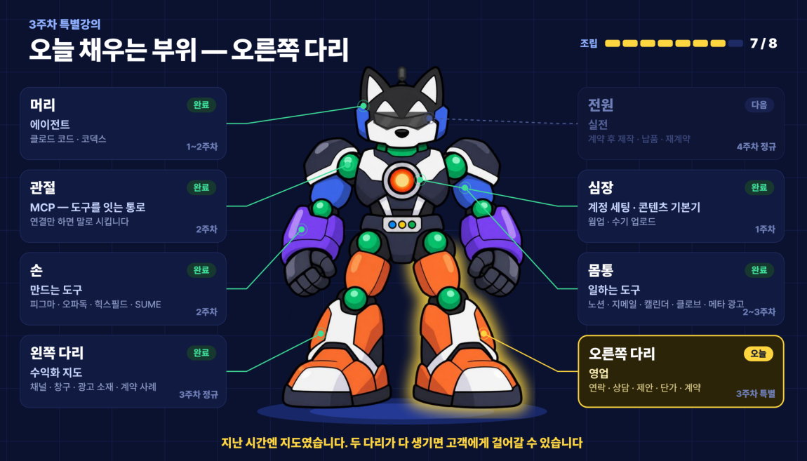
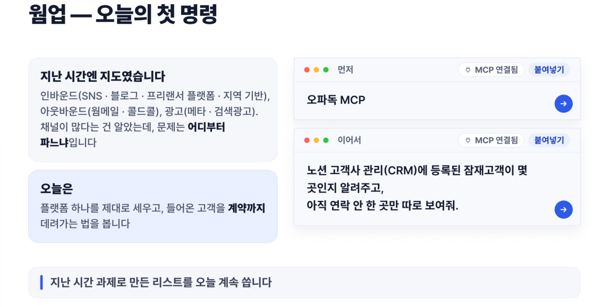
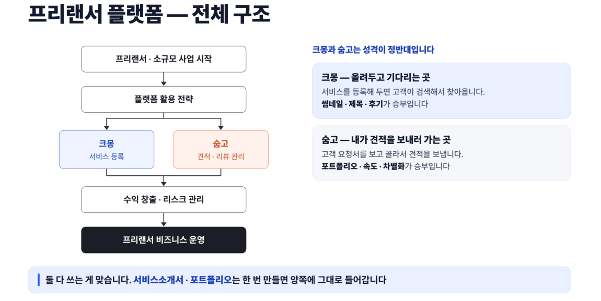
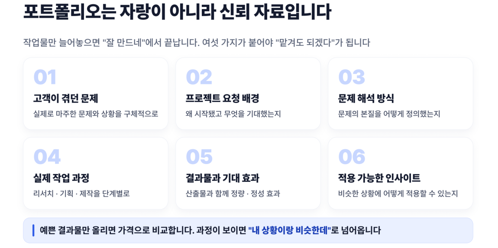
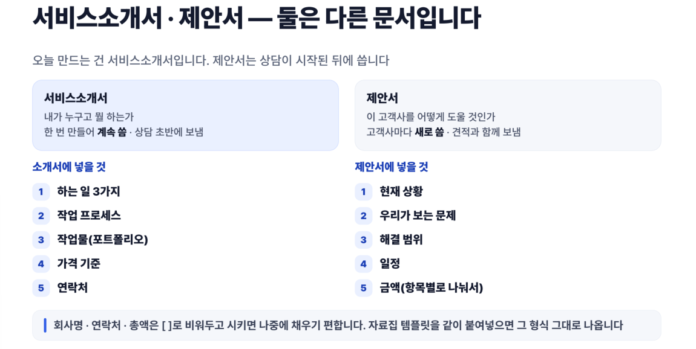
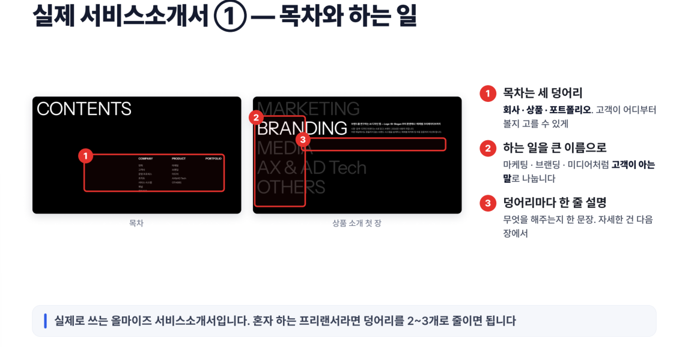
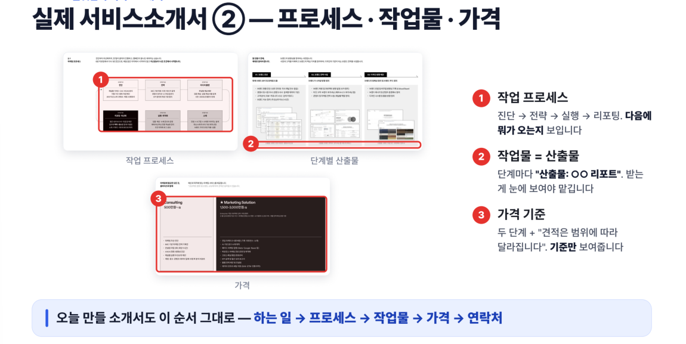
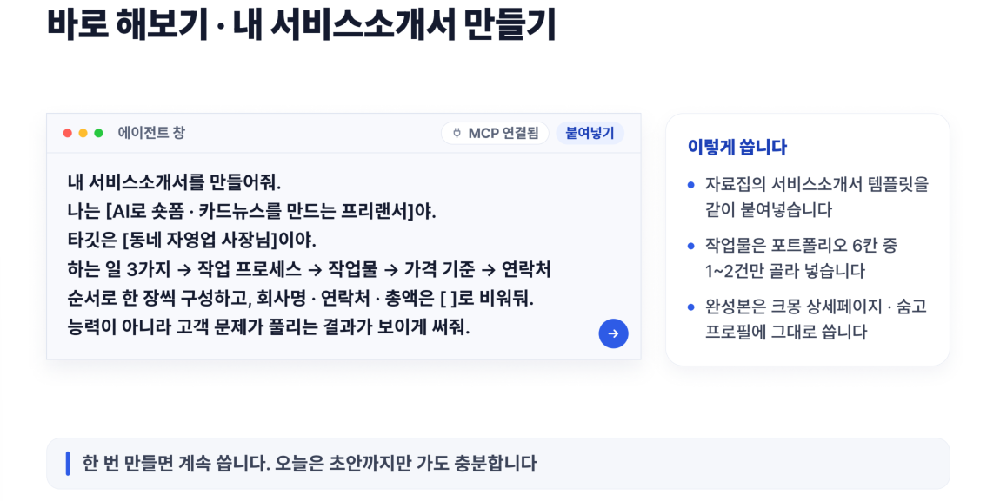
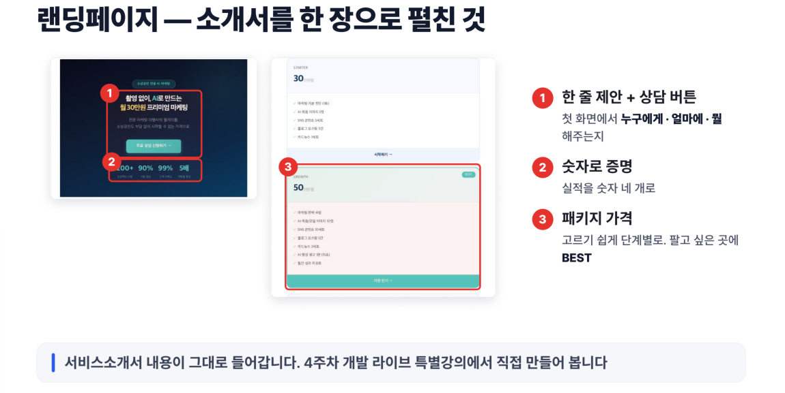

🏠 > [ai_agent](../../) > [opadog](../) > `S06_강의`

<table>
  <tr>
    <td><a href="./">[오파독]</a></td>
    <td><a href="S00_강의.md">O.T</a></td>
    <td><a href="S01_강의.md">강의1</a></td>
    <td><a href="S02_강의.md">강의2</a></td>
    <td><a href="S03_강의.md">강의3</a></td>
    <td><a href="S04_강의.md">강의4</a></td>
    <td><a href="S05_강의.md">강의5</a></td>
    <td><b href="S06_강의.md">강의6</b></td>
    <td><a href="S07_강의.md">강의7</a></td>
  </tr>
</table>


### INDEX
- [6차 강의](#6차-강의)
- [01. 플랫폼과 서비스소개서](#01-플랫폼과-서비스소개서) : 플랫폼 구조 · 포지셔닝 · 포트폴리오 · 서비스소개서
- [02. 연락](#02-연락) : 리드가 들어온 순간부터
- []()
- []()

---
## 6차 강의
> 안녕하세요 오파독입니다! 오늘 강의 링크 전달드립니다! 곧 뵐게요
- 구글미트: https://meet.google.com/kas-hbbm-pwy
- 유튜브: https://www.youtube.com/watch?v=ZFJJdV9_cLA





<br/>

[[TOP]](#index)

---
### 01. 플랫폼과 서비스소개서
> 플랫폼 구조 · 포지셔닝 · 포트폴리오 · 서비스소개서


#### 1-1. 프리랜서 플랫폼의 차이



| 플랫폼 | 운영 방식 | 핵심 경쟁력 |
|---|---|---|
| **크몽** | 서비스를 등록하고 고객의 검색·문의 기다리기 | 썸네일, 제목, 후기 |
| **숨고** | 고객 요청을 확인하고 직접 견적 발송 | 포트폴리오, 응답 속도, 차별화 |
| **당근** | 지역 소식 글·광고 등 지역 기반 접근 | 동네 고객과의 접점 |

- 초반에는 가격만 높게 잡기보다 **후기와 신뢰를 확보**하는 전략을 소개한다.
- 숨고는 견적 발송 비용과 거래 조건을 고려해 무분별하게 지원하지 않는다.
- 서비스소개서와 포트폴리오는 플랫폼 간 재활용할 수 있다.
- 플랫폼 정책, 수수료, 리뷰 관련 수치는 실제 등록 시 최신 규정을 다시 확인한다. (p.6–8)


#### 1-2. 서비스 포지셔닝: 능력이 아니라 문제 해결

| 단순 기술 표현 | 고객 문제 해결형 표현 |
|--------------|--------------------|
| **내가 할 수 있는 일** | **고객이 돈 내고 맡길 일** |
| 일정 관리    | 프로젝트 운영 매니징 |
| 영상 편집    | 판매 흐름을 고려한 숏폼 광고 영상 제작 |
| 카드뉴스 제작 | 저장을 부르는 정보형 SNS 콘텐츠 |

**핵심:** 고객은 제작 기술 자체보다 홍보, 문의, 예약, 구매 같은 결과를 기대한다. (p.9)

#### 1-3. 포트폴리오를 신뢰 자료로 만드는 6요소
> **포트폴리오는 자랑이 아니라 신뢰 자료입니다** <br/>
> 작업물만 늘어놓으면 "잘 만드네"에서 끝납니다. 여섯 가지가 붙어야 "맡겨도 되겠다"가 됩니다

1. 고객이 겪던 문제
2. 프로젝트 요청 배경
3. 문제 해석 방식
4. 실제 작업 과정
5. 결과물과 기대 효과
6. 적용 가능한 인사이트

실제 결과와 **기대 효과**는 구분해서 표기한다. 결과가 없는 가상 작업을 실제 고객 성과처럼 제시하지 않는다. (p.10)



#### 1-4. 서비스소개서 vs 제안서 vs 견적서

| 문서 | 답하는 질문 | 사용 시점 |
|---|---|---|
| 서비스소개서 | 나는 누구이고 무엇을 하는가? | 공통 자료, 상담 초반 |
| 제안서 | 이 고객의 문제를 어떻게 해결할 것인가? | 고객별 상담 이후 |
| 견적서 | 어떤 범위에 얼마인가? | 제안과 계약 전 |

**서비스소개서 권장 구성:** <br/>
하는 일 3가지 → 작업 프로세스 → 작업물 → 가격 기준 → 연락처. 고객이 이해하는 용어를 쓰고 단계별 산출물을 명확히 한다. (p.11–14)

**랜딩페이지:**  <br/>
한 줄 제안 + 상담 버튼, 검증 가능한 실적, 패키지 가격으로 서비스소개서를 한 화면에 펼친 형태. 실적이 없다면 숫자를 지어내지 않는다. (p.15)







---
#### 코덱스 작업시 사용할 프롬프트


- 광고소재 작성
```
내가 지금 메타 광고 라이브러리에서 세무사님의 광고 소재를 만들어야 돼. 
내가 10개를 만들어야 되는데 광고 라이브러리에서 너가 잘된 광고들을 찾아줘. 그 다음에 우리 느낌으로 베낀 느낌 안 들게 10개 제작해줘. 그리고 만든 거 피그마에다가 편집 가능하게 넣어줘.
```

- 개선
```
지금 너가 만든 거 AI 티가 너무 나서 근거를 메타 광고 라이브러리에서 잘 나가는 세무사 광고 소재를 찾아내. 그것도 캡처해서 넣어. 그 다음에 오파독 MCP를 활용해서 이미지를 생성해. 이미지로 한 번에 생성해. 그리고 AI 티 안 나게. 그 다음에 광고 소재 비율은 대부분 1:1인 것 같아. 1:1로 해서 제작해. 빠르게 수정해.
```

- 회사소개서 만들기
```
자, 내가 지금 오파독 강의를 들으면서 에이전시 회사 소개서를 만들려고 한다. 내 에이전시 이름은 내가 주로 하는 거는 SNS 운영 대행, 그리고 메타 광고 운영 대행도 나중에 할 거야. 그리고 근데 내가 SNS 운영 대행 관련해서는 지금 만들어둔 게 꽤 많아. 내 데스크탑 폴더에 다 모아놨죠, 여러분? 다 모아놨잖아요? 자, 모아둔 거 있어. 이거 폴더 링크도 줄 테니까 이거 활용해서 서비스 소개서도 만들어주고, 그리고 가격 산정도 해야 돼. 스탠던 에이전시.

[SNS 운영대행]
STANDARD 30만원 - 카드뉴스, 원페이지 릴스 5개
DELUXE 50만원 - 15개
PREMIUM 100만원

[메타광고 운영대행]
광고소재 제작비 - 수량에 따라서 50~150만원 사이 / 10~50개
메타 광고 소재 제작비는 너가 위에서 적절하게 분배하는데 알아서 해라.
메타 광고 소재 제작할 때 50만 원, 100만 원, 150만 원 이렇게 패키지 나누는데 50만 원짜리에는 영상 소재 1개, 그리고 100만 원짜리에는 영상 소재 뭐 5개, 150만 원짜리에는 영상 소재 10개 포함돼서 이제 10개에서 뭐 소재 총합해서 50개로 이렇게 해서 패키지 나눠놔.
메타광고 운영을 하는 경우 / 운영대행 수수료, 마크업비용 10% -> 15% 유지
최소 광고 실비 50만원 ~ 예산에 따라 몇천만원까지
이렇게 해서 html로 우리만의 서비스 소개서 만들어줘

```

```
그 서비스 소개서로 만들거야. 그래서 서비스 소개서. 
내가 
```

<br/>

[[TOP]](#index)

---
### 02. 연락
> 리드가 들어온 순간부터

<br/>

[[TOP]](#index)

---
## 이번주 해야할 일

- 인스타계정 웜업 작업 : 게시물 등록해보기
- 강의리뷰
  - 강의노트 작성
  - 바이브코딩 : 문서자료실, 미디어자료실, 프롬프트생성기 
- 오파독 Q&A 체크
  - 특히 첫영업부터 첫수익 목표
- 과제점검
  - 크몽 프로필 등록
  - 숨고 프로필 등록
  - 리틀리 작업
  - 회사 소개서 작성
- 첫프로젝트
  - 리드매칭 등록
  - 이번달 단돈 만원이라도 벌자!
- 기타
  - ONE사장님 미팅
  - 체납액 납부의무 소멸 관련 요청

<br/>

[[TOP]](#index)

---