🏠 > [ai_agent](../../) > [opadog](../) > `S07_강의`

<table>
  <tr>
    <td><a href="./">[오파독]</a></td>
    <td><a href="S00_강의.md">O.T</a></td>
    <td><a href="S01_강의.md">강의1</a></td>
    <td><a href="S02_강의.md">강의2</a></td>
    <td><a href="S03_강의.md">강의3</a></td>
    <td><a href="S04_강의.md">강의4</a></td>
    <td><a href="S05_강의.md">강의5</a></td>
    <td><a href="S06_강의.md">강의6</a></td>
    <td><b href="S07_강의.md">강의7</b></td>
    <td><a href="S08_강의.md">TIPs</a></td>
  </tr>
</table>

### INDEX

- [핵심 요약](#핵심-요약)
- [01. 리드 매칭과 상품](#01-리드-매칭과-상품)
- [02. 업종별 케이스 스터디](#02-업종별-케이스-스터디)
- [03. 웹사이트·서비스소개서](#03-웹사이트서비스소개서)
- [04. 제안·견적·계약·서명](#04-제안견적계약서명)
- [05. 계약 후 제작·납품](#05-계약-후-제작납품)
- [06. 제작 프롬프트 원칙](#06-제작-프롬프트-원칙)
- [07. 실습 및 복사용 프롬프트](#07-실습-및-복사용-프롬프트)
- [08. 마무리와 12주 챌린지](#08-마무리와-12주-챌린지)
- [실행 체크리스트](#실행-체크리스트)

---
## 7차 강의
> 안녕하세요 오파독입니다! 오늘 강의 링크 전달드립니다! 곧 뵐게요
> - 구글미트 링크: https://meet.google.com/bwr-qiae-fqn
> - 유튜브 링크: https://www.youtube.com/watch?v=8hFzxgB6vIo


## 핵심 요약 
> **주제:** 리드 매칭부터 계약·제작·납품·재계약까지. 

1. 고객에게 보여줄 **웹사이트와 서비스소개서**를 먼저 준비한다.
2. SNS 운영대행과 메타 광고 소재·운영대행은 별도 상품이며 서로 확장 판매할 수 있다.
3. 리드가 배정되면 빠르게 착수하고, 고객의 고민을 파악해 **맞춤 진단·시안**을 제시한다.
4. 계약에는 **산출물 수량, 수정 횟수, 기간, 금액, 확인 절차**를 명시한다.
5. **표지 1장으로 디자인을 먼저 확인**한 뒤 세트와 릴스로 확장한다.
6. 제작뿐 아니라 발행·보고·다음 달 제안까지 관리해야 재계약으로 이어진다.

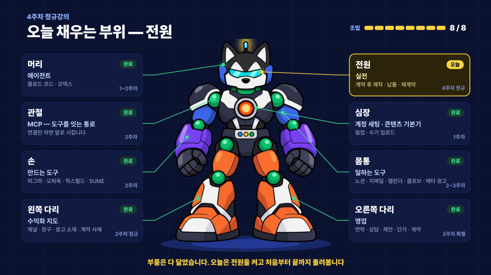
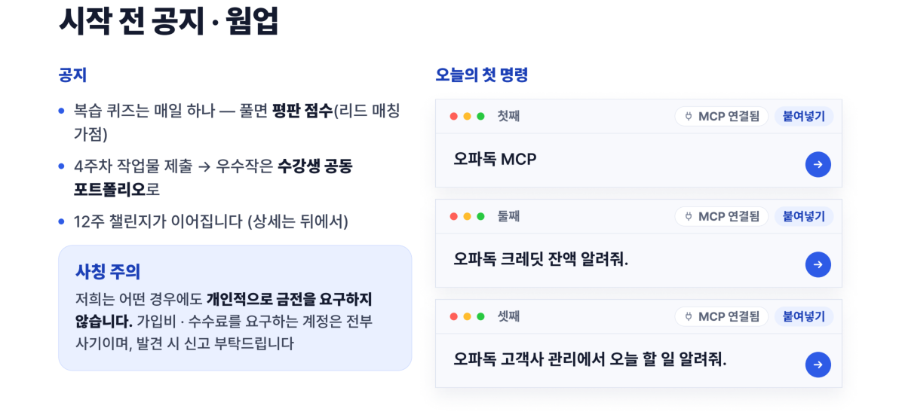
---
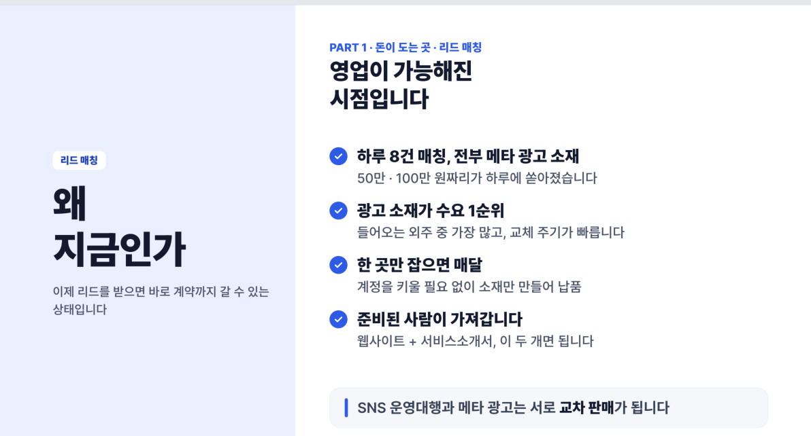

---
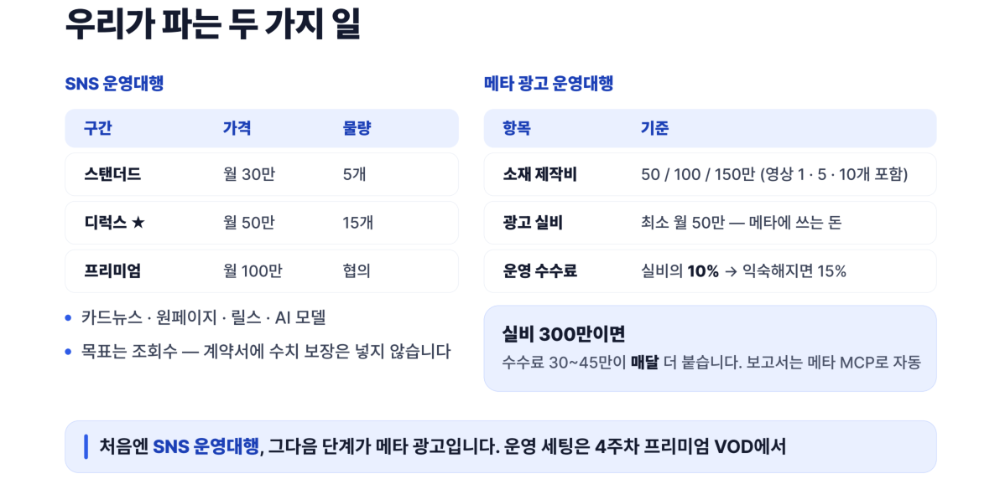

---
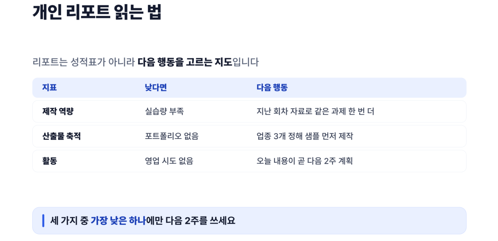

**당분간 오파독MCP만 판다!** <br/>
**Learnling by Doing, 이제부터 공부는 실전으로!**

---
## 01. 리드 매칭과 상품

### 판매할 두 가지 일 (슬라이드 6–14)

| 상품 | 강의의 예시 조건 | 비고 |
|---|---|---|
| SNS 운영대행 스탠더드 | 월 30만 원 / 5개 | 카드뉴스·릴스 등 |
| SNS 운영대행 디럭스 | 월 50만 원 / 15개 | 강의에서 주력 상품으로 소개 |
| SNS 운영대행 프리미엄 | 월 100만 원 / 수량 협의 | 범위 협의 |
| 메타 광고 소재 제작 | 50·100·150만 원 / 영상 1·5·10개 포함 | 강의 제시 패키지 |
| 메타 광고 운영 | 광고 실비 최소 월 50만 원, 운영 수수료 실비의 10% <br/> (숙련 후 15% 제안) | 광고비는 고객이 직접 집행 |

**주의:** 위 숫자는 강의의 예시 가격이지 시장 표준가나 현재 보장된 조건이 아니다. 조회수·성과 수치를 계약으로 보장하지 않는다는 원칙도 강조한다.

### 리드 매칭 6단계

1. **신청:** 웹사이트·포트폴리오 주소와 제안서 링크, 업종, 작업 유형, 동시 진행 가능 고객 수 입력
2. **승인:** 운영팀 검토
3. **배정:** 업종·예산·온도 점수 등을 보고 리드 알림 수신
4. **착수:** 기한 내 `착수하기`를 눌러 연락처 확인
5. **첫 연락:** 착수 후 3일 이내 연락·상태 회신(강의에서는 가능하면 30분 내 첫 메시지 권장)
6. **결과 보고:** 진행·성사·종료 기록

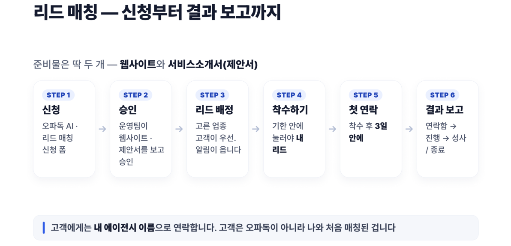

*원본 슬라이드 9페이지 — 리드 매칭 신청부터 결과 보고까지*

**첫 연락 실무 팁:** 고객에게는 내 에이전시 이름으로 연락하고, 첫 메시지는 3줄 정도로 간결하게 쓴다. 답이 없을 때는 일정 간격으로 후속 연락을 시도하되 과도한 연락은 피한다. 마지막에는 맞춤 시안을 제안할 수 있다.

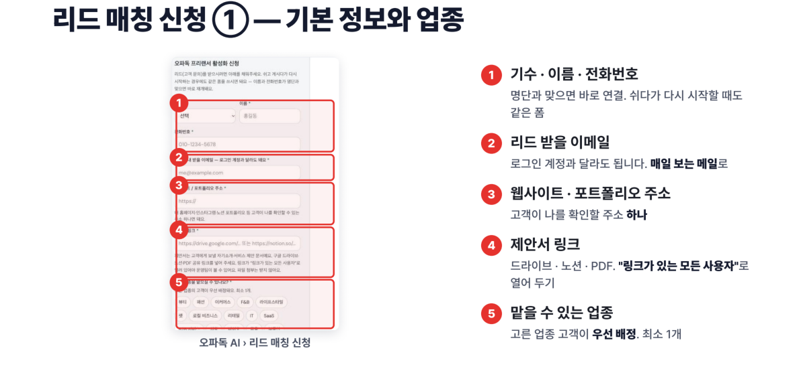
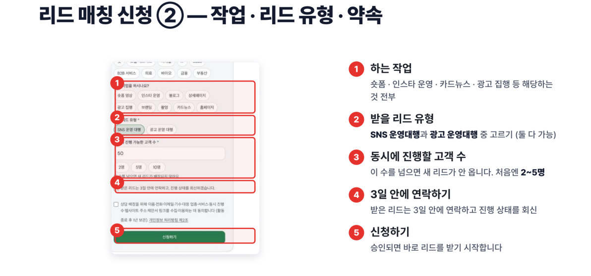
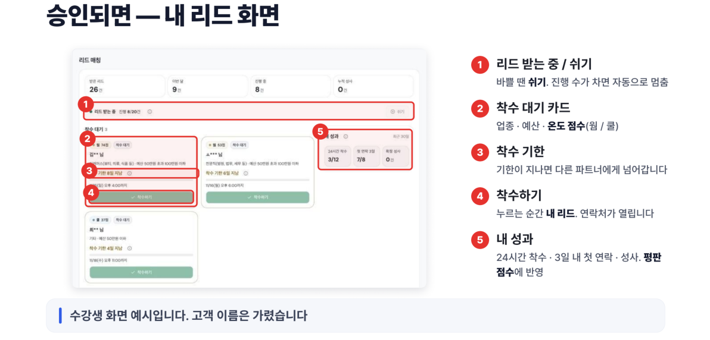
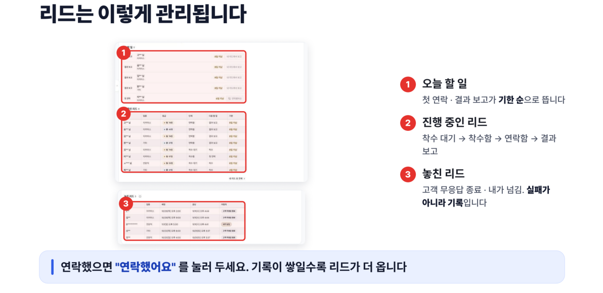
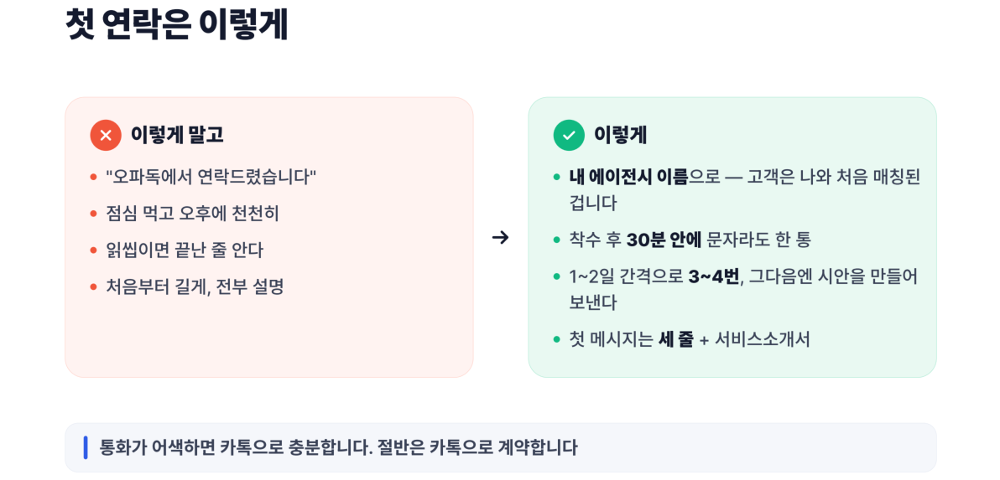


---
### 리드매칭 신청

### ❶ 기본 정보와 업종

- 연락처: 4기‧김진수‧010-5670-3847
- 이메일: standon.agencyk@gmail.com (STANDON AGENCY 대표메일)
- 웹사이트/포트폴리오 주소:
- 제안서링크:
- 맡을수 있는 업종:
    - 전문업종: 통신, 방송사, STARTUP, IT기업 (정보통신, 시큐리티, 빅데이터, AI서비스)
    - 관심업종: 헬스 및 바이오, 시니어/라이프
    - 관심업종: 패션, 뷰티, K-WAVE

### ❷ 작업‧리더유형‧약속

- 하는작업: 광고이미지 + 광고동영상
    
    **[이미지 제작]**
    
    - 제품이미지: 누끼컷, 연출컷, 라이프스타일컷, 디테일컷
    - 상세페이지: 이미지세트(롱스크롤) - 스마트스토어, 쿠팡, 자사몰
    - SNS피드: 카드뉴스 슬라이드, 캐러셀 (4:5) /  스토리, 릴스커버 (9:16)
    - 썸네일: 유튜버 썸네일(CTR 향상), 블로그 썸네일(핵심주제 전달)
    - 배너광고:  디스플레이 배너, 반응형 배너, 포털/네트워크 광고
    
    **[동영상 제작]**
    
    - 숏폼광고:  인스타 릴스‧유튜브 쇼츠
    - 제품·상품 영상: 제품 소개 영상, 쇼핑몰 상세페이지
    - 이미지→영상 변환: 슬라이드형 영상, 이미지 확장 모션

- 받을 리드 유형: SNS 운영대행, 광고 운영대행
- 동시에 진행할 고객 수: 2~5명  ⇒ 10명 이상
- 3일 안에 연락하기: 전화, 문자(톡 &  SMS)
- 신청하기: 승인되면 바로 리드 받기 시작

<br/>

[[TOP]](#index)

---
## 02. 업종별 케이스 스터디
> 리드가 들어오고 나서 생기는 일

| 업종 | 첫 계약 예시 | 서명까지 | 핵심 전략 |
|---|---:|---:|---|
| 세무사무소 | 광고 소재 50만 원 | 3일 | 업종별 시안 3종 → 소재 계약 → 운영 제안 |
| 스킨케어 브랜드 | SNS 운영 월 50만 원 | 4일 | 기존 계정 진단 → 3단 견적 → 월간 보고 |
| 동네 필라테스 | SNS 운영 월 30만 원 | 5일 | 카톡 상담 → 소규모 제안 → 샘플 릴스 |
| 반려견 간식 | 소재 100만 원 + 운영 수수료 | 3일 | 후킹 A/B/C 테스트 → 이긴 소재 변형 |
| 치과 | 릴스 운영 월 100만 원 | 6일 | 의료광고 표현 확인·검수 기간 반영 |

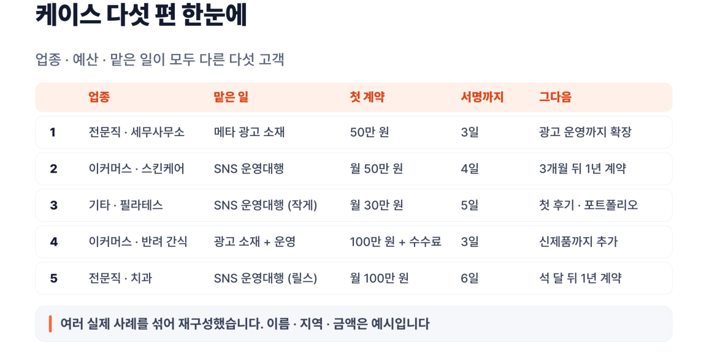

---
### 5가지 고객 케이스 비교

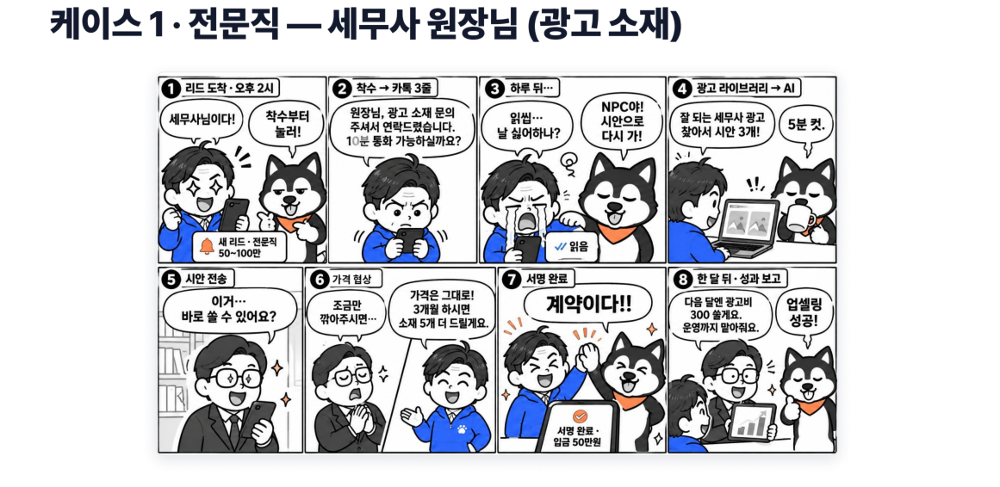
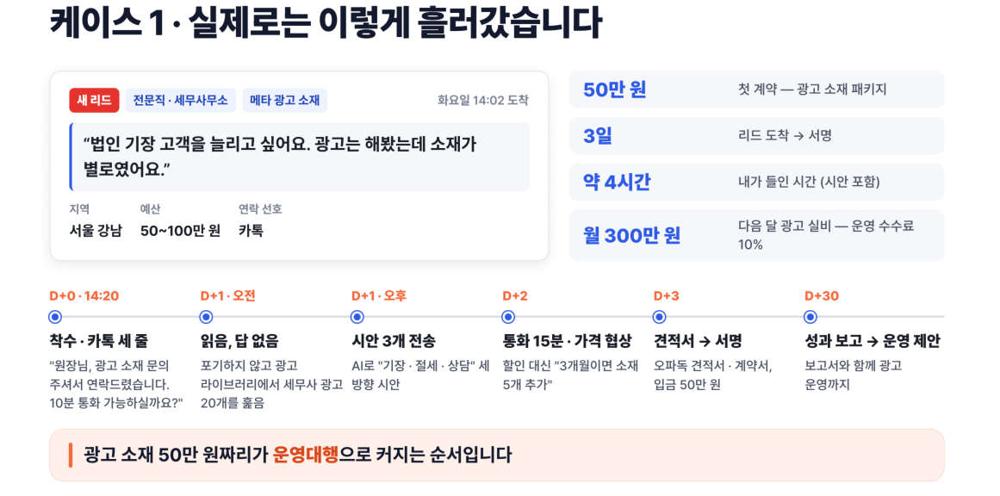

**전문직 — 세무사 원장님 (광고 소재)**

---
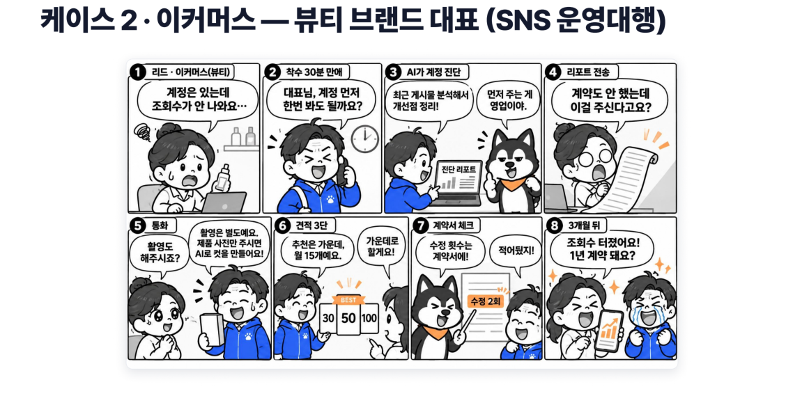
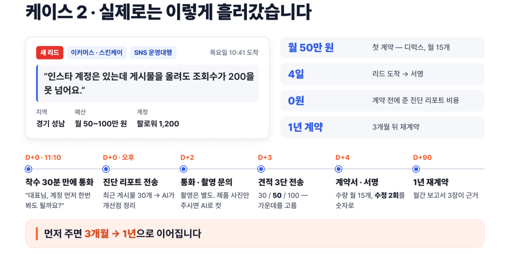

**이커머스 — 뷰티 브랜드 대표 (SNS 운영대행)**

---
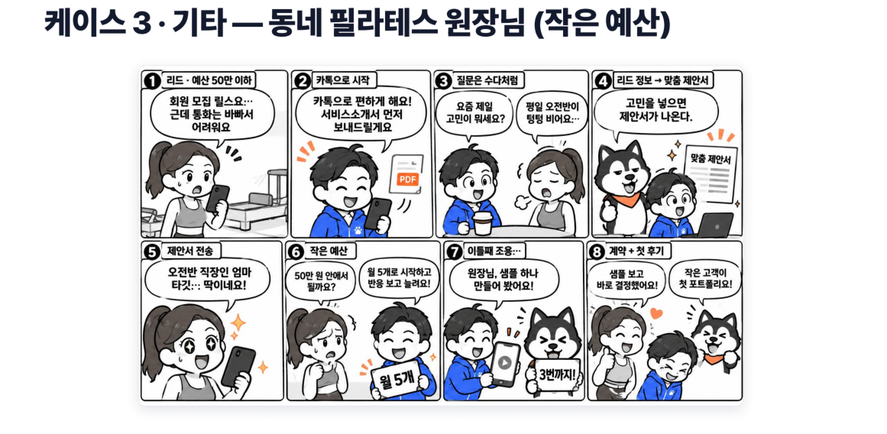
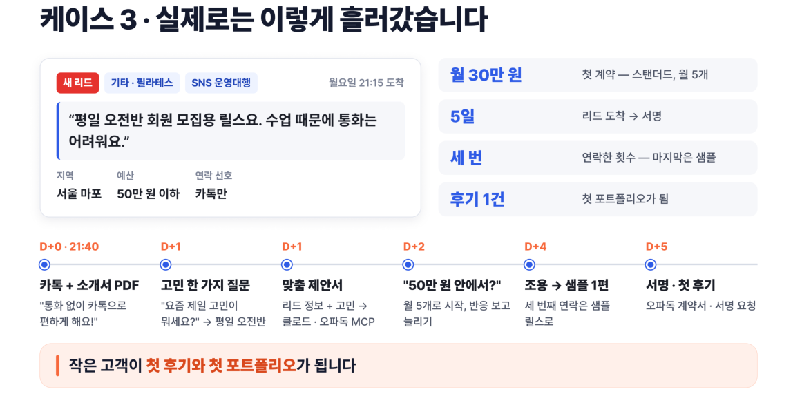

**기타 — 동네 필라테스 원장님 (작은 예산)**

---
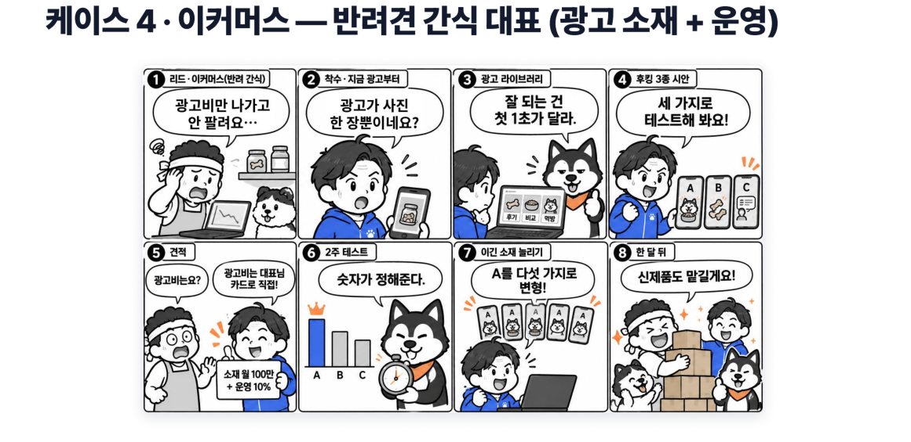
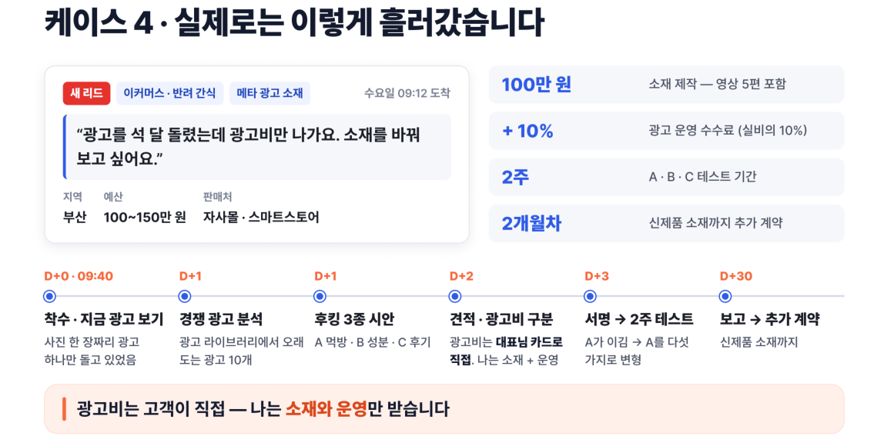

**이커머스 — 반려견 간식 대표 (광고 소재 + 운영)**

---
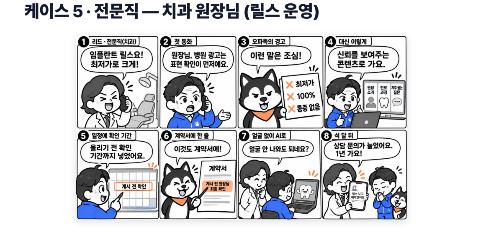
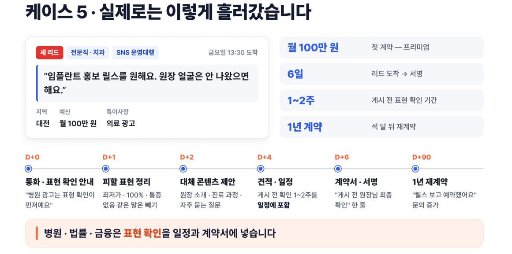

**전문직 — 치과 원장님 (릴스 운영)**

---
### 놓친 케이스와 공통 교훈

- 영어학원 사례: 첫 연락 지연, 가격표만 전송, 성급한 할인, 후속 연락 부족이 문제로 소개된다.
- 다섯 사례의 공통 패턴: **빠르게 움직이기 / 먼저 진단·시안 제공 / 적절한 후속 연락 / 수량·수정·기간·검수 절차를 숫자로 명시**.

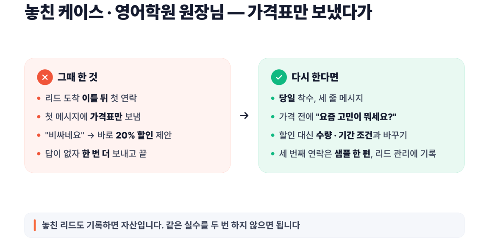


<br/>

[[TOP]](#index)

---
## 03. 웹사이트·서비스소개서

### 서비스소개서 기본 구조 (슬라이드 30–32)

1. 회사·상품·포트폴리오 중심 목차
2. 하는 일: 마케팅·브랜딩·미디어처럼 고객이 이해하는 분류
3. 작업 프로세스: 진단 → 전략 → 실행 → 리포팅
4. 단계별 산출물: 무엇을 받는지 구체화
5. 가격 기준과 상담 연락처

**랜딩페이지:** 첫 화면의 제안·상담 버튼, 근거가 있는 숫자, 선택 가능한 패키지 가격을 중심으로 구성한다. 없는 실적은 만들어 적지 않는다.

### 제작 5단계

`만들기 → 디자인 레퍼런스 고르기 → DESIGN.md/색상 적용 → 소개서 PDF 정리 → 링크 공개`

강의에서 소개한 도구는 오파독 홈페이지 제작·멀티룸·MCP, 디자인 참고용 **getdesign.md**, **Refero Styles**, **Color Hunt**다. 강의에는 홈페이지 제작·멀티룸 완성 페이지에 각각 500크레딧이 안내되지만 현재 요금은 별도 확인이 필요하다.


*원본 슬라이드 33페이지 — 웹사이트·소개서 제작 5단계*


*원본 슬라이드 37페이지 — 디자인 레퍼런스 사이트 3곳*

### 디자인 수정 원칙

- 참고 스타일은 한 번에 하나만 적용한다.
- 내용·문구·순서를 유지하고 **색·글꼴·여백·버튼**만 조정하도록 명시한다.
- 고객에게 공개하기 전 링크 접근 권한과 연락처를 확인한다.

<br/>

[[TOP]](#index)

---
## 04. 제안·견적·계약·서명

### 세일즈 문서 흐름 (슬라이드 43–53)

`리드 정보 → 맞춤 제안서 → 견적서 초안 → 계약서 초안 → 서명 요청 초안 → 직접 확인·발송 → 고객사 관리`

강의에서 오파독 MCP는 초안 작성·등록을 지원하되, **외부 발송과 서명 요청은 사람이 확인 후 직접 진행**한다고 설명한다.


*원본 슬라이드 43페이지 — 리드에서 서명까지의 단계*

### 계약서 기본 양식 6종

1. 광고 소재 제작
2. SNS 운영 대행 월계약
3. 상세페이지·배너 제작
4. 영상 제작
5. 프리랜서 외주
6. 인플루언서 시딩·협찬

**계약 확인 사항:** 계약 당사자, 범위, 채널, 수량, 납품 형식, 수정 횟수, 금액·세액, 대금 지급 조건, 검수·해지·권리 조건. 강의에서는 선금 50%·잔금 50% 예시를 제시한다. 기본 양식은 초안이며 큰 계약은 전문가 검토를 권장한다.


*원본 슬라이드 47페이지 — 계약서 기본 양식 6종*

### 협상 응대 예시

| 고객의 질문 | 강의에서 제안하는 대응 |
|---|---|
| 조금 깎아 주세요 | 할인 대신 계약 기간에 따라 산출물 추가 제안 |
| 촬영도 해주시죠? | 촬영은 별도 견적, 제공 사진을 활용한 AI 제작 범위 안내 |
| 생각해 볼게요 | 맞춤 샘플 1편으로 후속 제안 |
| 광고비도 포함인가요? | 고객 광고비와 제작·운영 수수료 분리 |
| 결과 보장되나요? | 확정 보장 대신 테스트·분석·개선 계획 제시 |

<br/>

[[TOP]](#index)

---
## 05. 계약 후 제작·납품

### 10단계 운영 사이클 (슬라이드 55–62)

| 단계 | 할 일 | 강의에서 언급한 도구 |
|---|---|---|
| 1 | 온보딩: 자료·접근·금지어 | 노션·지메일 |
| 2 | 경쟁 계정·광고 리서치 | 오파독 리서치 |
| 3 | 한 달 주제 기획 | 노션 캘린더 |
| 4 | 방향·제작 프롬프트 | 에이전트 |
| 5 | 카드뉴스·릴스 제작 | 오파독 MCP |
| 6 | 글자·색·여백 편집 | 피그마 |
| 7 | 고객 검수·수정 | 노션·카톡 |
| 8 | 예약·발행 | 브라우저 컨트롤 |
| 9 | 월간 성과 보고 | 노션 |
| 10 | 다음 달 재계약 제안 | 지메일 |


*원본 슬라이드 55페이지 — 계약 후 제작 10단계*

**제작 순서:** 표지 1장으로 톤 확인 → 같은 스타일의 카드뉴스 6장 → 릴스 1편 → 검수·발행 → 월간 보고서. 기획안 수정은 완성 후 재제작보다 비용을 줄이는 방법으로 설명한다.


*원본 슬라이드 57페이지 — 표지 1장으로 톤 확인하는 프롬프트*


*원본 슬라이드 61페이지 — 월간 보고서와 재계약 연결*

**월간 보고서 권장 구성:** 발행 건수 / 반응 좋은 콘텐츠 3개와 이유 / 개선할 점 / 다음 달 강화 방향 3가지. 조회수·팔로워를 확정적으로 보장하지 않는다.

**포트폴리오 6요소:** 고객 문제, 요청 배경, 해석, 작업 과정, 결과, 인사이트. 가상 프로젝트라면 가상 기획임을 반드시 표시한다.

<br/>

[[TOP]](#index)

---
## 06. 제작 프롬프트 원칙

강의의 핵심 메시지는 **“프롬프트는 글쓰기가 아니라 결정하기”**다. AI가 추측하지 않도록 아래 여섯 칸을 채운다.

| 항목 | 예시 |
|---|---|
| 역할·상황 | 동네 필라테스 인스타 운영 |
| 대상 | 허리가 뻐근한 30~40대 직장인 |
| 목표 | 저장·체험 수업 신청 |
| 형식 | 카드뉴스 6장, 4:5 |
| 참고 | 캡처 2장, 브랜드 색, 금지 표현 |
| 결과 | PNG, 지정 폴더 저장 |


*원본 슬라이드 65페이지 — 프롬프트 설계 6칸*

<br/>

[[TOP]](#index)

---
## 07. 실습 및 복사용 프롬프트

### 업종 하나로 실습 8단계

1. 업종을 하나 선택하고 광고 레퍼런스 20개 수집
2. 타깃·행동 목표·핵심 메시지 3줄 정리
3. 표지 1장 제작 후 톤 확정
4. 카드뉴스 1세트와 디자인 규칙 저장
5. 릴스 1편 제작
6. 광고 소재 이미지 세트 제작
7. 피그마 정리 및 노션 콘텐츠 관리 등록
8. 포트폴리오 6요소로 정리해 웹사이트에 추가


*원본 슬라이드 70페이지 — 한 업종으로 실습하는 8단계*

### 강의에 나온 복사용 프롬프트

**1. 레퍼런스 조사**

```text
오파독으로 [업종] 광고를 검색해서 반응 좋은 20개의
후킹 문구와 형식을 표로 정리해줘.
```

**2. 콘텐츠 방향**

```text
[업종] 콘텐츠 방향을 잡고 싶어. 누가 보는지, 보고 나서 뭘 하게 할지,
한 문장 메시지를 나한테 하나씩 질문해서 정리해줘.
```

**3. 표지 제작**

```text
오파독으로 [업종] 카드뉴스 표지 1장 만들어줘.
문구는 "[한 문장 메시지]".
4:5 비율, [대표 색]. 만들기 전에 크레딧 견적부터 알려줘.
```

**4. 카드뉴스 세트와 규칙**

```text
이 톤 그대로 "[주제]"로 6장 만들어줘.
마음에 들면 규칙 파일로 저장해줘.
```

**5. 서비스소개서 기반 웹사이트**

```text
오파독 웹사이트로 내 에이전시 소개 사이트를 만들어줘.
[서비스소개서 PDF 첨부]
하는 일 · 프로세스 · 작업물 · 가격 · 상담 버튼 순서로.
```

**6. 디자인 스타일 적용**

```text
아래 DESIGN.md 스타일로 이 웹사이트를 다시 디자인해줘.
내용 · 문구 · 순서는 그대로 두고, 색 · 글꼴 · 여백 · 버튼만 바꿔줘.
[DESIGN.md 붙여넣기]
```

**7. 리드 맞춤 제안서**

```text
이건 방금 받은 리드 정보야. [리드 정보 붙여넣기]
인스타 계정이 있으면 들어가서 진단해 주고,
내 서비스소개서를 바탕으로 이 고객 맞춤 제안서를 써줘.
현재 상황 · 문제 · 해결 범위 · 일정 · 금액(항목별) 순서로, PDF로.
```

**8. 견적·계약·서명 초안**

```text
오파독 MCP로 이 리드를 고객사에 리드로 등록하고,
제안서 기준으로 견적서와 계약서 초안을 만들어줘.
서명 요청은 [이름 · 이메일]로 초안까지만. 보내는 건 내가 확인하고 할게.
```

**9. 월간 성과 보고서**

```text
노션 콘텐츠 캘린더에서 필라테스 스튜디오 이번 달 발행분을 모아
월간 성과 보고서 페이지를 만들어줘.
발행 건수, 반응이 좋았던 3개와 이유, 아쉬웠던 점,
다음 달 강화할 방향 3가지 순서로.
```


*원본 슬라이드 71페이지 — 강의 실습 프롬프트 4종*

<br/>

[[TOP]](#index)

---
## 08. 마무리와 12주 챌린지

### 4주 과정 정리

- **1주차:** 계정 세팅·웜업·콘텐츠 기본기
- **2주차:** 제작 도구·MCP·노션 관리
- **3주차:** 수익화 창구·영업·계약 준비
- **4주차:** 리드 매칭·세일즈 문서·제작·납품·재계약


*원본 슬라이드 74페이지 — 4주 과정의 핵심 10줄*


### 12주 챌린지 (강의 안내)

4주차 작업물 제출과 공동 포트폴리오 → 5주차 숨고 가입·첫 후기 → 6~7주차 외주 포트폴리오·세일즈 → 8주차 웹사이트·포트폴리오 업데이트 → 10주차 아웃바운드 고도화 → 11~12주차 매칭 현황·성과 발표. 세부 일정은 강의 공지방 확인.


*원본 슬라이드 75페이지 — 12주 챌린지 계획*

<br/>

[[TOP]](#index)

---
## 실행 체크리스트

- [ ] 내 에이전시 웹사이트 또는 랜딩페이지 공개
- [ ] 서비스소개서 PDF 및 공유 권한 점검
- [ ] 맡을 업종·상품·동시 진행 고객 수 결정
- [ ] 업종별 레퍼런스 20개 수집
- [ ] 맞춤 제안서·견적서·계약서 템플릿 준비
- [ ] 카드뉴스 표지 1장과 세트 1개 제작
- [ ] 릴스 1편과 광고 소재 이미지 세트 제작
- [ ] 수정 횟수·납품 규격·검수·저작권·결제 조건 정리
- [ ] 노션 콘텐츠 캘린더·고객사 관리 구성
- [ ] 월간 보고서 템플릿과 포트폴리오 6요소 작성

---

### GitHub 업로드

`README.md`와 `images/` 폴더를 **같은 저장소의 같은 상위 폴더**에 올리면 이미지가 상대경로로 표시된다. 강의 슬라이드 이미지의 공개 재배포 권한은 별도 확인해야 한다. 필요하면 이미지 폴더를 제외하고 텍스트 요약만 게시한다.

*이 노트는 제공된 「오파독 4주차 정규강의」 77페이지를 기반으로 재구성한 학습용 요약이며, 외부 사실 검증이나 서비스의 현재 제공 여부 확인을 수행하지 않았다.*


---
### 업종별 케이스 스타디

리드매칭 핵심2가지


오파독MCP를 통해서 계약서, 견적서 


수익화 프로세스가 복잡


고객문의 → 계약서작성 → 클로드/코덱스 명령 → 기획안작성 →

케이스2. 이커머스

가격표가 없는 
저희는 가격이 정해져 있다


### 프롬프트


```text
내가 세무사랑 얘기를 해봤는데 지금은 시작은 원리에서 한 50만 원으로 시작을 하겠다라고 한다. 계약서랑 견적서가 필요하고, 그 다음에 이번 달 만족을 해서 그 다음 달 계약서는 월에 한 300만 원 정도에 우리가 이제 수수료가 한 15% 정도 받고 소재 제작 비용이 한 50만 원 되니까 이것도 계약서를 작성해줘. 아, 이거는 견적서 작성해서 보낼 거야.
```


```text
이 프로세스 좋다. 그럼 앞으로는 내 리드 매칭이나 내 웹사이트 그 고객 문의 폼에 들어오자마자 견적서부터 계약서 다 작성해서 준비해서 메일이랑 문자 초안까지 다 작성하는 그 루틴을 만들어줘. 자동화를 만들어줘.
```


### SNS계정을 받자마자 해야하는 것
- 분석후 웜업
  - 3개월안에 조회수 터트릴수 있다. 
  - 계정이 최적화가 안되면 할수가 없다.
  - 웜업을 하지 않으면 조회수도 안나오고, 터지지 않는다.
  - 따라서 최소한 3개월 계약 해야 한다
  - 성과가 안나와도 상관없다. 그냥 고개만 이탈할 뿐!
  - 위험관리
    - 될때까지 연장
    - 그냥 연습한다고 생각하고 계속해준다
    - 저장+관심, 부담되면 팔로우가 없어도 된다.


### 주제선정
- 내가 잘하는 분야, 앞으로 잘하고 싶은 분야를 하나파야 한다.
- 배워보고싶은 것
- 세무사, 한의사
- 우선순위
  - 나의 전문분야: 
  - 나의 관심분야:
  - 내가 하고픈것:
  - 분야의 경험이 중요하다!
  - 전문지식이 필요한 부분
  - MC대상, 2030대상, 시니어대상
  - 전문성을 길러야 고객응대가 편하다!
- 고객의 스토커가 되어야 한다
  - 고객의 모든 정보를 알면 응대하기가 편하다
  - 블로그, SNS 등
- 고객 응대
  - 요청할때마다 막해주면 안된다
  - 이 가격에 여기까지가 한계입니다.
  - 이건 제가 더 해드리는 겁니다. 
  - 없는것도 팔자!
  - 일단 계약부터 하고 어떻게든 해결한다.

- 세금혜택

- 간이과세자:
  - 직전연도 매출액 1억400만원(VAT포함) 미만인 개인사업자에게 적용되는 부가가치세 특례제도
  - 
- 중진공융자: 사업만 하는거 보이면 1억 융자는 그냥 딸수 있다.
  - 연대보증없다
  - 물론 갚아야 하지만..
- 세무사 선정도 중요
  - 중요하다
  - 자비스 이런거 쓰지마라
  - 세무사를 잘써야 재무가 깔끔해진다
  - 세무사 특강 및 세무사 소개
  - 기장료 단체할인 가능


---
### 4. 세일즈 가이드

- 광고수수료: 10% ~15%
- 막히면 - 세일즈봇


<br/>

[[TOP]](#index)

---
### 5. 계약후제작

- 웜업후 성과는 3개월이내 
- 조회수만 나와도 매출과 연계되는 건 아니다
- 바이럴

- 우선 오파독MCP 기반으로 작업을 해보자
- 자꾸 사용하다보면 다양한 방법이 떠오른다
  - 숏폼공장
  - 오파독모션 : 레퍼런스 영상 + 내 소재로 바이럴 영상
  - 이미지 영상:
  - 홈페이지 제작
  - 멀티룸: 랜딩‧웹앱 한 장 

- HTML은 무료로 얼마든지 제작 가능
- 이미지는 SUME 을 사용: 엄청 싸다. 그냥 손해보면서 제공
- What If: AI영상 안쓰는 것은 몇십~몇백개로 만들어도 된다. 코드로 만드는 거라
  - 영상들어가는것은 오파독MCP 사용하는것보다 SUME을 사용하는 것이 훨씬 싸다
- 1소스 멀티유저: 카드뉴스, 릴스 하넙ㄴ에 제작이 가능, 비율만 9:16으로 바꾸면 된다
  - 카드뉴스: 팔로워에게 간다. 노출이 어렵다
  - 릴스: 모르는 사람에게 훨씬 많이 노추로딘다
  - 순서: 릴스로 시작 ⇒ 터지면 카드뉴스 병행
  - 재활용: 새로 만들지 말고 비율만 9:16으로 바꿔 재등록
  - 주제: 다른 계정에서 이미 터진 주제에서
  - 한번 터뜨려 보야 하면 되는구나가 생긴다


- 월간 보고서
  - 템플릿 활용
  - 매일매일 노션템플릿에 기록되게 MCP에게 시키면 된다
  - 좋아요, 댓글, 팔라워 등
  - 개인정보가 있기 때문에
  - 


<br/>

[[TOP]](#index)

---
### 6. 제작 노하우


<br/>

[[TOP]](#index)

---
### 7


메타 광고랩: 내가 안찾아도 코덱스에서 시키면 된다
고객 만나기전에 미리 만들어보면 좋다
주제: 건강, 여행, 등


- 실습 프롬픔트
  - 검색: 반응 좋은 후킹 문구
  - 

- 웹사이트 제작

코덱스 - 오파독 MCP
제작 > 홈페이지 제작
HTML 다운로드
숏폼공장 > 홈페이지 제작
브랜드 홍보웹사이트 > 맘에 드는거 하나 고른다, 에이전시 템플릿
구조는 다운받은 HTML


나는 스탠드온 에이전시 
디자인 사이트 세곳:

초안이 나오면
나 같으면 컬러헌터에서 내가 좋아하는 색조합만 변경


```
나는 스탠드온 에이전시야.  우리는 SNS 운영 대행이랑 그다음에 메타 광고 운영 대행을 한다. 우리만의 서비스 소개서를 만들어줘. 그리고 내 정보는 오파독 MCP에도 연동이 되어 있고 내가 했던 작업물들은 지금 이 폴더에 있어. 이런 식으로 하면 돼요. 그 폴더 어디 있냐면 지난번에 했던 거 똑같아요, 여러분들


나는 스탠드온 에이전시야.  우리는 SNS 운영 대행이랑 그다음에 메타 광고 운영 대행을 한다. 우리만의 서비스 소개서를 만들어줘. 그리고 내 정보는 오파독 MCP에도 연동이 되어 있고 내가 했던 작업물들은 지금 이 폴더에 있어. 이런 식으로 하면 돼요. 그 폴더 어디 있냐면 지난번에 했던 거 똑같아요, 여러분들


pdf로 만들거라서 16:9 로 쪼개

근데 색상 조합을 나는 기존 템플리과는 좀 다르게 하고 싶어서 지금 내가 넣은 이미지 참고해서 디테일 개선해줘


```


 레피드 : 사업자 없이도 카드결재가 가능, 수수료 1ㅍ로데


<br/>

[[TOP]](#index)

---
### 8


<br/>

[[TOP]](#index)

---