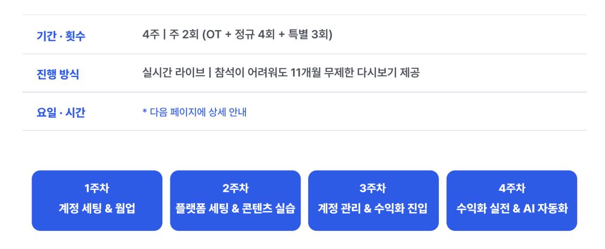
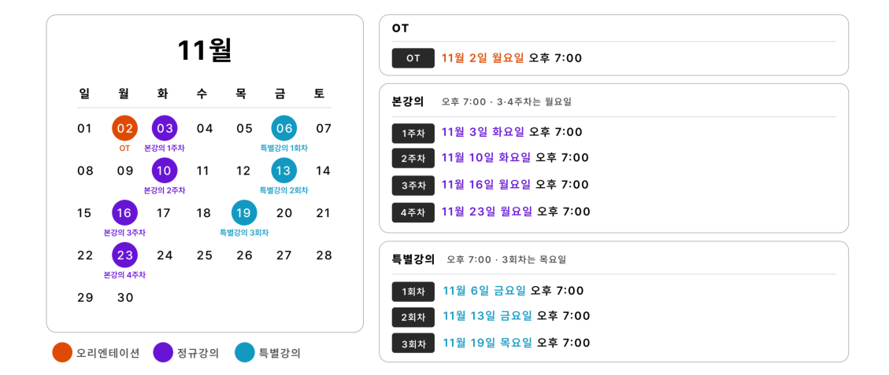

🏠 > [ai_agent](../../) > [opadog](../) > `오파독 강의`

<table>
  <tr>
    <td><a href="./">[오파독]</a></td>
    <td><a href="S00_강의.md">O.T</a></td>
    <td><a href="S01_강의.md">강의1</a></td>
    <td><a href="S02_강의.md">강의2</a></td>
    <td><a href="S03_강의.md">강의3</a></td>
    <td><a href="S04_강의.md">강의4</a></td>
    <td><a href="S05_강의.md">강의5</a></td>
    <td><a href="S06_강의.md">강의6</a></td>
    <td><a href="S07_강의.md">강의7</a></td>
  </tr>
</table>

# 오파독4기 강의

### INDEX

NO   | 강의순서  | 강의주제 | 강의노트 | 강의자료 | 유튜브링크
:---:|:--------:|--------|:-------:|:-------:|:-------:
0 | 오파독OT  | 사전안내 및 커리큘럼 소개           | -                          | 💻[[강의자료]][강의자료0] | 🧏[[다시보기]][오파독OT] 
1 | 1주차강의 | 계정셋팅‧웜업‧레퍼런스 수집           | 📄[[강의노트]](S01_강의.md) | 💻[[강의자료]][강의자료1] | 🧏‍♂️[[다시보기]][1주차강의] 
2 | 1주차특강 | 카드뉴스‧원페이지릴스‧광고소재 제작봇   | 📄[[강의노트]](S02_강의.md) | 💻[[강의자료]][강의자료2] | 🧏[[다시보기]][1주차특강] 
3 | 2주차강의 | 플랫폼 세팅 & 콘텐츠 실습           | 📄[[강의노트]](S03_강의.md) | 💻[[강의자료]][강의자료3] | 🧏‍♂️[[다시보기]][2주차강의] 
4 | 2주차특강 | 플랫폼 세팅 & 콘텐츠 실습           | 📄[[강의노트]](S04_강의.md) | 💻[[강의자료]][강의자료4] | 🧏[[다시보기]][2주차특강] 
5 | 3주차강의 | 계정 관리 & 수익화 진입             | 📄[[강의노트]](S05_강의.md) | 💻[[강의자료]][강의자료5] | 🧏‍♂️[[다시보기]][3주차강의] 
6 | 3주차특강 | 계정 관리 & 수익화 진입             | 📄[[강의노트]](S06_강의.md) | 💻[[강의자료]][강의자료6] | 🧏[[다시보기]][3주차특강] 
7 | 4주차강의 | 수익화 실전 & AI 자동화             | 📄[[강의노트]](S07_강의.md) | 💻[[강의자료]][강의자료7] | 🧏‍♂️[[다시보기]][4주차강의] 

[구글미트]: https://meet.google.com/qxo-sjvg-tci
[오파독OT]: https://www.youtube.com/watch?v=Xovh7WHsu4s
[1주차강의]: https://www.youtube.com/watch?v=c2HATlMxsvU
[1주차특강]: https://www.youtube.com/watch?v=RjUa2WqnvZg
[2주차강의]: https://www.youtube.com/watch?v=c2HATlMxsvU
[2주차특강]: https://www.youtube.com/watch?v=RjUa2WqnvZg
[3주차강의]: https://www.youtube.com/watch?v=c2HATlMxsvU
[3주차특강]: https://www.youtube.com/watch?v=RjUa2WqnvZg
[4주차강의]: https://www.youtube.com/watch?v=c2HATlMxsvU
[강의자료0]: https://drive.google.com/file/d/1pGhWvom0dFT0covail26wq8hMHN7YD_s/view?usp=drive_link
[강의자료1]: https://drive.google.com/file/d/1aEmEyMrfm3bZQ8qCh7BulECgenGJX0HZ/view?usp=drive_link
[강의자료2]: https://drive.google.com/file/d/131ZRGfHWrlzEeJGLvMi7reClBu4VJomW/view?usp=drive_link

[강의자료3]: https://drive.google.com/file/d/131ZRGfHWrlzEeJGLvMi7reClBu4VJomW/view?usp=drive_link
[강의자료4]: https://drive.google.com/file/d/131ZRGfHWrlzEeJGLvMi7reClBu4VJomW/view?usp=drive_link
[강의자료5]: https://drive.google.com/file/d/131ZRGfHWrlzEeJGLvMi7reClBu4VJomW/view?usp=drive_link
[강의자료6]: https://drive.google.com/file/d/131ZRGfHWrlzEeJGLvMi7reClBu4VJomW/view?usp=drive_link
[강의자료7]: https://drive.google.com/file/d/131ZRGfHWrlzEeJGLvMi7reClBu4VJomW/view?usp=drive_link

---
### 강의커리큘럼

 

 

[[TOP]](#index)

---